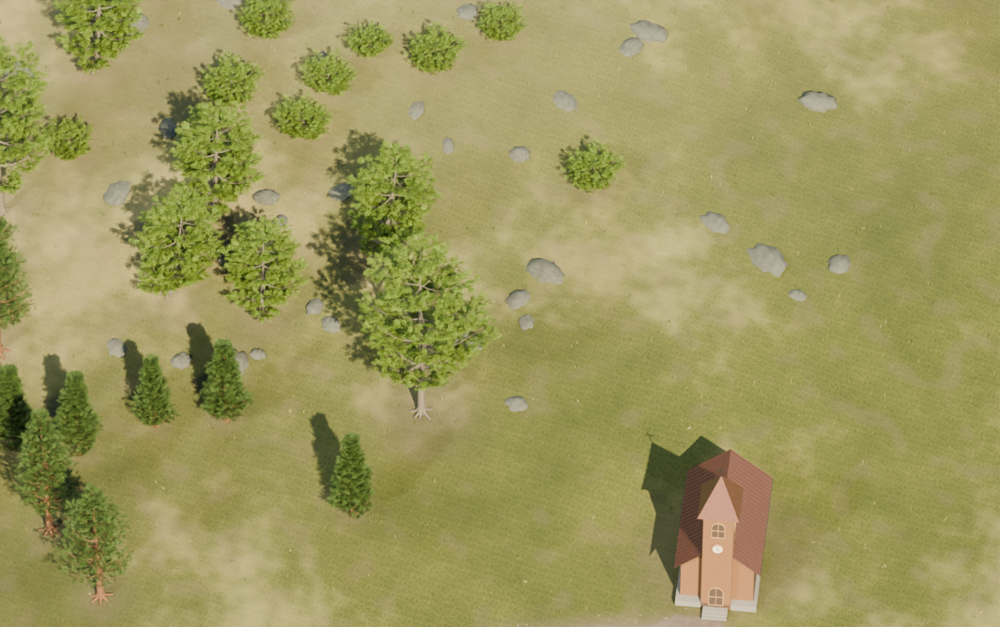

# Investigación de piedras y suelo · miniaturas patagónicas

Fecha: 4 de noviembre de 2026. Solicitud: investigar por qué las piedras y el piso de las últimas escenas se ven artificiales, manteniendo la dirección de miniatura y el desenfoque elegido.

**Resultado:** el problema principal está en la forma de las rocas, su integración con el terreno y la lectura del suelo a escala de cámara. La profundidad de campo y la reducción de ruido suavizan el detalle, pero las pruebas no los identifican como la causa principal. La escena existente tiene texturas escaneadas; hay que revisar cómo se combinan y qué detalle consigue llegar al render.

Esta entrega contiene investigación, mediciones y pruebas de diagnóstico. No se modificaron los `.blend`, GLB ni renders de producción. El primer ciclo de vegetación sigue siendo una entrega técnica terminada; el acabado de superficies queda abierto por la revisión visual del usuario.

**Continuación:** la primera muestra de corrección se entrega por separado en [Ladera y capilla · superficies v01](../../models/superficies_patagonicas/01_ladera/README.md), con [comparación visual antes/después](../../models/superficies_patagonicas/01_ladera/comparacion.html) y un `.blend` independiente. El diagnóstico de esta carpeta conserva las mediciones de la versión anterior.

## Documentos y evidencias

- [Fuentes primarias, referencias regionales y recursos](fuentes-y-criterios.md).
- [Mediciones del archivo Blender](evidencias/auditoria_actual.json).
- [Parámetros de las tres pruebas](evidencias/renders.json).
- [Script reproducible de auditoría](auditar_escena.py).

## Qué se comprobó en nuestro archivo

Se abrió `models/vegetacion_patagonica/escenas/02_caserio_del_cipres.blend` y se inspeccionaron geometría, materiales, luces y cámaras. Las medidas se expresan en metros representados, usando la escala de maqueta 1:500. Los tamaños de rocas son dimensiones de malla completa, no la altura visible sobre tierra. Los tamaños en píxeles son estimaciones de la caja proyectada, antes de desenfoque y oclusión.

| Elemento | Dato medido | Consecuencia práctica |
| --- | --- | --- |
| Rocas | 50 instancias de sólo 4 mallas | La variación se apoya principalmente en giro y escala; falta variedad de estructura |
| Ancho de roca | 1,98–6,32 m; mediana 3,60 m | Son bloques grandes, no grava: se espera leer caras, fracturas y volumen |
| Alto completo de roca | 1,17–3,77 m; mediana 2,01 m | Parte queda enterrada; la forma visible necesita evaluarse después del contacto con la ladera |
| Roca en cámara de detalle | 21–80 px de ancho; mediana 42 px | Hay píxeles suficientes para una silueta y caras principales mejores; el grano fino por sí solo no las aporta |
| Terreno | 231.361 vértices, 460.800 triángulos, grilla de 1,17 m | La geometría cubre el relieve amplio; no puede resolver por sí sola rodadas estrechas o piedras centimétricas |
| Resolución sobre el suelo | Aproximadamente 7–11 px por metro en dos puntos medidos de la cámara de detalle | Un canto de 5 cm ocupa alrededor de 0,35–0,57 px; no conviene exigirle que dé identidad a toda la superficie |
| Texturas del suelo | Cuatro superficies escaneadas de 2K conectadas al color | Ya existe una base de detalle aprovechable |
| Rugosidad del suelo | Su entrada sólo depende de la máscara de caminos | Los mapas de rugosidad escaneados quedaron fuera de la cadena final |
| Normales del suelo | Alturas escaneadas combinadas mediante bump | Los mapas de normales importados no se usan en la entrada final; esto es una elección a revisar, no una prueba automática de error |
| Material de roca | Sin imágenes; un Noise para color y bump; rugosidad constante 0,93 | La textura no describe planos de fractura, erosión ni inclusiones minerales reconocibles |

Los datos completos están en [auditoria_actual.json](evidencias/auditoria_actual.json). El script calcula la proyección con la cámara real de Blender; no se dedujeron los metros contando píxeles a ojo.

### Piedras: causa probable

El generador crea cuatro icosferas de subdivisión 3, mueve sus vértices radialmente, suaviza todas las caras, escala las instancias y las distribuye alrededor de un centro mediante una distribución gaussiana. Esto produce bultos de una misma familia de formas. No modela caras de rotura coherentes, bloques encajados, roca continua ni fragmentos desprendidos. [Código de la escena](../../models/vegetacion_patagonica/source/escena_ladera.py).

Los bloques están parcialmente enterrados mediante una fórmula sobre su centro. El generador no crea tierra, detritos o vegetación en el contacto de cada roca con el piso, ni conecta la distribución de fragmentos con una roca madre. **Inferencia visual:** por eso se leen como piezas grises colocadas encima del paisaje, incluso cuando la malla atraviesa el terreno.

El Noise de roca tiene `Scale=7` y la entrada Vector desconectada. Blender usa coordenadas Generated en ese caso. Conviene fijar explícitamente la escala espacial del material para no cambiar el tamaño aparente del grano al escalar cada roca. [Manual de Noise Texture](https://docs.blender.org/manual/en/4.0/render/shader_nodes/textures/noise.html).

La dimensión de 2–6 m no es por sí misma incorrecta: puede haber bloques grandes. El problema artístico es usar muchos bloques con esa escala, formas suaves y poco detalle visible sin una estructura de afloramiento o acumulación que explique el conjunto.

### Suelo: causa probable

La base combina `grass_ground`, `forest_ground_04`, `gravelly_sand` y `gravel_road`. Sus metadatos y archivos originales están en [sources.json](../../models/textures/cycles_detail/sources.json). Hay una mezcla de altura para bump, además de ruido fino y pequeñas variaciones geométricas.

Sobre esa base se acumulan tintes y mezclas de pradera, paja, tierra y altura. La revisión posterior reemplaza la rugosidad escaneada por una mezcla entre 0,94 y 0,78 controlada por rodadas. **Inferencia:** el suelo pierde contraste entre materia vegetal, tierra compactada y mineral, y muchas diferencias quedan expresadas como manchas de color suaves. La rugosidad es sólo una parte del problema; restaurarla no garantiza resolver la composición. [Material y máscaras](../../models/casas_5/iteraciones_pueblos/suelo_natural/refinar.py).

Las matas añadidas por ese script tienen briznas de 12–42 cm representados, muy pequeñas desde esta cámara. El mero número de matas no equivale a una cobertura de vegetación legible. Hace falta una escala intermedia: grupos, bordes, terrones, bolsillos de suelo y cambios de altura que se lean como materia antes de aplicar DOF.

## Prueba controlada: desenfoque y reducción de ruido

Se renderizó el mismo recorte de la cámara `Cámara · detalle de la ladera`, a resolución de escena 2048 × 1152, semilla 1029, hasta 128 muestras, mínimo 32 y umbral adaptativo 0,018. El recorte no amplía el campo de visión. Se conservaron geometría, materiales y luces.

| Prueba | DOF | Denoise | Lectura visual |
| --- | --- | --- | --- |
| [A · Configuración estética](evidencias/01_dof_y_denoise.png) | Sí | Sí | Suelo moteado y rocas suaves; el desenfoque funciona como miniatura |
| [B · Sin DOF](evidencias/02_sin_dof.png) | No | Sí | Mejoran bordes y grano, pero persisten el piso homogéneo y las formas de piedra |
| [C · Sin DOF ni denoise](evidencias/03_sin_dof_sin_denoise.png) | No | No | Aparecen ruido y detalle fino; no se recupera una estructura de roca ni una cobertura vegetal que no estaban modeladas |



**Conclusión de la prueba:** no conviene quitar el tilt-shift como arreglo. Se debe trabajar primero sobre geometría, distribución y mezcla de materiales, revisar una vista nítida y volver a juzgar el resultado con el DOF final.

Limitación: los renders con y sin DOF trazan rayos diferentes; el muestreo es adaptativo. Esto es una comparación visual controlada, no una descomposición numérica exacta de cada causa. No se hizo todavía una prueba separada de iluminación. La escena ya usa Albedo + Normal y prefiltrado Accurate en el denoiser; no estaba usando sólo RGB. El manual de Blender explica el papel de esos pases y del número de muestras en la conservación de detalle. [Denoise, Blender 5.2](https://docs.blender.org/manual/en/5.2/compositing/types/filter/denoise.html).

## Dirección de corrección

Estas son decisiones artísticas propuestas a partir de las mediciones y referencias, no datos geológicos universales.

**Enfoque recomendado: formas principales propias y material escaneado de apoyo.** Modelar una pequeña familia de bloques con caras quebradas y algunos bordes erosionados; reservar unas pocas piezas grandes para puntos que expliquen el conjunto. Agrupar alrededor fragmentos medianos y pequeños, variando qué parte emerge del suelo. Usar materiales escaneados a escala métrica para que la textura refuerce la forma.

Dos alternativas sirven para comparar: un bloque escaneado puede funcionar como referencia de volumen y material; un modelo totalmente procedural da más variación, pero requiere controles de fractura y erosión coherentes. Repetir el mismo escaneo por todo el mapa o aumentar el ruido de las icosferas mantendría problemas de repetición o estructura.

La ladera y la costa necesitan familias distintas. Para esta ladera, la referencia más útil encontrada es el corte de terreno junto a la capilla de Villa Mascardi: planos de roca, material suelto, tierra y pastos agrupados. La playa de Lago Lolog sirve para guijarros y una franja húmeda, no como molde de todos los afloramientos. Son referencias visuales de lugares concretos, no una regla para toda Patagonia. Autorías, enlaces y fuentes regionales en [fuentes-y-criterios.md](fuentes-y-criterios.md).

### Orden de una siguiente iteración

1. **Banco de materiales y escala:** una muestra pequeña con terreno, camino, matas y tres rocas junto a una casa. Cámara de escena más una cámara cercana; luz neutra y luz final. Validar 0,3–1 m para piedras secundarias y 1,5–3 m para pocos bloques principales como punto de partida artístico, ajustándolo a la composición.
2. **Forma y apoyo:** sustituir los bultos por bloques con planos y roturas legibles; acomodarlos a la pendiente, variar enterramiento y crear detritos alrededor de unos pocos grupos.
3. **Materiales completos:** calibrar color, rugosidad y normal/altura de cada capa a la misma escala. Reducir la acumulación de tintes globales; variar humedad, polvo y vegetación mediante máscaras relacionadas con el lugar.
4. **Suelo de escala intermedia:** matas y bolsas de tierra, cambios de cobertura junto a rocas y troncos, borde de camino irregular, rodadas y drenaje moderados. Reservar geometría para lo que afecta silueta y sombras; detalle subpíxel en material.
5. **Integración en un recorte:** aplicar primero al entorno de la capilla y la ladera, conservando cámara, casas, árboles y luz para comparar el cambio.
6. **Revisión con miniatura:** comparar el recorte nítido y con DOF; aprobar la lectura a tamaño de entrega antes de extenderlo al mapa completo y generar otra serie.

Este orden fue la propuesta de revisión de superficies, independiente del ciclo de seis pasos de vegetación ya entregado. Su primera implementación localizada se registra en [superficies v01](../../models/superficies_patagonicas/01_ladera/README.md).

### Criterios para considerar resuelto el problema

- La roca principal conserva una silueta y caras reconocibles a 20–80 px, sin depender exclusivamente del ruido de color.
- Se distingue el contacto con el suelo mediante geometría, sombra, tierra o vegetación coherentes; evitar un anillo oscuro idéntico alrededor de todas las piedras.
- Hay diferencia material entre pradera, tierra expuesta, hojarasca y ripio al ver el render al 100 %.
- Las matas forman grupos y transiciones; el pastizal no queda reducido a un plano con manchas ni a miles de briznas invisibles.
- El DOF final conserva la sensación de miniatura y no se usa para ocultar un material que falla en la zona enfocada.
- Las formas y materiales siguen funcionando con la luz heredada. Si hace falta cambiar iluminación, compararla en una prueba aparte para no confundir causas.

## Reproducir la auditoría

Desde la raíz del proyecto:

```bash
/Applications/Blender.app/Contents/MacOS/Blender --background --python-exit-code 1 --python docs/investigacion-superficies/auditar_escena.py -- --render
```

Sin `--render` genera solamente las mediciones. Requiere el `.blend` actual y `models/vegetacion_patagonica/source/arboles.py` para seleccionar Metal. No descarga materiales ni guarda el archivo de producción. El script comprueba al final que el SHA-256 del `.blend` original no cambió.
