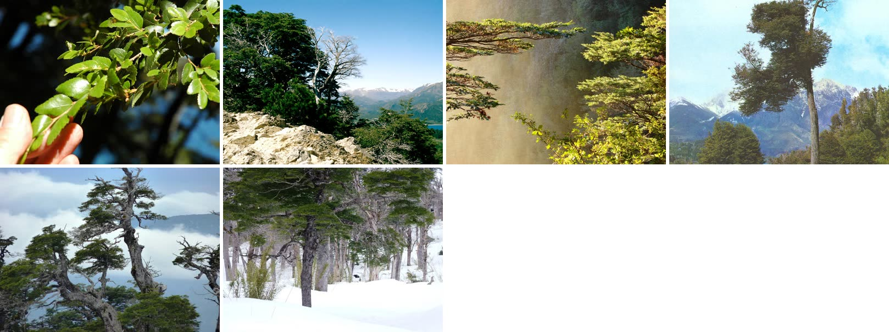
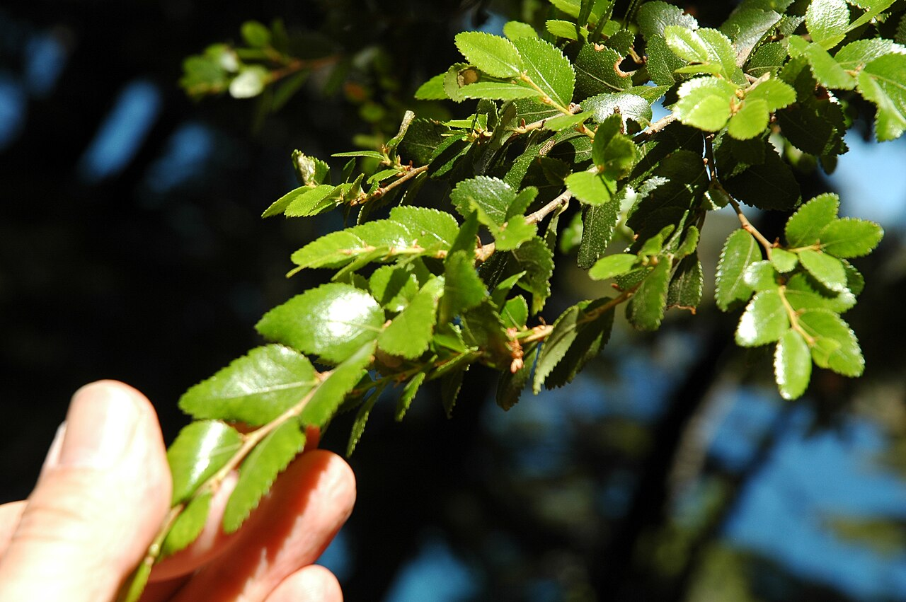
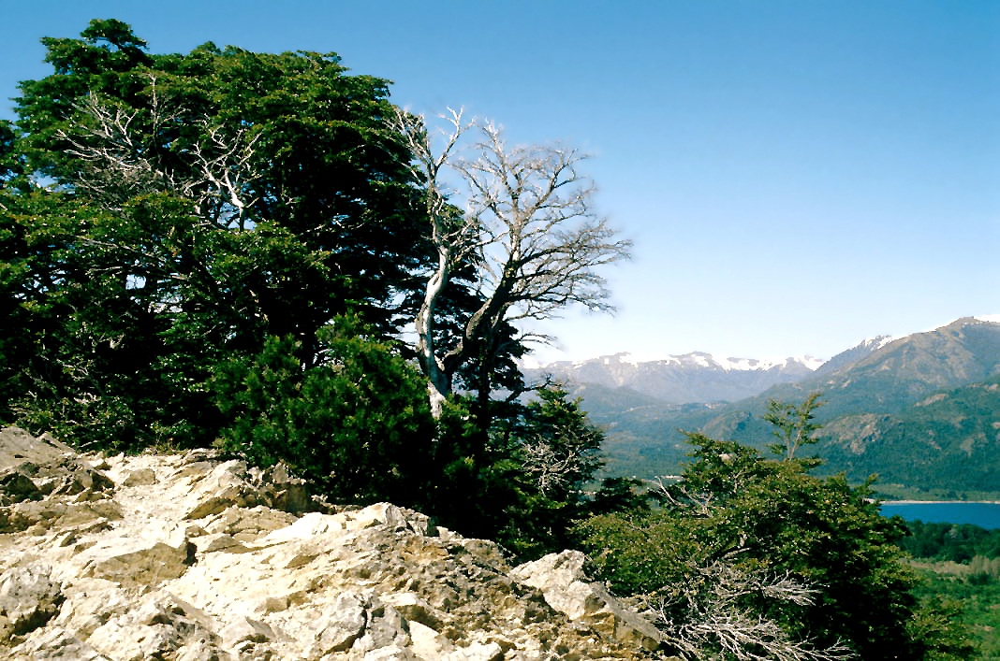
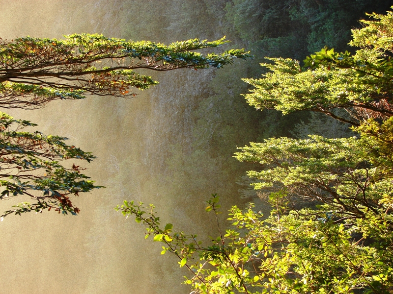
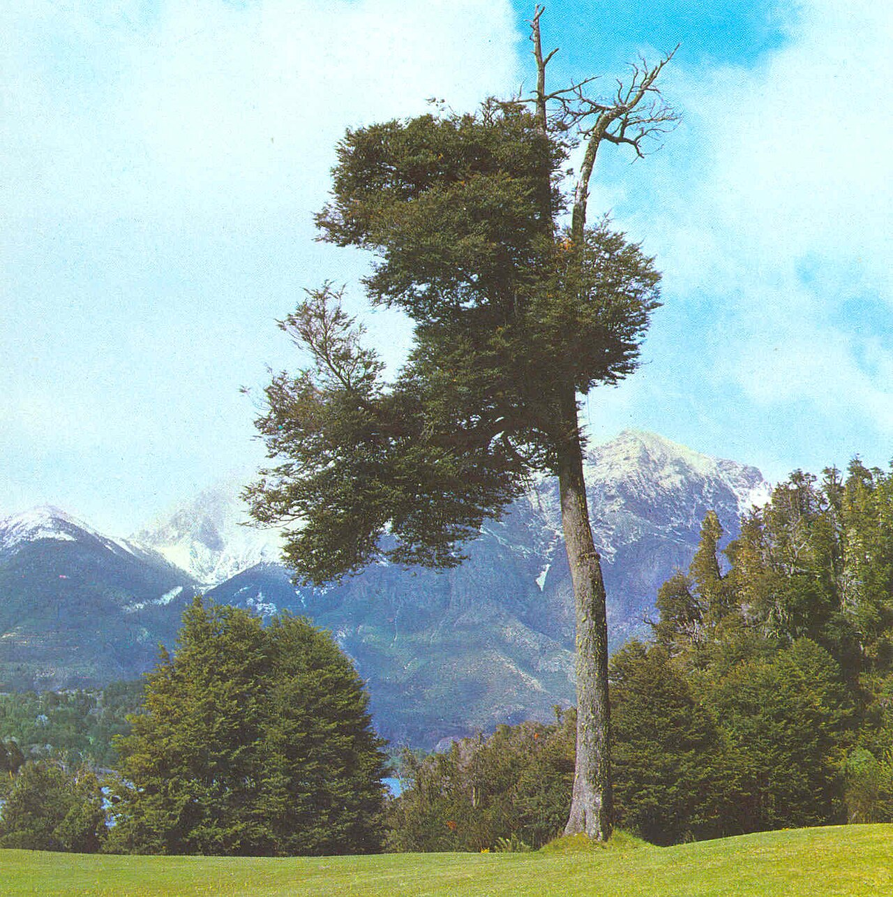
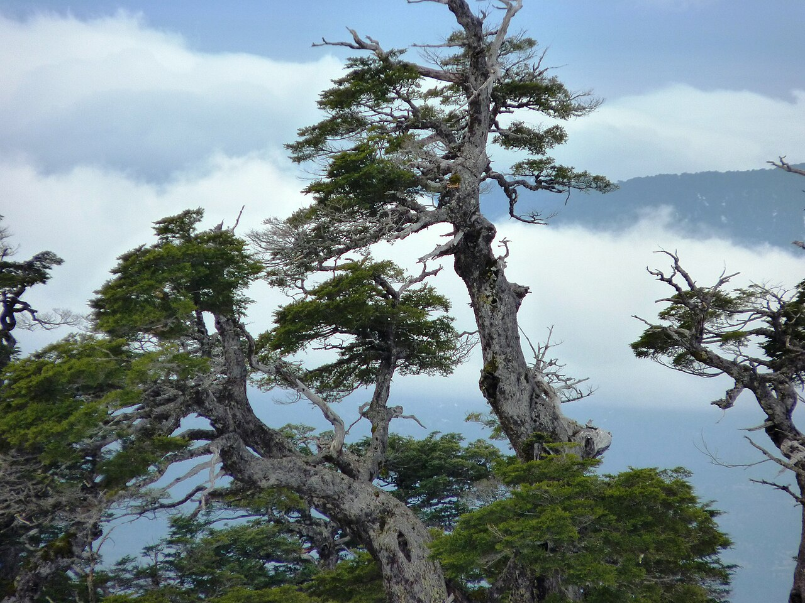
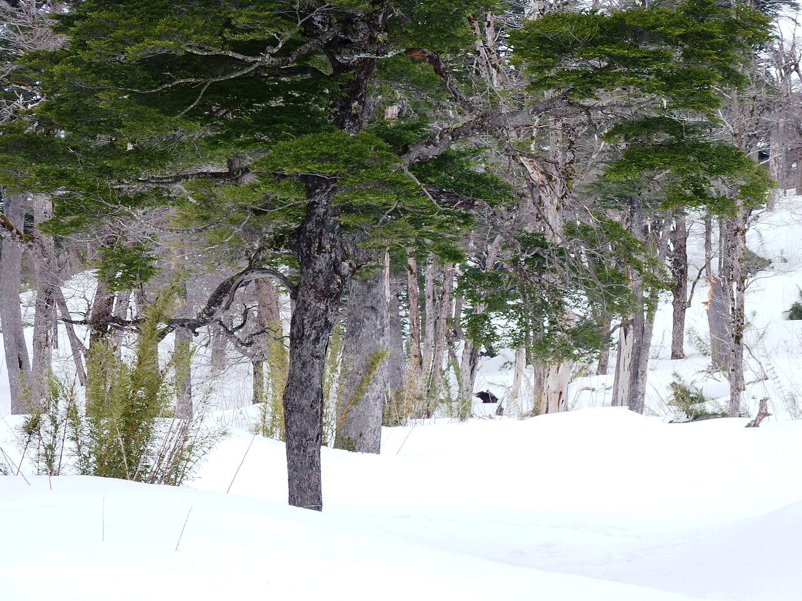

# Coihue (*Nothofagus dombeyi*)

Familia Nothofagaceae. También escrito coigüe o coigue. **Perenne.** Es el árbol dominante del bosque húmedo de Bariloche y del Lácar, y el emergente que sobresale por encima de las demás copas.

[Índice](../README.md) · [Contexto regional](../00-contexto-sma-bariloche.md) · [Generación de assets](../generacion-de-assets.md)

## Ficha rápida

| Rasgo | Valor |
| --- | --- |
| Altura | 35–45 m; ejemplares maduros hasta 50 m |
| Tronco | Recto y cilíndrico, hasta 2–3 m de diámetro |
| Copa | Estratificada en planos horizontales; ovoide-cónica de joven |
| Corteza | Gris oscura, lisa con bandas claras de lenticelas de joven; luego se agrieta en escamas que dejan ver corteza nueva rojiza |
| Hojas | Perennes, coriáceas, lanceoladas o algo romboidales, 2–4 cm, borde aserrado |
| Aspecto general | Siempreverde, frondoso, de tono grisáceo |
| Dónde | Bosque húmedo y mixto, cañadones, laderas sudoeste, costas de lago |

## Dónde verlo

- **Bariloche**: Puerto Blest (extremo húmedo), Llao Llao, cerro Campanario, cerro Otto, Isla Victoria. Junto con lenga y ñire, ocupa más del 60 % del Parque Nacional Nahuel Huapi. ([Parques Nacionales](https://www.argentina.gob.ar/node/138538))
- **San Martín de los Andes**: costas del Lácar, Hua Hum, sendero al cerro Chivo (bosque de coihue con cañaveral de colihue). ([Welcome Argentina](https://www.welcomeargentina.com/sanmartindelosandes/parque-nacional-lanin.html))
- En la ladera ocupa el sudoeste y los cañadones. La lenga queda arriba y el ciprés en las laderas norte, más secas. ([Revista ADBiA](https://revistas.unc.edu.ar/index.php/revistaadbia/article/download/40363/40610/150911))

## Rasgos visuales

**Porte.** Fuste muy recto y alto antes de las primeras ramas. Los adultos son emergentes: por su menor densidad y su crecimiento rápido, forman árboles grandes y espaciados que sobresalen del rodal. ([FAO AGRIS](https://agris.fao.org/search/en/records/64746aac425ec3c088f04fca))

**Copa.** Es el rasgo que más lo define. Las fichas describen una ramificación "radiada, que da la sensación de estar estratificada en planos horizontales" y ramas "elegantes, aplanadas horizontalmente". El follaje se distribuye en varios niveles. ([Patagonia-ar](https://patagonia-ar.com/pages/coihue), [Currículum Nacional Chile](https://www.curriculumnacional.cl/estudiante/621/articles-254295_recurso_pdf.pdf), [Earthpedia](https://earthpedia.earth.com/plant-encyclopedia/angiosperms/nothofagaceae/nothofagus-dombeyi))

**Corteza.** Gris oscura y lisa con grietas longitudinales poco profundas. Con la edad, se rompe en escamas grandes que dejan ver corteza nueva de tono rojizo. ([Oregon State](https://landscapeplants.oregonstate.edu/plants/nothofagus-dombeyi), [SAG](https://sag.cl/sites/default/files/COIHUE.pdf)) Las cortezas de Nothofagus andino-patagónicos son grises a pardo oscuras y con fisuras profundas, salvo la del roble. ([Castro, Botany 2005](https://connectsci.au/bt/article/53/1/69/133006/Bark-anatomy-of-Nothofagus-species-Nothofagaceae))

**Hojas.** Pequeñas para un árbol tan grande (2–4 cm), duras y brillantes, en ramitas aplanadas. En masa, la copa se ve **verde oscuro con brillo grisáceo**, y nunca amarilla.

**Lectura a distancia.** Una columna con bandejas oscuras separadas por huecos de luz. En las laderas del Nahuel Huapi, el bosque de coihue se ve como un "terciopelo" verde oscuro y uniforme, que en otoño contrasta con las manchas rojas de lenga y ñire.

## Para el asset

- **Silueta**: 3–5 discos o elipsoides aplanados, apilados con desplazamiento lateral, con huecos que muestren el tronco. Es el árbol más alto del set: debe quedar 20–30 % más alto que los vecinos.
- **Variantes**: joven (cono de 2 pisos), adulto, emergente (5 pisos y más alto), seco (tronco gris claro con muñones de ramas).
- **Color**: sombra `#2E3B22`, luz `#5E6E3C`, corteza `#5F5E58`.
- **Errores a evitar**: copa redonda tipo roble europeo; verde brillante y amarillento; color otoñal (es perenne).
- **Acompañantes**: caña colihue debajo, barba de viejo en ramas bajas, troncos caídos con musgo.

## Imágenes

<!-- GALERIA:coihue -->

Imágenes de Wikimedia Commons con licencia libre, guardadas en [`imagenes/coihue/`](../imagenes/coihue/). Las marcadas con 📍 fueron tomadas en Argentina o en la Patagonia según su descripción.

📍 *Leaves of Nothofagus dombeyi (Coihue). Neuquén, Argentina.*  
Valerio Pillar from Porto Alegre, Brazil · [CC BY-SA 2.0](https://creativecommons.org/licenses/by-sa/2.0) · [ficha en Commons](https://commons.wikimedia.org/wiki/File:Nothofagus_dombeyi_leaves_001_(Valerio_Pillar).jpg)

📍 *Southern beech trees (Nothofagus dombeyi) at Campanario Hill. San Carlos de Bariloche, Río Negro, Argentina*  
LBM1948 · [CC BY-SA 4.0](https://creativecommons.org/licenses/by-sa/4.0) · [ficha en Commons](https://commons.wikimedia.org/wiki/File:Bariloche,_varios_1994_06.jpg)

*Coigües (Nothofagus dombeyi) en los saltos del Huilo-huilo, región de Los Ríos, Chile.*  
Pato Novoa · [CC BY 2.0](https://creativecommons.org/licenses/by/2.0) · [ficha en Commons](https://commons.wikimedia.org/wiki/File:Coigues_(Nothofagus_dombeyi)_-_Saltos_de_Huilo-Huilo_por_Pato_Novoa_-_001.jpg)

*Nothofagus dombeyi.jpg*  
autor sin datos legibles · Public domain · [ficha en Commons](https://commons.wikimedia.org/wiki/File:Nothofagus_dombeyi.jpg)

*Nothofagus dombeyi*  
Pato Novoa · [CC BY 2.0](https://creativecommons.org/licenses/by/2.0) · [ficha en Commons](https://commons.wikimedia.org/wiki/File:Nothofagus_dombeyi_-_Camino_Puc%C3%B3n_-_Volc%C3%A1n_Villarrica_47.jpg)

*Nothofagus dombeyi*  
Pato Novoa · [CC BY 2.0](https://creativecommons.org/licenses/by/2.0) · [ficha en Commons](https://commons.wikimedia.org/wiki/File:Nothofagus_dombeyi_-_Camino_Puc%C3%B3n_-_Volc%C3%A1n_Villarrica_by_Pato_Novoa.jpg)

<!-- /GALERIA -->
## Fuentes

- [Currículum Nacional Chile, ficha coihue](https://www.curriculumnacional.cl/estudiante/621/articles-254295_recurso_pdf.pdf)
- [Patagonia-ar, coihue (con acuarela)](https://patagonia-ar.com/pages/coihue)
- [SAG Chile, coihue](https://sag.cl/sites/default/files/COIHUE.pdf)
- [Reforestemos, coigüe](https://www.reforestemos.org/content/uploads/coigue-23.pdf)
- [Oregon State, Nothofagus dombeyi](https://landscapeplants.oregonstate.edu/plants/nothofagus-dombeyi)
- [Earthpedia, Nothofagus dombeyi](https://earthpedia.earth.com/plant-encyclopedia/angiosperms/nothofagaceae/nothofagus-dombeyi)
- [Guía de Nothofagus, Ladera Sur (PDF)](https://laderasur.com/wp-content/uploads/2024/03/guia-nothofagus-ladera-sur.pdf)
- [Castro et al., anatomía de corteza de Nothofagus andino-patagónicos](https://connectsci.au/bt/article/53/1/69/133006/Bark-anatomy-of-Nothofagus-species-Nothofagaceae)
- [Ecología de un rodal mixto conífera-latifoliada en Patagonia (FAO AGRIS)](https://agris.fao.org/search/en/records/64746aac425ec3c088f04fca)
- [iNaturalist, Nothofagus dombeyi](https://www.inaturalist.org/taxa/Nothofagus-dombeyi) · [Wikimedia Commons](https://commons.wikimedia.org/wiki/Category:Nothofagus_dombeyi)
