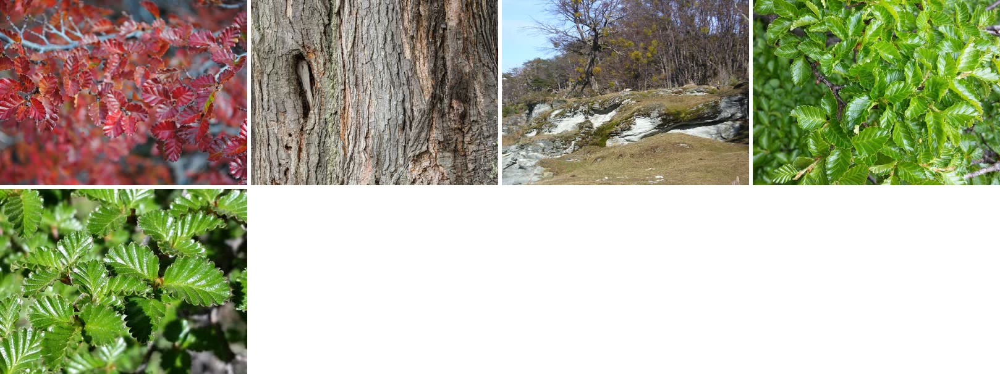
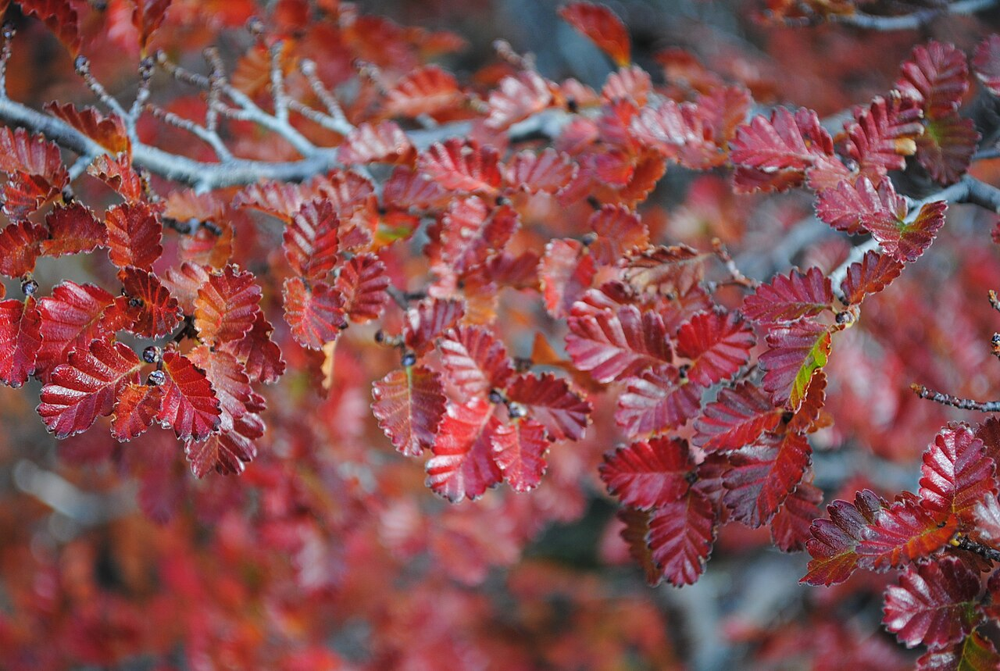
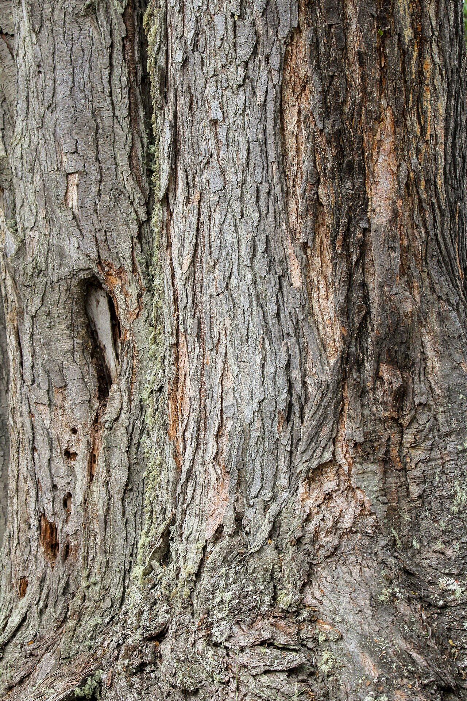
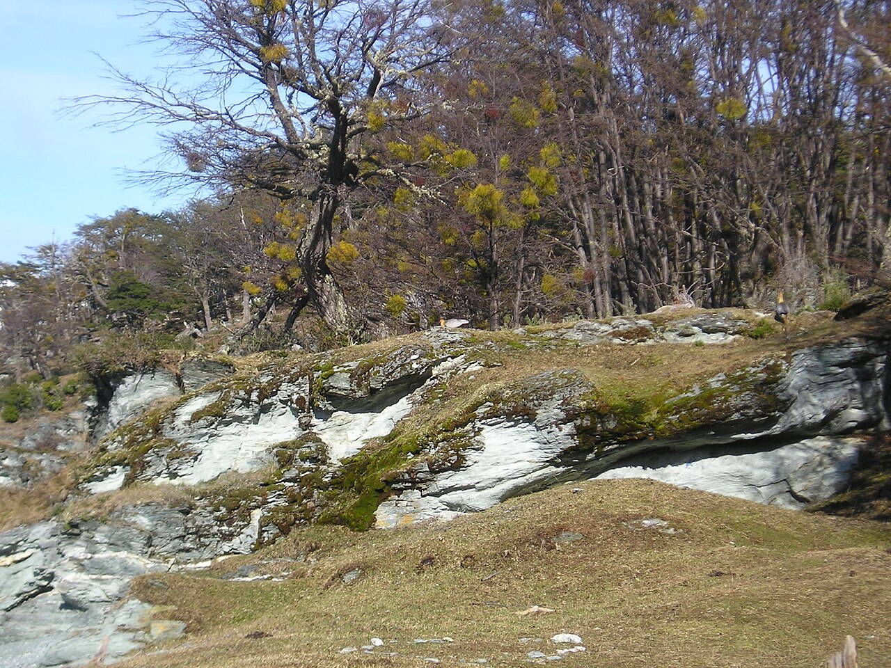
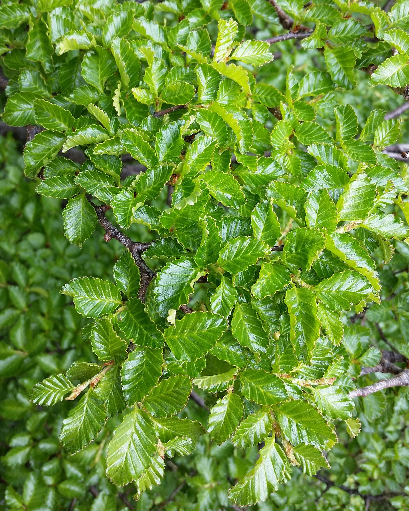
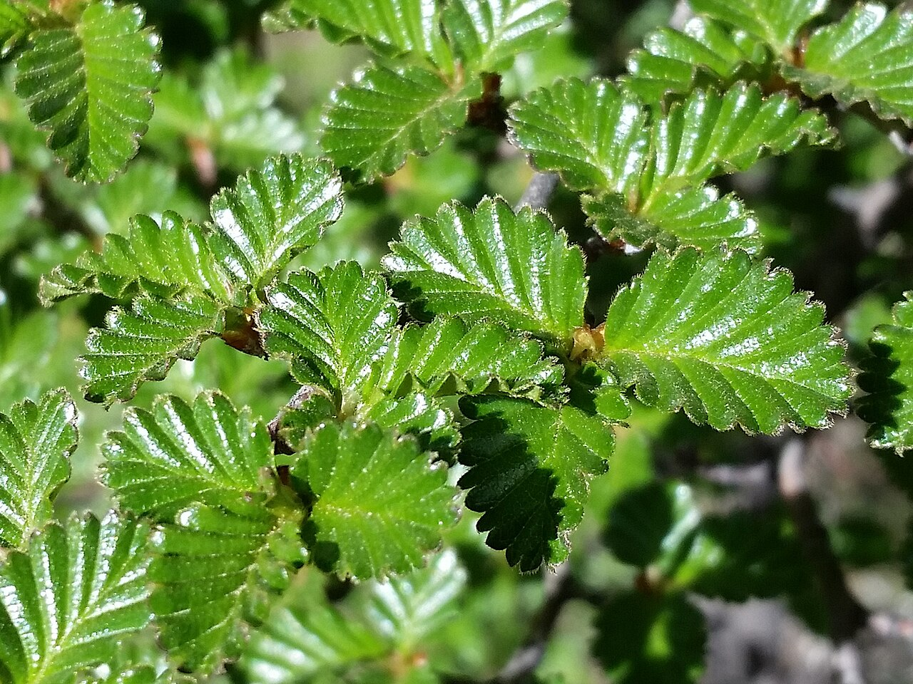

# Lenga (*Nothofagus pumilio*)

Familia Nothofagaceae. **Caducifolia.** Es el árbol de la montaña: forma el bosque puro de las laderas altas y el límite superior del bosque. En otoño pinta de rojo y naranja el Chapelco, el Catedral y el López.

[Índice](../README.md) · [Contexto regional](../00-contexto-sma-bariloche.md) · [Generación de assets](../generacion-de-assets.md)

## Ficha rápida

| Rasgo | Valor |
| --- | --- |
| Altura | Hasta 30 m en el valle (algunas fuentes 20 m, otras 40 m); tronco de hasta 1,5 m |
| Forma en altura | Arbolito retorcido, base curvada en "L" y *krummholz* rastrero en el límite |
| Hojas | Caducas, verde oscuro, 2–4 × 1,2–2,2 cm, elípticas; **dos lóbulos redondeados entre cada par de nervaduras** |
| Otoño | Amarillo, naranja y rojo intenso |
| Dónde | Ladera alta y sur; bosque puro por encima de unos 1000 m |
| Superficie | ≈ 1,6 millones de ha de bosque de lenga en Argentina |

## Dónde verlo

- **Bariloche**: cerro Catedral, López, Otto alto, Tronador. Forma bosques puros en altura y mixtos con coihue más abajo.
- **San Martín de los Andes**: cerro Chapelco (las pistas de esquí atraviesan lengales), laderas altas del Lácar y Lolog, y junto a la araucaria en el norte.
- Ocupa la parte superior de los cerros y las laderas sur. ([Revista ADBiA](https://revistas.unc.edu.ar/index.php/revistaadbia/article/download/40363/40610/150911))

## Rasgos visuales

**Gradiente de forma.** Es la clave visual de la especie, porque la misma lenga cambia mucho con la altura:

1. **Valle y ladera media**: árbol alto, recto y con copa amplia.
2. **Cerca del límite**: árbol bajo, torcido, con la base del tronco curvada en forma de "L" por la presión de la nieve, la pendiente y el deslizamiento del suelo.
3. **Límite superior (krummholz)**: troncos que se arrastran sobre el suelo y ramas que forman una maraña. En Tierra del Fuego se describe una franja cerrada y achaparrada de 20–30 m de ancho. ([EcuRed](https://www.ecured.cu/Bosques_de_lenga), [UNLP / J. Veg. Sci.](https://api.naturalis.fcnym.unlp.edu.ar/server/api/core/bitstreams/b2340ded-c4ea-4fda-83e1-c19a47613aea/content))

**Hojas.** Pequeñas, con borde de lóbulos dobles (dos dientes grandes y romos entre cada par de nervaduras, a veces tres más chicos en el par inferior). Esto las distingue de los demás Nothofagus. ([Trees and Shrubs Online](https://www.treesandshrubsonline.org/articles/nothofagus/nothofagus-pumilio/), [MMA Chile](https://repositorioambiental.mma.gob.cl/wp-content/uploads/2019/09/Afiche-lenga.pdf))

**Otoño.** Amarillo y rojo. ([MMA Chile](https://repositorioambiental.mma.gob.cl/wp-content/uploads/2019/09/Afiche-lenga.pdf), [Wikipedia](https://en.wikipedia.org/wiki/Nothofagus_pumilio)) En la ladera aparecen **bandas**: rojo intenso arriba (frío) y naranja o amarillo más abajo, con manchas verdes oscuras del coihue intercaladas.

**Invierno.** Ramas grises desnudas y nieve. El bosque se ve como una "niebla" gris violácea en la ladera.

**Epífitas.** Es la hospedera típica del **farolito chino** (*Misodendrum*, muérdago parásito que reduce su tamaño) y de la **barba de viejo** (*Usnea*, *Protousnea*). ([Alamy](https://alamy.com/stock-photo/mizodendrum.html), [EcuRed](https://www.ecured.cu/Lenga))

## Para el asset

- **Base**: la función `lenga()` en `models/source/base_geometry.py:155` ya define tronco y tres lóbulos.
- **Parámetros nuevos**:
  - `estacion`: verano `#6E8A3A`, amarillo `#D9A331`, naranja `#C8622A`, rojo `#9E2B22`, invierno (sin hojas, ramas `#7A746E`).
  - `exposicion` 0–1: baja la altura, curva la base en "L", reduce y achata los lóbulos.
  - `krummholz`: lóbulos aplastados a ras del suelo y sin tronco visible.
- **Distribución**: banda superior de cada ladera. Usar ruido de baja frecuencia para el tinte otoñal por instancia (`setColorAt`), con rojo más probable a mayor altura.
- **Detalles**: 1–3 tiras de barba de viejo y 1–2 esferas pequeñas amarillo-anaranjadas (farolito chino) en primer plano.
- **Errores a evitar**: hojas grandes; un único color otoñal uniforme; lenga en el ecotono seco del este (ahí va ñire).

## Imágenes

<!-- GALERIA:lenga -->

Imágenes de Wikimedia Commons con licencia libre, guardadas en [`imagenes/lenga/`](../imagenes/lenga/). Las marcadas con 📍 fueron tomadas en Argentina o en la Patagonia según su descripción.

📍 *Fall leaves of Nothofagus pumilio near the timber line, Cerro Catedral, Bariloche, Argentina.*  
Fernando Lopez-Anido · [CC BY-SA 4.0](https://creativecommons.org/licenses/by-sa/4.0) · [ficha en Commons](https://commons.wikimedia.org/wiki/File:Picada_al_Frey_048.jpg)

📍 *Lenga beech (Nothofagus pumilio) tree trunk, Tierra del Fuego National Park, Argentina*  
Bob Ramsak · [CC BY-SA 4.0](https://creativecommons.org/licenses/by-sa/4.0) · [ficha en Commons](https://commons.wikimedia.org/wiki/File:Lenga_beech_(Nothofagus_pumilio)_tree_trunk,_Tierra_del_Fuego_National_Park,_Argentina.jpg)

📍 *Semiparasitic plant Misodendrum punctulatum on lengas (Nothofagus pumilio). A photo taken in the Tierra del Fuego National Park, a few km west of Ushuaia, Argentina*  
No machine-readable author provided. Heretiq assumed (based on copyright claims). · [CC BY-SA 2.5](https://creativecommons.org/licenses/by-sa/2.5) · [ficha en Commons](https://commons.wikimedia.org/wiki/File:Misodendrum_punctulatum_on_lenga.jpg)

📍 *Nothofagus pumilio; picture taken near Perito Moreno glacier, Los Glaciares National Park, Argentina*  
Mlwiki · [CC BY-SA 4.0](https://creativecommons.org/licenses/by-sa/4.0) · [ficha en Commons](https://commons.wikimedia.org/wiki/File:Nothofagus_pumilio,_foliage.jpg)

📍 *Lenga Nothofagus pumilio; picture taken at the foot of the Fitz Roy mountain, Los Glaciares National Park, Argentina*  
Mlwiki · [CC BY-SA 4.0](https://creativecommons.org/licenses/by-sa/4.0) · [ficha en Commons](https://commons.wikimedia.org/wiki/File:Nothofagus_pumilio,_leaves.jpg)

<!-- /GALERIA -->
## Fuentes

- [MMA Chile, afiche lenga](https://repositorioambiental.mma.gob.cl/wp-content/uploads/2019/09/Afiche-lenga.pdf)
- [Reforestemos, ficha técnica lenga](https://www.reforestemos.org/content/uploads/ficha-tecnica-lenga-compressed-1.pdf) · [lenga 44](https://www.reforestemos.org/content/uploads/lenga-44.pdf)
- [EcuRed, bosques de lenga](https://www.ecured.cu/Bosques_de_lenga) · [Lenga](https://www.ecured.cu/Lenga)
- [Trees and Shrubs Online, Nothofagus pumilio](https://www.treesandshrubsonline.org/articles/nothofagus/nothofagus-pumilio/)
- [Wikipedia, Nothofagus pumilio](https://en.wikipedia.org/wiki/Nothofagus_pumilio)
- [Límite arbóreo en Tierra del Fuego, J. Veg. Sci. 2000 (UNLP)](https://api.naturalis.fcnym.unlp.edu.ar/server/api/core/bitstreams/b2340ded-c4ea-4fda-83e1-c19a47613aea/content)
- [Lara et al. 2001, dendroecología de lenga en el límite arbóreo](https://www.st-andrews.ac.uk/~rjsw/all%20pdfs/Laraetal2001.pdf)
- [Lenga y ñire, las hayas australes más tolerantes al frío (INTA)](https://repositoriosdigitales.mincyt.gob.ar/vufind/Record/INTADig_c6f20f78b569a27919983ca681539de2)
- [iNaturalist, Nothofagus pumilio](https://www.inaturalist.org/taxa/Nothofagus-pumilio) · [Wikimedia Commons](https://commons.wikimedia.org/wiki/Category:Nothofagus_pumilio)
