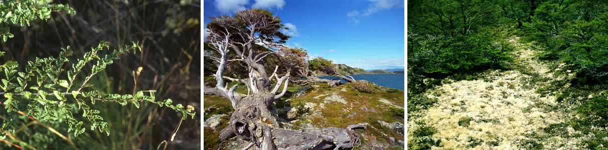
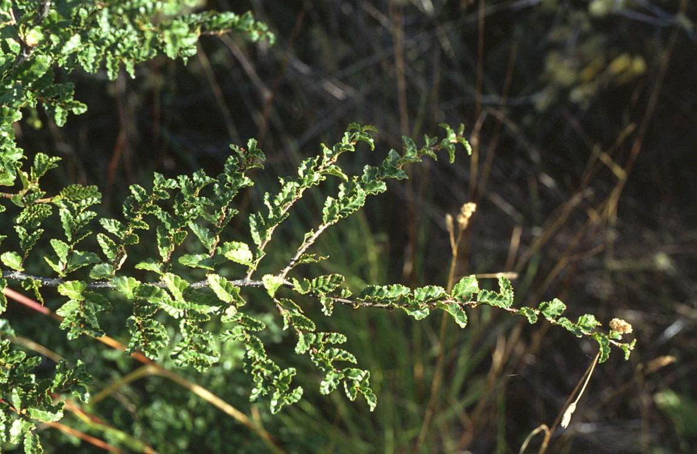
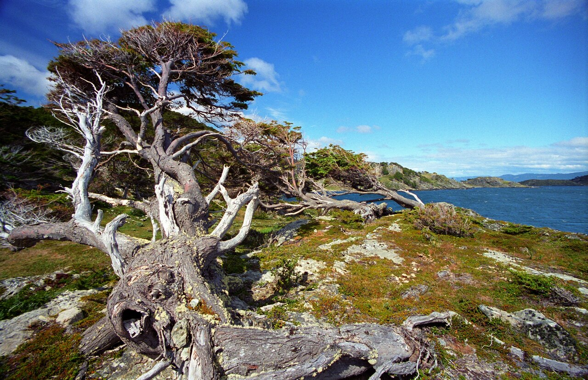
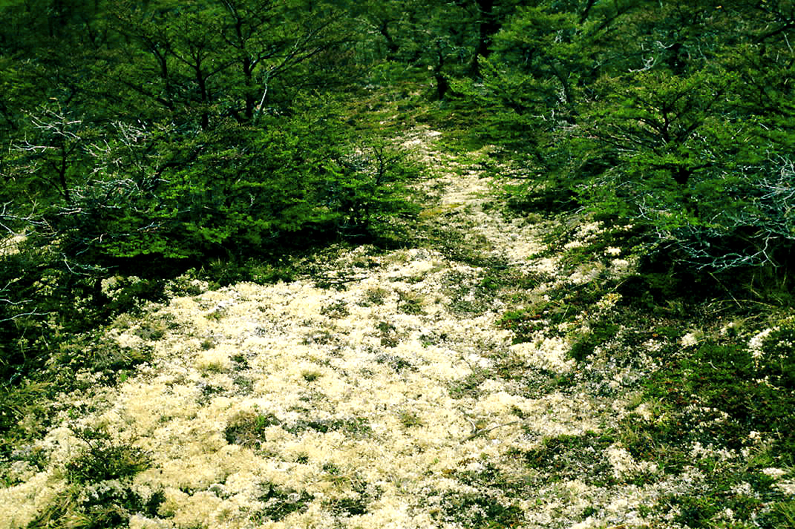

# Ñire (*Nothofagus antarctica*)

Familia Nothofagaceae. **Caducifolio.** Es el más adaptable de los Nothofagus: crece desde los mallines húmedos hasta el ecotono seco con la estepa, y desde el fondo de los valles fríos hasta el límite del bosque. Forma los "ñirantales", matorrales retorcidos que se vuelven rojos en otoño.

[Índice](../README.md) · [Contexto regional](../00-contexto-sma-bariloche.md) · [Generación de assets](../generacion-de-assets.md)

## Ficha rápida

| Rasgo | Valor |
| --- | --- |
| Altura | Puede ser árbol de 15–20 m, pero con mucha frecuencia es arbusto o arbolito bajo |
| Porte | Multitronco, retorcido, achaparrado; bosques puros achaparrados y matorrales |
| Hojas | Caducas, pequeñas (1–3 cm), elípticas u ovadas, borde aserrado o lobulado |
| Otoño | Amarillo-rojizo a rojo; "fuego antártico" |
| Tolerancia | Heladas invernales de hasta −22 °C |
| Dónde | Mallines, fondos de valle, ecotono bosque-estepa, límite superior |
| Superficie | ≈ 864.000 ha de bosque de ñire en Argentina |

## Dónde verlo

- **Bariloche**: bordes de la estepa hacia Dina Huapi y el aeropuerto, valles del este, mallines, laderas secas junto al ciprés y el radal. Junto con coihue y lenga, cubre más del 60 % del Nahuel Huapi. ([Parques Nacionales](https://www.argentina.gob.ar/node/138538))
- **San Martín de los Andes**: valles del este hacia Junín y Meliquina, mallines, y en el norte junto a la araucaria.
- Matorrales mixtos con radal, laura y retamo en el ecotono. ([INTA](https://repositorio.inta.gob.ar/handle/20.500.12123/14974?show=full))

## Rasgos visuales

**Porte.** Lo más característico es la forma torcida y achaparrada. En Aysén se describen bosques puros de tipo achaparrado y matorrales. ([Redalyc](https://www.redalyc.org/pdf/1731/173129280005.pdf)) Las ramas tienen un recorrido en zigzag.

**Mosaico.** El ñire forma parches de una sola especie que alternan con la estepa en zonas elevadas y con mallines en las depresiones. Ocupa sitios planos y bajos de valle. ([Vettese et al. 2020, INTA](https://sipas.inta.gob.ar/sites/default/files/archivos/Chapter%20Book_Land%20use%20%C3%B1ire%20dendrocronology%20%28Springer%20Latin%20American%20Dendroecology%29_2020.pdf)) Este patrón de manchas de bosque bajo sobre pradera amarilla es muy reconocible.

**Hojas.** Muy pequeñas, de 1–3 cm, con bordes aserrados. En otoño pasan a amarillo-rojizo. ([Gob. Tierra del Fuego](https://prodyambiente.tierradelfuego.gob.ar/wp-content/uploads/2022/07/IT-Solicitud-inclusion-art-1192-CAA-hojas-de-Nire-como-hierbas-para-infusion.pdf)) La NASA destaca su aporte de "colores encendidos" al paisaje del sur. ([NASA Ciencia](https://ciencia.nasa.gov/ciencias-terrestres/intensos-colores-otonales-en-el-sur-de-chile/))

**Epífitas.** Mucha barba de viejo y farolito chino, sobre todo en los rodales secos.

## Para el asset

- **Silueta**: arbusto o arbolito de 2–4 troncos que salen del mismo punto, con quiebres en zigzag, y 5–8 lóbulos pequeños y sueltos que dejan ver ramas.
- **Escala**: 0.3–0.5 del coihue. Debe leerse como "mata", no como árbol.
- **Color**: verano `#8BA04A` (más claro y amarillento que la lenga), otoño `#B5432A` y `#9E2B22`, ramas `#4A403A`.
- **Distribución**: grupos densos y compactos (ñirantales) sobre pradera, borde de mallín (círculo verde intenso con juncos), ecotono este.
- **Variante**: `nire_mallin`, más alto y más verde, en el borde de agua quieta.
- **Errores a evitar**: copa redonda y densa; colocarlo dentro del bosque húmedo cerrado.

## Imágenes

<!-- GALERIA:nire -->

Imágenes de Wikimedia Commons con licencia libre, guardadas en [`imagenes/nire/`](../imagenes/nire/). Las marcadas con 📍 fueron tomadas en Argentina o en la Patagonia según su descripción.

📍 *Antarktische Scheinbuche (Nothofagus antarctica), Scheinbuchengewächse (Nothofagaceae) - Chile, Patagonien/Patagonia, Parque Nacional Torres del Paine, bei Posada Río Serrano*  
Franz Xaver · [CC BY-SA 3.0](http://creativecommons.org/licenses/by-sa/3.0/) · [ficha en Commons](https://commons.wikimedia.org/wiki/File:Nothofagus_antarctica_1.jpg)

📍 *Nothofagus sp., Ushuaia, Tierra del Fuego, Argentina*  
Jan Reurink · [CC BY 2.0](https://creativecommons.org/licenses/by/2.0) · [ficha en Commons](https://commons.wikimedia.org/wiki/File:Nothofagus_Tierra_del_Fuego_1.jpg)

📍 *Lichens covering the soil among dwarf soutern beech trees (Nothofagus antactica) in the surroundings of El Chaltén, Lago Argentino Dept., Santa Cruz, Argentina*  
LBM1948 · [CC BY-SA 4.0](https://creativecommons.org/licenses/by-sa/4.0) · [ficha en Commons](https://commons.wikimedia.org/wiki/File:Santa_Cruz_(provincia)_1994_11.jpg)

<!-- /GALERIA -->
## Fuentes

- [Reforestemos, ñirre](https://www.reforestemos.org/content/uploads/nirre.pdf)
- [Currículum Nacional Chile, ñirre](https://www.curriculumnacional.cl/estudiante/621/articles-254602_recurso_pdf.pdf)
- [Gobierno de Tierra del Fuego, hojas de ñire](https://prodyambiente.tierradelfuego.gob.ar/wp-content/uploads/2022/07/IT-Solicitud-inclusion-art-1192-CAA-hojas-de-Nire-como-hierbas-para-infusion.pdf)
- [Vettese et al. 2020, uso de la tierra y dendrocronología del ñire (INTA)](https://sipas.inta.gob.ar/sites/default/files/archivos/Chapter%20Book_Land%20use%20%C3%B1ire%20dendrocronology%20%28Springer%20Latin%20American%20Dendroecology%29_2020.pdf)
- [INTA, matorrales de ñire del ecotono](https://repositorio.inta.gob.ar/handle/20.500.12123/14974?show=full)
- [INTA, ñire y sequía en el noroeste de la Patagonia](https://repositorio.inta.gob.ar/handle/20.500.12123/1586)
- [NASA Ciencia, colores otoñales en el sur de Chile](https://ciencia.nasa.gov/ciencias-terrestres/intensos-colores-otonales-en-el-sur-de-chile/)
- [RHS, Nothofagus antarctica](https://www.rhs.org.uk/plants/11557/wd/details)
- [iNaturalist, Nothofagus antarctica](https://www.inaturalist.org/taxa/Nothofagus-antarctica) · [Wikimedia Commons](https://commons.wikimedia.org/wiki/Category:Nothofagus_antarctica)
