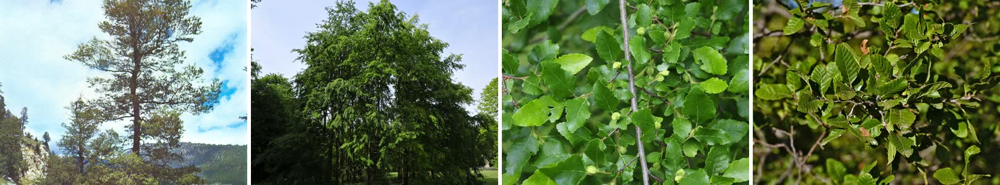
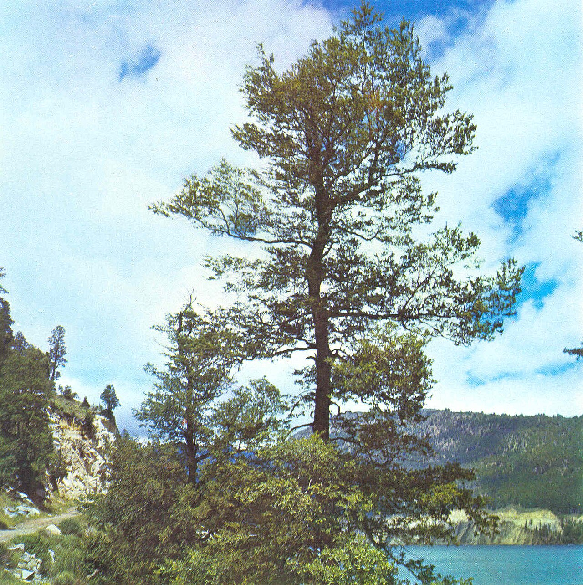
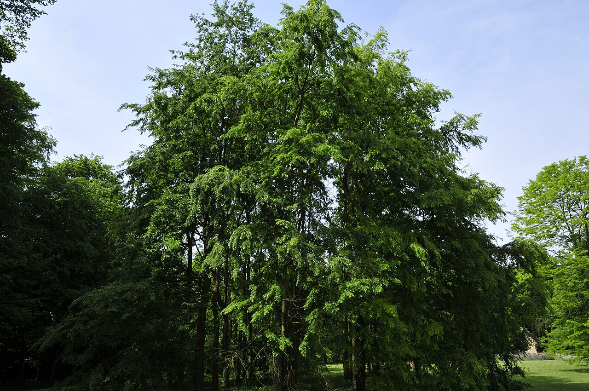
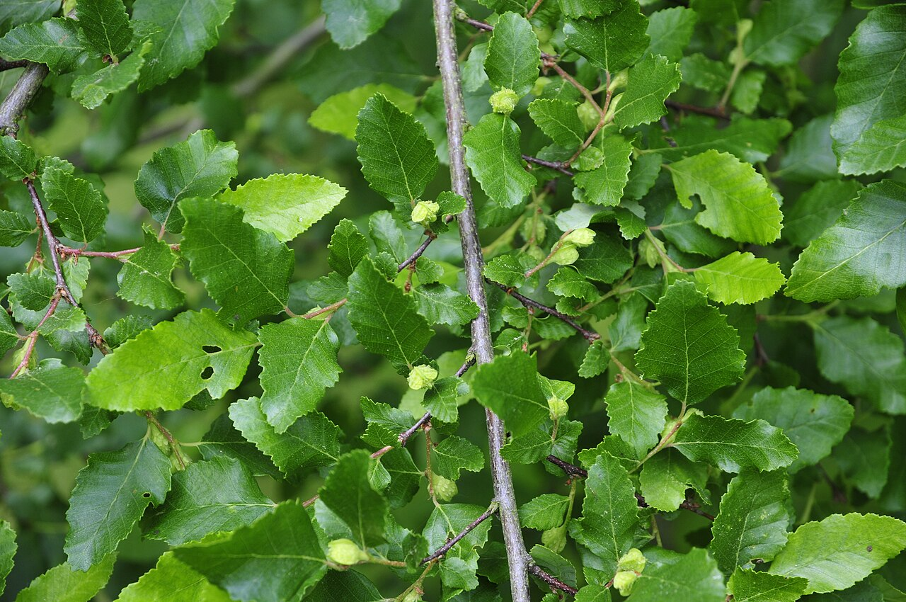
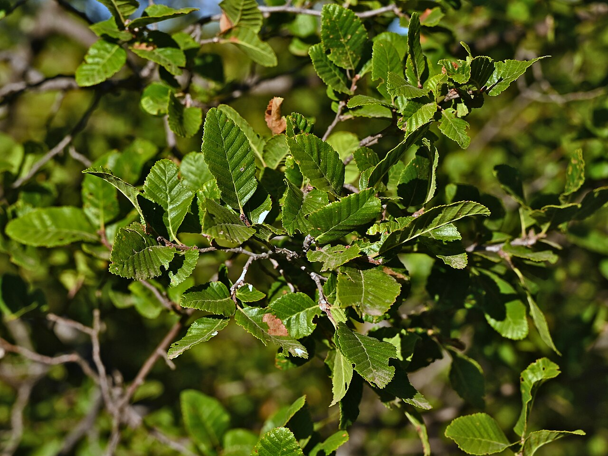

# Roble pellín (*Nothofagus obliqua*)

Familia Nothofagaceae (propuesto como *Lophozonia obliqua* en 2013). También roble, pellín o hualle. **Caducifolio.** En Argentina solo crece en Neuquén, con su centro en el Parque Nacional Lanín. Es uno de los árboles que diferencia a San Martín de los Andes de Bariloche.

[Índice](../README.md) · [Contexto regional](../00-contexto-sma-bariloche.md) · [Generación de assets](../generacion-de-assets.md)

## Ficha rápida

| Rasgo | Valor |
| --- | --- |
| Altura | Hasta 40 m (algunas fuentes 50 m); tronco de hasta 2 m |
| Ramas | Gruesas, casi perpendiculares al tronco |
| Copa | Frondosa y amplia |
| Corteza | Joven: lisa y gris clara. Adulta: gruesa, agrietada en placas irregulares, gris oscura a café |
| Hojas | Caducas, alternas, simples, 3–7 cm, ovado-lanceoladas, algo onduladas entre nervaduras, borde aserrado; muy variables |
| Frutos | Nuececillas bi y trialadas en cúpulas |
| Otoño | Amarillo, naranja y carmesí |
| En Argentina | Solo Neuquén; ≈ 26.300 ha, 90 % dentro de los parques Lanín y Nahuel Huapi |

## Dónde verlo

- **San Martín de los Andes**: Lácar y su cuenca hacia Hua Hum, Lolog, valles del Lanín. En el parque crece en los sectores suroeste y norte, junto al coihue y el raulí. ([Medina 2020, Desde la Patagonia](https://desdelapatagonia.uncoma.edu.ar/wp-content/uploads/2020/07/7.-Revista-29_Medina.pdf), [Parques Nacionales](https://www.argentina.gob.ar/parquesnacionales/regionpatagonia/parque-nacional-lanin/biodiversidad))
- **Bariloche**: no aparece de forma natural en el sector rionegrino.
- Distribución muy acotada y fragmentada en Argentina. Está protegida. ([CONICET](https://ri.conicet.gov.ar/handle/11336/159663))

## Rasgos visuales

**Porte.** Árbol grande y frondoso, con ramas gruesas casi perpendiculares al tronco. ([Currículum Nacional Chile](https://www.curriculumnacional.cl/estudiante/621/articles-254297_recurso_pdf.pdf), [Medina 2020](https://desdelapatagonia.uncoma.edu.ar/wp-content/uploads/2020/07/7.-Revista-29_Medina.pdf)) Es el Nothofagus que más se parece a un roble europeo por su estructura de ramas.

**Corteza.** Es la más distintiva de los Nothofagus de la zona. De joven es lisa y gris clara; de adulta, gruesa y partida en **placas angulosas** gris oscuro a café. ([Earth.com](https://earth.com/plant-encyclopedia/Angiosperms/Nothofagaceae/nothofagus-obliqua/en/), [Castro et al.](https://connectsci.au/bt/article/53/1/69/133006/Bark-anatomy-of-Nothofagus-species-Nothofagaceae)) Hay una foto de detalle en la galería.

**Hojas.** Muy variables, ovadas a lanceoladas, de 3–7 cm, con el borde aserrado y la superficie levemente ondulada entre las nervaduras. ([Van den Berk](https://www.vdberk.co.uk/trees/nothofagus-obliqua/))

**Otoño.** Amarillo y carmesí, y también dorado y naranja. ([RHS](https://www.rhs.org.uk/plants/11565/wd/details), [Van den Berk](https://www.vdberk.co.uk/trees/nothofagus-obliqua/)) En fotos chilenas donde aparece junto al raulí, el roble se ve amarillo-verdoso y el raulí rojo. Ver la foto de Pato Novoa en [`../imagenes/rauli/`](../imagenes/rauli/).

## Para el asset

- **Silueta**: tronco recto, 2–3 ramas principales casi horizontales visibles, copa ancha de 5–6 lóbulos. Más ancha que el raulí.
- **Color**: verano `#5F7E36`, otoño `#C9A23A` (amarillo) y `#C8622A` (naranja), corteza `#5B5149` con placas.
- **Distribución**: solo en mapas de San Martín de los Andes. Mezclado con coihue y raulí en ladera baja y media del Lácar.
- **Errores a evitar**: ponerlo en Bariloche; corteza lisa en ejemplares grandes.

## Imágenes

<!-- GALERIA:roble-pellin -->

Imágenes de Wikimedia Commons con licencia libre, guardadas en [`imagenes/roble-pellin/`](../imagenes/roble-pellin/). Las marcadas con 📍 fueron tomadas en Argentina o en la Patagonia según su descripción.

*Nothofagus obliqua.jpg*  
autor sin datos legibles · Public domain · [ficha en Commons](https://commons.wikimedia.org/wiki/File:Nothofagus_obliqua.jpg)

*Habitus*  
Homoarborea · [CC0](http://creativecommons.org/publicdomain/zero/1.0/deed.en) · [ficha en Commons](https://commons.wikimedia.org/wiki/File:Nothofagus_obliqua_(1).jpg)

*close up blad en bloem. Let op de veervormige (tweezijdige) vertakking*  
Homoarborea · [CC0](http://creativecommons.org/publicdomain/zero/1.0/deed.en) · [ficha en Commons](https://commons.wikimedia.org/wiki/File:Nothofagus_obliqua_(2).jpg)

*Nothofagus obliqua in Las Trancas in Region de Nuble, Chile*  
Krzysztof Ziarnek, Kenraiz · [CC BY 4.0](https://creativecommons.org/licenses/by/4.0) · [ficha en Commons](https://commons.wikimedia.org/wiki/File:Nothofagus_obliqua_kz01.jpg)

<!-- /GALERIA -->
## Fuentes

- [Medina 2020, roble pellín en Neuquén, *Desde la Patagonia* 17(29)](https://desdelapatagonia.uncoma.edu.ar/wp-content/uploads/2020/07/7.-Revista-29_Medina.pdf)
- [Currículum Nacional Chile, roble](https://www.curriculumnacional.cl/estudiante/621/articles-254297_recurso_pdf.pdf)
- [SAG Chile, roble](https://www.sag.cl/sites/default/files/ROBLE.pdf)
- [Reforestemos, roble](https://www.reforestemos.org/content/uploads/roble-22.pdf)
- [UNNE, descripción de Nothofagaceae (láminas)](https://exa.unne.edu.ar/biologia/diversidadv/documentos/SUBCLASE%20HAMAMELIDAE%20PDF/Descripci%F3n%20de%20las%20familias/Nothofagaceae.pdf)
- [CONICET, capítulo sobre roble pellín](https://ri.conicet.gov.ar/handle/11336/159663)
- [Earth.com, Nothofagus obliqua](https://earth.com/plant-encyclopedia/Angiosperms/Nothofagaceae/nothofagus-obliqua/en/)
- [Van den Berk, Nothofagus obliqua](https://www.vdberk.co.uk/trees/nothofagus-obliqua/) · [RHS](https://www.rhs.org.uk/plants/11565/wd/details)
- [Ladera Sur, guía de 7 árboles nativos en otoño (PDF)](https://laderasur.com/wp-content/uploads/2025/03/guia-7-arboles-nativos-otono.pdf)
- [iNaturalist, Nothofagus obliqua](https://www.inaturalist.org/taxa/Nothofagus-obliqua) · [Wikimedia Commons](https://commons.wikimedia.org/wiki/Category:Nothofagus_obliqua)
