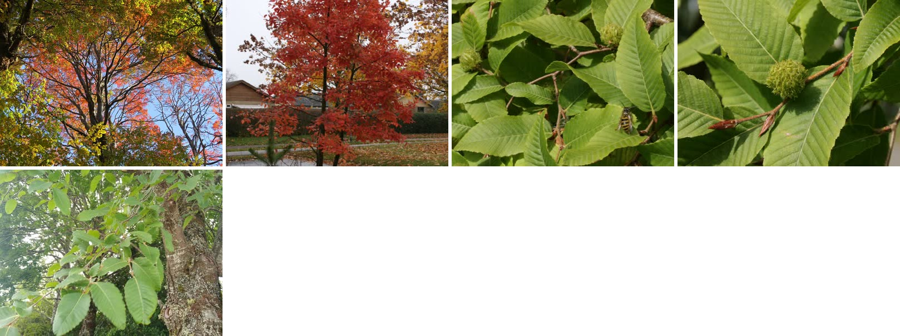
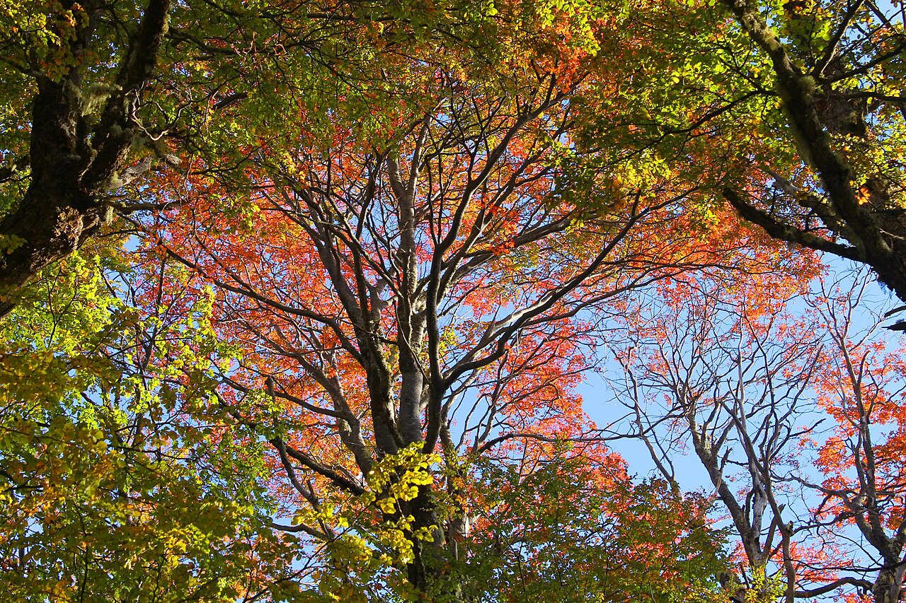
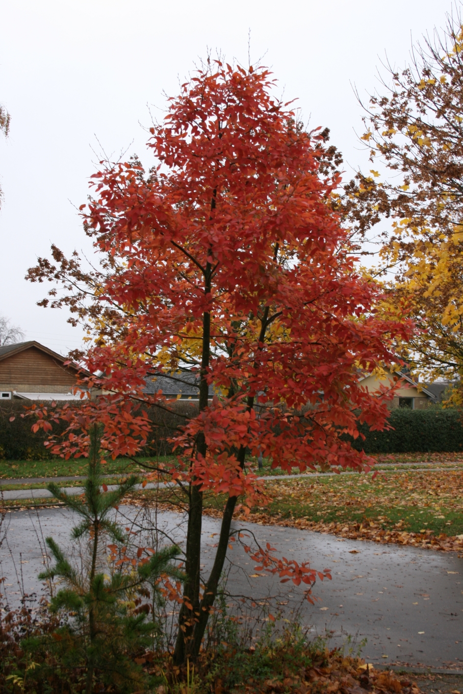
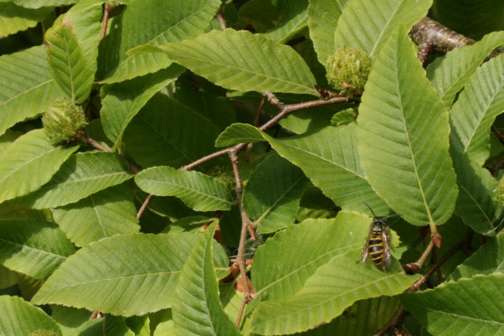
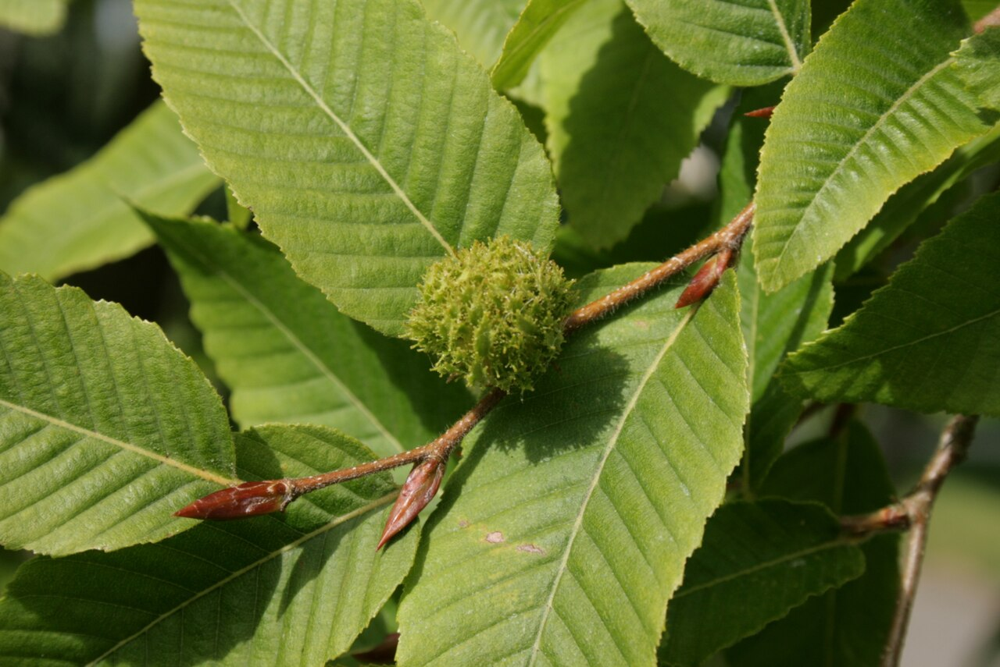
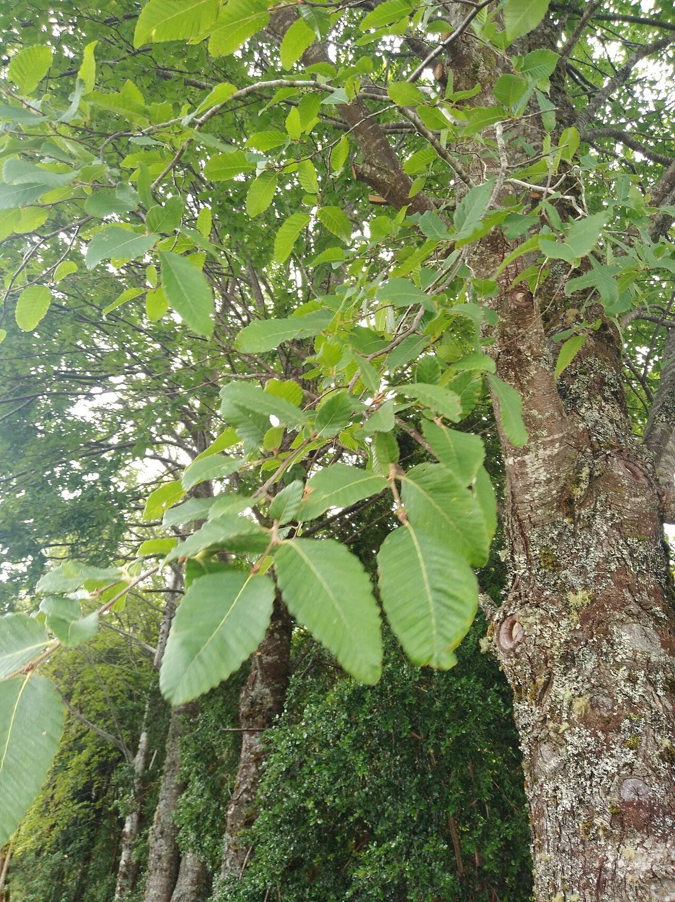

# Raulí (*Nothofagus alpina*, sin. *N. nervosa*)

Familia Nothofagaceae. **Caducifolio.** Considerado la madera dura de mejor calidad de la Patagonia. En Argentina vive en una franja estrecha del Lanín que termina en San Martín de los Andes. Tiene las hojas más largas de los Nothofagus y el otoño más rojo junto con la lenga.

[Índice](../README.md) · [Contexto regional](../00-contexto-sma-bariloche.md) · [Generación de assets](../generacion-de-assets.md)

## Ficha rápida

| Rasgo | Valor |
| --- | --- |
| Hojas | Las más estilizadas y largas de los Nothofagus, hasta 12 cm; nervadura marcada y simétrica |
| Corteza | Lisa, gris oscura, agrietada con la edad |
| Otoño | Rojo intenso, naranja y dorado |
| En Argentina | Ladera oriental de los Andes entre 39°24' y 40°10' S; ≈ 79.600 ha, 97 % protegidas |
| Dónde | Bosque húmedo del Lanín, Lácar, Hua Hum, Quillén |

## Dónde verlo

- **San Martín de los Andes**: es su límite sur continuo en Argentina (40°10' S). Cuenca del Lácar, Hua Hum y lagos del Lanín, mezclado con coihue y roble pellín. ([FAO AGRIS](https://agris.fao.org/search/en/records/675abd790ce2cede71cfa4c0), [INTA](https://repositorio.inta.gob.ar/handle/20.500.12123/9125))
- **Bariloche**: no crece de forma natural.
- Hay estudios de regeneración de bosques mixtos de coihue, raulí y roble en la Reserva Nacional Lanín. ([Revistas Chilenas](https://revistaschilenas.uchile.cl/handle/2250/139969))

## Rasgos visuales

**Hojas.** Su rasgo más llamativo. Hasta 12 cm de largo, con nervaduras paralelas muy marcadas y simétricas (de ahí el sinónimo *nervosa*). ([Currículum Nacional Chile](https://www.curriculumnacional.cl/estudiante/621/articles-254353_recurso_pdf.pdf), [Reforestemos](https://www.reforestemos.org/content/uploads/rauli-25.pdf)) Por su tamaño, la copa se ve con una textura más "suave" y de manchas grandes que la del roble o la lenga.

**Otoño.** Intenso color rojizo que destaca entre los paisajes de otoño, con tonos naranja y dorados. ([Ladera Sur](https://laderasur.com/wp-content/uploads/2025/03/guia-7-arboles-nativos-otono.pdf), [Reforestemos](https://www.reforestemos.org/content/uploads/rauli-25.pdf))

**Corteza.** Lisa, gris oscura y agrietada. ([Reforestemos](https://www.reforestemos.org/content/uploads/rauli-25.pdf))

**Porte.** Fuste recto y largo (por eso se lo valora como madera), con copa alta y ordenada.

## Raulí y roble lado a lado

| | Raulí | Roble pellín |
| --- | --- | --- |
| Hoja | Larga (hasta 12 cm), nervios marcados | Más corta (3–7 cm), variable |
| Otoño | Rojo | Amarillo a naranja |
| Corteza adulta | Gris oscura, más lisa | Gruesa en placas angulosas |
| Copa | Alta y ordenada | Amplia, ramas horizontales |

## Para el asset

- **Silueta**: tronco recto y alto, copa elíptica alta de 4–5 lóbulos grandes y suaves.
- **Color**: verano `#79963E` (más claro que el roble), otoño `#A8321F` y `#C9542A`, corteza `#5A5752`.
- **Distribución**: solo mapas de San Martín de los Andes, junto al roble y al coihue. En otoño, el contraste rojo raulí / amarillo roble / verde oscuro coihue es la "firma" del Lácar.

## Imágenes

<!-- GALERIA:rauli -->

Imágenes de Wikimedia Commons con licencia libre, guardadas en [`imagenes/rauli/`](../imagenes/rauli/). Las marcadas con 📍 fueron tomadas en Argentina o en la Patagonia según su descripción.

*Nothofagus alpina, raulí copa roja Nothofagus obliqua, roble o hualle copa amarillo-verdosa. Otoño 2016*  
Pato Novoa from Valparaíso, Chile · [CC BY 2.0](https://creativecommons.org/licenses/by/2.0) · [ficha en Commons](https://commons.wikimedia.org/wiki/File:Nothofagus,_dos_especies_-_Flickr_-_Pato_Novoa.jpg)

*Nothofagus alpina: Autumn habit.*  
Sten Porse · [CC BY-SA 3.0](https://creativecommons.org/licenses/by-sa/3.0) · [ficha en Commons](https://commons.wikimedia.org/wiki/File:Nothofagus-alpina-autumn-total.jpg)

*Nothofagus alpina: Foliage and fruits*  
Sten Porse · [CC BY-SA 3.0](https://creativecommons.org/licenses/by-sa/3.0) · [ficha en Commons](https://commons.wikimedia.org/wiki/File:Nothofagus-alpina-foliage2.jpg)

*Nothofagus alpina: Fruits*  
Sten Porse · [CC BY-SA 3.0](https://creativecommons.org/licenses/by-sa/3.0) · [ficha en Commons](https://commons.wikimedia.org/wiki/File:Nothofagus-alpina-fruits2.jpg)

*Nothofagus alpina, Llanquihue, CL-LL, CL, 2024-12-22 (iNaturalist).*  
Warren Bohmwald · [CC0](http://creativecommons.org/publicdomain/zero/1.0/deed.en) · [ficha en Commons](https://commons.wikimedia.org/wiki/File:Nothofagus_alpina_-_Warren_Bohmwald_-_458879123.jpeg)

<!-- /GALERIA -->
## Fuentes

- [Currículum Nacional Chile, raulí](https://www.curriculumnacional.cl/estudiante/621/articles-254353_recurso_pdf.pdf)
- [Reforestemos, raulí](https://www.reforestemos.org/content/uploads/rauli-25.pdf)
- [INTA, *Raulí: la madera dura de mejor calidad de la Patagonia*](https://repositorio.inta.gob.ar/handle/20.500.12123/9125)
- [FAO AGRIS, superficie y protección de raulí y roble](https://agris.fao.org/search/en/records/675abd790ce2cede71cfa4c0)
- [Regeneración de coihue, raulí y roble en la Reserva Nacional Lanín](https://revistaschilenas.uchile.cl/handle/2250/139969)
- [Ladera Sur, 7 árboles nativos en otoño (PDF)](https://laderasur.com/wp-content/uploads/2025/03/guia-7-arboles-nativos-otono.pdf)
- [Trees and Shrubs Online, Nothofagus alpina](https://www.treesandshrubsonline.org/articles/nothofagus/nothofagus-alpina/)
- [Wikimedia Commons, Nothofagus alpina](https://commons.wikimedia.org/wiki/Nothofagus_alpina) · [iNaturalist](https://www.inaturalist.org/taxa/Nothofagus-alpina)
