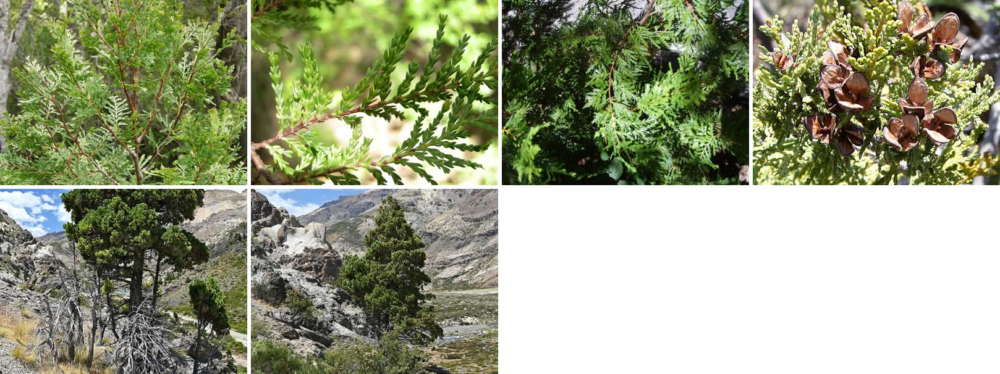
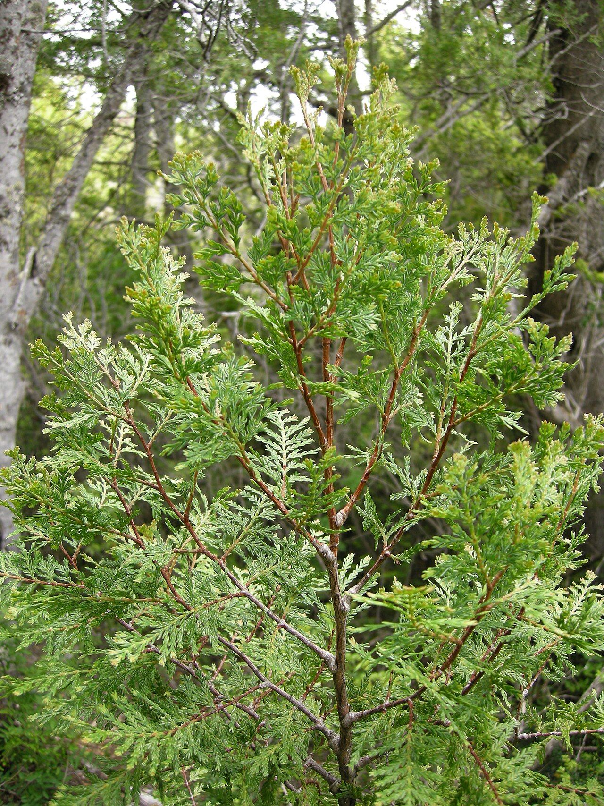
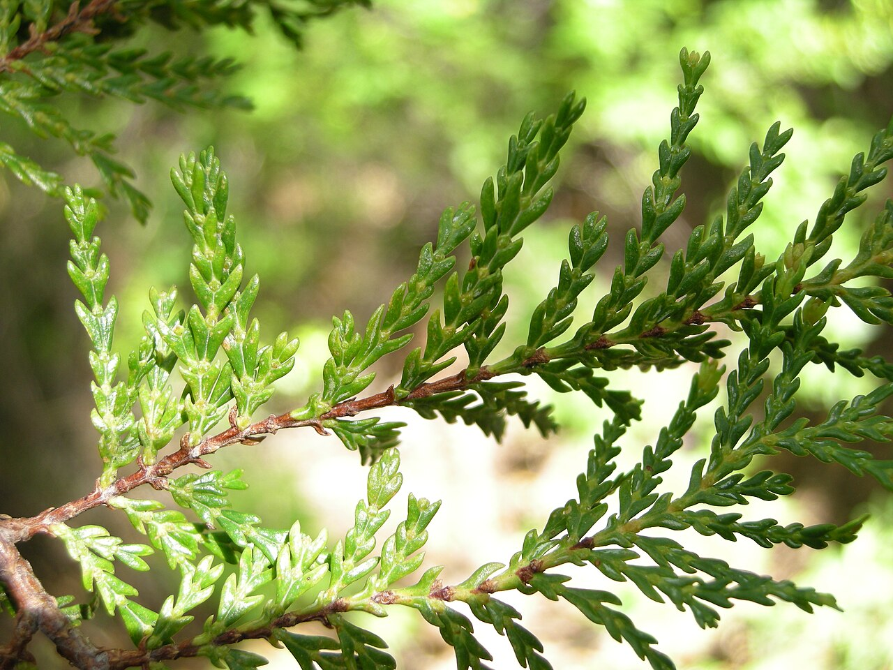
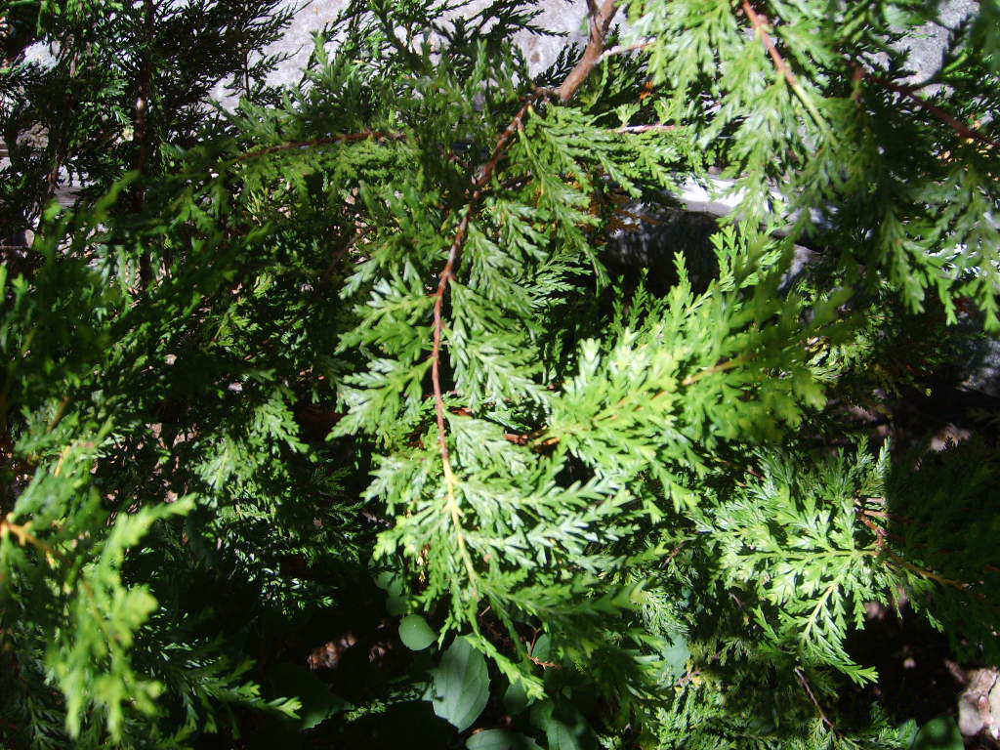
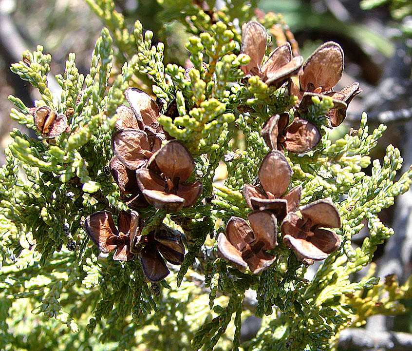
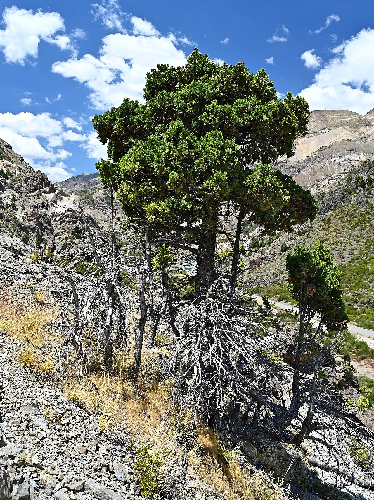
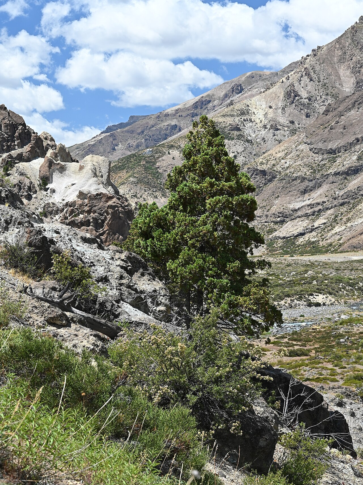

# Ciprés de la cordillera (*Austrocedrus chilensis*)

Familia Cupressaceae. También lahuán, len o ciprés. **Perenne.** Es la conífera de las laderas secas y soleadas y del ecotono con la estepa. Alrededor de Bariloche llega mucho más al este que en otros lugares. Es el reemplazo natural de los `fir` actuales del atlas.

[Índice](../README.md) · [Contexto regional](../00-contexto-sma-bariloche.md) · [Generación de assets](../generacion-de-assets.md)

## Ficha rápida

| Rasgo | Valor |
| --- | --- |
| Altura | Hasta unos 20 m (15 m frecuente); tronco de 1–2 m |
| Copa | Cónica y densa de joven; se ensancha y se aplana arriba con la edad |
| Follaje | Ramillas en **abanicos aplanados** tipo helecho, con cara superior e inferior; hojas en escama en pares opuestos |
| Color | Verde amarillento, con líneas blancas en una cara de las hojas |
| Conos | Ovoides, 7–14 × 4–7 mm, pardos al madurar, en una temporada |
| Distribución | Chile y Argentina, de 30° a 44° S, hasta 2000 m |
| Hábitat | Pedregoso y erosionado; laderas norte; ecotono bosque-estepa |
| Amenaza | "Mal del ciprés" (*Phytophthora austrocedrae*), que deja árboles secos en pie |

## Dónde verlo

- **Bariloche**: cerro Otto, Llao Llao (mixto con coihue), costas secas del Nahuel Huapi, valle del Ñirihuau, y hacia el este en bosques abiertos con ñire y estepa. Se extiende desde el borde occidental del bosque hasta la estepa. ([Parques Nacionales](https://www.argentina.gob.ar/node/138538), [SEDICI](https://sedici.unlp.edu.ar/bitstream/handle/10915/189600/Documento_completo.pdf?sequence=1))
- **San Martín de los Andes**: laderas norte del Lácar, valles hacia Junín, Meliquina. Hay senderos con bosques de cipreses añosos y cartelería. ([Welcome Argentina](https://www.welcomeargentina.com/junindelosandes/parque-nacional-lanin.html))
- Domina las partes bajas y las laderas norte. ([Revista ADBiA](https://revistas.unc.edu.ar/index.php/revistaadbia/article/download/40363/40610/150911))

## Rasgos visuales

**Copa.** Piramidal de joven. Con la edad, densa y cónica, y luego más ancha y aplanada arriba. ([Conifers Garden](https://conifersgarden.com/rare-conifers/austrocedrus-chilensis), [Australian National Arboretum](https://www.nationalarboretum.act.gov.au/living-collections/forests-and-trees/forest-57))

**Follaje.** Las ramillas forman abanicos aplanados, parecidos a frondas de helecho, con cara superior e inferior distintas. Las hojas son escamas que cubren densamente las ramitas, en pares opuestos, de color verde amarillento y con líneas blancas en una cara. ([Gymnosperm Database](https://s10.lite.msu.edu/res/msu/botonl/b_online/earle/cu/au/index.htm), [SAG](https://sag.cl/sites/default/files/Cipr%C3%A9s%20de%20la%20cordillera.pdf))

**Hábitat y lectura a distancia.** Crece en lugares pedregosos y erosionados. ([MMA Chile](https://clasificacionespecies.mma.gob.cl/wp-content/uploads/2019/10/Austrocedrus_chilensis_14RCE_FINAL.pdf)) En el ecotono forma bosques abiertos: conos oscuros separados, con suelo claro, pasto amarillo y roca entre ellos. En la ladera húmeda se mezcla con coihue como lanzas más oscuras dentro de la masa.

**Árboles secos.** El mal del ciprés deja ejemplares muertos en pie de color pardo rojizo o gris, muy frecuentes en la zona. ([CONICET](https://repositoriosdigitales.mincyt.gob.ar/vufind/Record/CONICETDig_03faaa715561a7a8b2326b1b22860d0c))

## Para el asset

- **Silueta**: cono angosto (altura/ancho ≈ 3:1 de joven, 2:1 de adulto), 5–6 anillos de follaje y punta levemente inclinada. Adulto con anillos superiores más anchos y punta roma.
- **Base**: los anillos de conífera de `models/source/base_geometry.py:140` y la textura `conifer()` en `make_textures.py:42`.
- **Superficie**: no usar agujas tipo pino. Mejor capas de "ramilletes" planos o lóbulos aplanados con bordes suaves.
- **Color**: follaje `#46552C` (con luz `#6A7A3A`), corteza `#6E4A36` fibrosa.
- **Variantes**: joven, adulto, seco (pardo rojizo `#7A5A44` o gris), grupo abierto en ecotono.
- **Distribución**: ladera norte (normal hacia el norte), roca, ecotono este. En grupos abiertos con separación visible.

## Imágenes

<!-- GALERIA:cipres-cordillera -->

Imágenes de Wikimedia Commons con licencia libre, guardadas en [`imagenes/cipres-cordillera/`](../imagenes/cipres-cordillera/). Las marcadas con 📍 fueron tomadas en Argentina o en la Patagonia según su descripción.

📍 *Branch of Austrocedrus chilensis. Picture taken in Los Alerces National Park (Chubut province, Argentina).*  
Gagea · [CC BY-SA 3.0](https://creativecommons.org/licenses/by-sa/3.0) · [ficha en Commons](https://commons.wikimedia.org/wiki/File:Austrocedrus_chilensis_-_branch_-_01.JPG)

📍 *Leaves of Austrocedrus chilensis. Picture taken in Los Alerces National Park (Chubut province, Argentina).*  
Gagea · [CC BY-SA 3.0](https://creativecommons.org/licenses/by-sa/3.0) · [ficha en Commons](https://commons.wikimedia.org/wiki/File:Austrocedrus_chilensis_-_leaves_-_01.JPG)

*Ciprés de Cordillera (es:Austrocedrus chilensis)*  
User:Daga · [CC BY 2.5](https://creativecommons.org/licenses/by/2.5) · [ficha en Commons](https://commons.wikimedia.org/wiki/File:Austrocedrus_chilensis_1.jpg)

*Cordilleran Cypress Austrocedrus chilensis foliage and cones, southeast of the Colbun Reservoir on the Maule River, Chile.*  
Dick Culbert from Gibsons, B.C., Canada · [CC BY 2.0](https://creativecommons.org/licenses/by/2.0) · [ficha en Commons](https://commons.wikimedia.org/wiki/File:Austrocedrus_chilensis_Maule_River.jpg)

*Austrocedrus chilensis 14 km SE from El Medano in Rio Maule valley, Region del Maule, Chile*  
Krzysztof Ziarnek, Kenraiz · [CC BY 4.0](https://creativecommons.org/licenses/by/4.0) · [ficha en Commons](https://commons.wikimedia.org/wiki/File:Austrocedrus_chilensis_kz01.jpg)

*Austrocedrus chilensis 14 km SE from El Medano in Rio Maule valley, Region del Maule, Chile*  
Krzysztof Ziarnek, Kenraiz · [CC BY 4.0](https://creativecommons.org/licenses/by/4.0) · [ficha en Commons](https://commons.wikimedia.org/wiki/File:Austrocedrus_chilensis_kz02.jpg)

<!-- /GALERIA -->
## Fuentes

- [MMA Chile, ficha *Austrocedrus chilensis*](https://clasificacionespecies.mma.gob.cl/wp-content/uploads/2019/10/Austrocedrus_chilensis_14RCE_FINAL.pdf) · [P07](https://clasificacionespecies.mma.gob.cl/wp-content/uploads/2019/10/Austrocedrus_chilensis_P07.pdf)
- [SAG Chile, ciprés de la cordillera](https://sag.cl/sites/default/files/Cipr%C3%A9s%20de%20la%20cordillera.pdf)
- [Reforestemos, ciprés de la cordillera](https://www.reforestemos.org/content/uploads/cipres-de-la-cordi-21.pdf)
- [The Gymnosperm Database, *Austrocedrus*](https://s10.lite.msu.edu/res/msu/botonl/b_online/earle/cu/au/index.htm)
- [Australian National Arboretum, Forest 57](https://www.nationalarboretum.act.gov.au/living-collections/forests-and-trees/forest-57)
- [Conifers Garden, *Austrocedrus chilensis*](https://conifersgarden.com/rare-conifers/austrocedrus-chilensis)
- [UNNE, Cupressaceae](https://exa.unne.edu.ar/biologia/diversidadv/documentos/GIMNOSPERMAS/CONIFEROPHYTA/Cupressaceae.PDF)
- [Pastorino, genética del ciprés (Bol. Soc. Argent. Bot.)](https://botanicaargentina.org.ar/wp-content/uploads/2017/06/307MarioPastorino.pdf)
- [*Phytophthora austrocedrae*, mal del ciprés (CONICET)](https://repositoriosdigitales.mincyt.gob.ar/vufind/Record/CONICETDig_03faaa715561a7a8b2326b1b22860d0c)
- [iNaturalist, Austrocedrus chilensis](https://www.inaturalist.org/taxa/Austrocedrus-chilensis) · [Wikimedia Commons](https://commons.wikimedia.org/wiki/Category:Austrocedrus_chilensis)
