# Araucaria o pehuén (*Araucaria araucana*)

Familia Araucariaceae. También pehuén, pino araucano o *monkey puzzle*. **Perenne.** Es la conífera emblemática de Neuquén. En Argentina vive casi solo en esa provincia, entre el lago Aluminé y el lago Lolog, justo al norte de San Martín de los Andes. Está En Peligro según la UICN.

[Índice](../README.md) · [Contexto regional](../00-contexto-sma-bariloche.md) · [Generación de assets](../generacion-de-assets.md)

## Ficha rápida

| Rasgo | Valor |
| --- | --- |
| Altura | 30–40 m (25–35 m frecuente; hasta 50 m en bosques viejos) |
| Tronco | 1–1,5 m (más de 2 m en viejos), recto y desnudo |
| Copa adulta | **Paraguas** o candelabro en lo alto; pierde las ramas inferiores |
| Copa joven | Piramidal, con ramas hasta el suelo |
| Ramas | Horizontales, en verticilos de 5–7 |
| Corteza | Muy gruesa (10–14 cm), agrietada en **placas hexagonales**, gris oscura |
| Hojas | Escamas rígidas, coriáceas, imbricadas en espiral, verde oscuro brillante, punzantes |
| Altitud | (600–)900–1800 m, a menudo hasta el límite del bosque |
| Suelo | Volcánico, ácido, bien drenado; rodales puros en laderas volcánicas empinadas |
| Sexo | Dioica: árboles macho y hembra separados (rara vez ambos en uno) |
| Conos | Macho: amentos cilíndricos pardos, efímeros. Hembra: esféricos, leñosos, 10–20 cm, dos años en la rama |
| Piñón | 3–5 cm, 3,5–4 g; 120–200 por cono; producción muy variable entre años |
| Longevidad | Crecimiento muy lento; más de 1000 años |
| Fuego | Muy resistente salvo incendios intensos: corteza gruesa, yemas protegidas, rebrota desde la copa |
| Estado | En Peligro (UICN) |

## Dónde verlo

- **San Martín de los Andes y norte**: Lolog (límite sur), Lanín, Huechulafquen, Quillén, Ñorquinco, Aluminé, Villa Pehuenia y Moquehue. En el norte del Lanín, entre el Ñorquinco y el Huechulafquen, el pehuén cubre valles y laderas occidentales. ([RBGE](https://threatenedconifers.rbge.org.uk/conifers/araucaria-araucana), [Lacgeo](https://lacgeo.com/node/91), [Parques Nacionales](https://www.argentina.gob.ar/parquesnacionales/regionpatagonia/parque-nacional-lanin/biodiversidad))
- **Villa Pehuenia, Moquehue y Batea Mahuida** (≈ 300 km al norte de San Martín de los Andes): los pehuenares más fotografiados de Argentina; la galería tiene un bosque en la ladera sur del Batea Mahuida y un ejemplar milenario junto a La Angostura.
- **Caviahue–Copahue**: araucarias sueltas sobre pradera de altura, con el volcán nevado de fondo (foto 13 de la galería).
- **Quillén, Rucachoroi, Ñorquinco**: rutas de trekking del Lanín por valles de transición, pehuenares y mallines de altura; la laguna Verde cerca de Rucachoroi está rodeada de lengas y araucarias. ([Cultura de Montaña](https://revistadigital.culturademontania.org.ar/articulo/638419f541678f4c748953d8))
- **Bariloche**: no crece de forma natural. Solo ejemplares plantados en jardines y plazas.
- Casi todos los ejemplares argentinos están en Neuquén. ([Billiken](https://billiken.lat/naturaleza/pino-araucano-en-que-sector-de-argentina-crece-este-tipo-de-arbol-en-peligro-de-extincion/))

## Rasgos visuales

**Silueta.** La más reconocible de la región. De joven, una pirámide ancha. Con la edad pierde las ramas inferiores y queda un fuste desnudo con la copa en forma de paraguas arriba. ([Currículum Nacional Chile](https://www.curriculumnacional.cl/estudiante/621/articles-254609_recurso_pdf.pdf))

**Ramas.** Salen en verticilos (coronas) de 5–7 desde un mismo nivel del tronco. Son horizontales y, al desprenderse las basales, la copa queda aparasolada. Las ramas terminales son gruesas, como cuerdas cubiertas de escamas, y se curvan hacia arriba en la punta. ([UNCuyo](https://bdigital.uncu.edu.ar/objetos_digitales/20034/12-araucaria-araucana-corregido.pdf), [EcuRed](https://www.ecured.cu/Pehu%C3%A9n))

**Corteza.** Muy gruesa (10–14 cm) y agrietada profundamente en placas hexagonales de distintos tamaños, gris oscura. Para un juego de hexágonos es un detalle muy aprovechable. ([UNCuyo](https://bdigital.uncu.edu.ar/objetos_digitales/20034/12-araucaria-araucana-corregido.pdf))

**Hojas.** Escamas rígidas, coriáceas y punzantes, de verde oscuro brillante, dispuestas en espiral muy apretada alrededor de la rama. ([SAG](https://sag.cl/sites/default/files/ARAUCARIA.pdf))

**Paisaje.** Rodales abiertos en laderas volcánicas, a veces puros y a veces con lenga y ñire debajo. En otoño, los paraguas verde oscuro sobre un fondo de lenga y ñire rojos son una imagen clásica de Pehuenia y del Lanín. Hay una foto de otoño de Conguillío en la galería.

**Conos y sexo.** La especie es dioica. Los conos femeninos son esferas leñosas verde amarillentas de 10–20 cm, erizadas de brácteas, que tardan unos dos años en madurar y se desarman en el árbol; los masculinos son amentos cilíndricos pardos y efímeros. ([MMA Chile, ficha RCE](https://clasificacionespecies.mma.gob.cl/wp-content/uploads/2019/10/Araucaria_araucana_14RCE_FINAL.pdf), [Meteored, el ciclo del piñón](https://www.meteored.cl/noticias/plantas/el-largo-viaje-del-pinon-por-que-el-fruto-de-la-araucaria-tarda-anos-en-completar-su-ciclo.html)) A escala del juego, unos pocos puntos amarillentos en las puntas de rama de algunos ejemplares bastan para insinuar árboles hembra.

**Edad y crecimiento.** Crece muy despacio en sitios restrictivos y supera los 1000 años; por eso se usa en dendrocronología, y el crecimiento difiere entre machos y hembras en los años de fructificación masiva. ([MMA Chile](https://clasificacionespecies.mma.gob.cl/wp-content/uploads/2019/10/Araucaria_araucana_14RCE_FINAL.pdf), [CONICET](https://ri.conicet.gov.ar/handle/11336/171342)) Los ejemplares viejos son gruesos, con fuste muy alto y copa reducida a un paraguas chato.

**Fuego y perturbación.** Vive en zonas sometidas a caída de ceniza volcánica, coladas, incendios, avalanchas y remoción en masa. Su corteza gruesa y sus yemas protegidas la hacen muy resistente al fuego y rebrota desde la copa, a diferencia de la lenga, que no rebrota. ([Frontiers 2025](https://www.frontiersin.org/journals/forests-and-global-change/articles/10.3389/ffgc.2025.1631614/full), [Gayana Botánica](https://gayanabotanica.cl/index.php/gb/article/download/113/27/1482)) Pero los incendios severos y repetidos matan casi todo: en Ñorquinco, el fuego de 2013 quemó unas 1500 ha, y el parque replantó miles de araucarias jóvenes en comanejo con la Confederación Mapuche de Neuquén. ([Río Negro](https://www.rionegro.com.ar/sociedad/en-norquinco-ayudan-a-la-naturaleza-a-recuperar-un-bosque-2331182/?amp=1), [La Nación](https://www.lanacion.com.ar/sociedad/plantaron-3000-araucarias-para-recuperar-un-bosque-incendiado-en-neuquen-nid30092021/))

**Sotobosque.** En el norte del Lanín el sotobosque es tupido, con caña colihue, michay y espino negro; en altura, en cambio, el pehuenar es abierto, sobre pastizal, roca o arena volcánica. ([Welcome Argentina, PN Lanín](https://www.welcomeargentina.com/sanmartindelosandes/parque-nacional-lanin.html))

**Cultura.** El piñón (semilla) es alimento central del pueblo pehuenche ("gente del pehuén").

## Para el asset

- **Silueta adulta**: fuste de 8 lados hasta el 60–70 % de la altura. Copa de 2–4 verticilos de 5–7 ramas. Cada rama es un tubo de 4–5 segmentos, horizontal y curvado hacia arriba en el último tercio, con un "pompón" en la punta.
- **Silueta joven**: pirámide completa de verticilos hasta el suelo.
- **Corteza**: alternar tonos en patrón hexagonal (`#5E5B55` / `#4A4843`).
- **Follaje**: `#26361E` con brillo `#3E5230`.
- **Uso**: hito o "landmark" de bioma. Solo en mapas "San Martín de los Andes norte / Lanín / Pehuenia", sobre suelo volcánico claro (`#B8A98A`).
- **Variantes sugeridas**: `araucaria_joven` (pirámide hasta el suelo, como la foto 11), `araucaria_adulta` (paraguas), `araucaria_vieja` (fuste muy alto y grueso, paraguas chato y ralo, alguna rama rota), `araucaria_hembra` (puntos `#C9B54A` en puntas de rama). Pehuenares con 10–20 % de jóvenes entre adultos se ven creíbles.
- **Tile quemado**: fustes grises con copa parcial o sin copa y retoños jóvenes alrededor, como en Ñorquinco.
- **Errores a evitar**: ponerla en Bariloche o en bosque húmedo cerrado; ramas planas tipo abeto.

## Imágenes

<!-- GALERIA:araucaria -->

Imágenes de Wikimedia Commons con licencia libre, guardadas en [`imagenes/araucaria/`](../imagenes/araucaria/). Las marcadas con 📍 fueron tomadas en Argentina o en la Patagonia según su descripción.

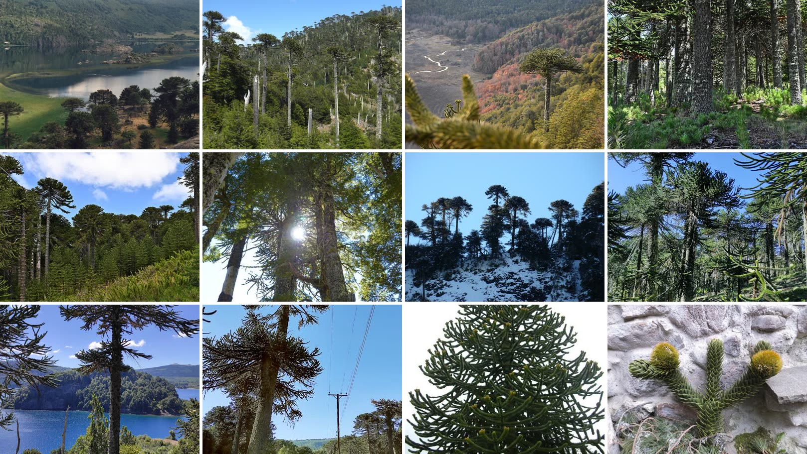

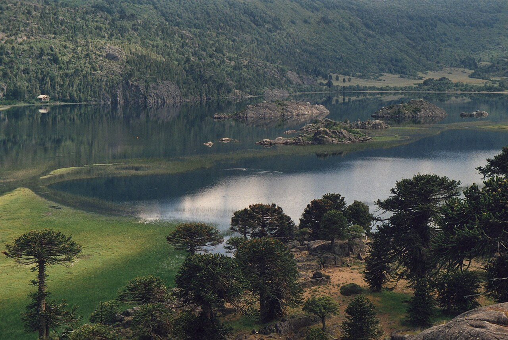

📍 *Araucaria araucana trees by lake - Neuquén Province - Argentina.*  
pruxo · [CC BY 2.5](https://creativecommons.org/licenses/by/2.5) · [ficha en Commons](https://commons.wikimedia.org/wiki/File:Araucaria_araucana_pulmari.jpg)

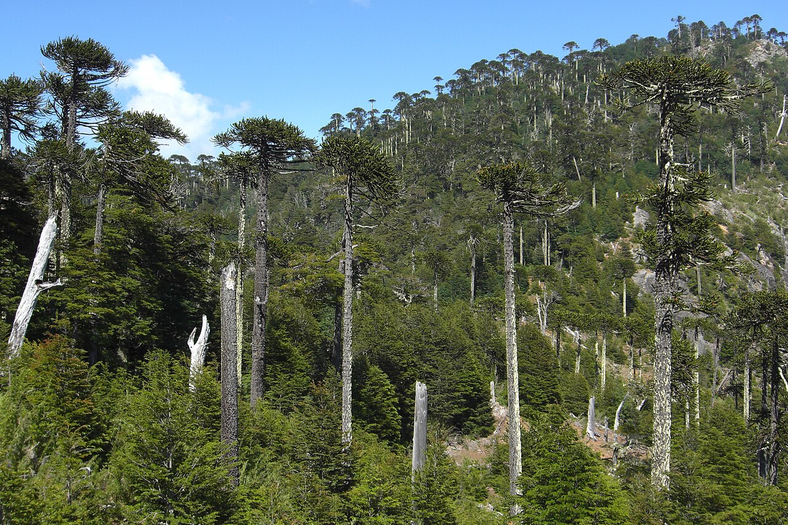

*Araucaria araucana, Parque Nacional Huerquehue, Chile.*  
Jason Hollinger · [CC BY 2.0](https://creativecommons.org/licenses/by/2.0) · [ficha en Commons](https://commons.wikimedia.org/wiki/File:Araucaria_Forest_(3440545832).jpg)

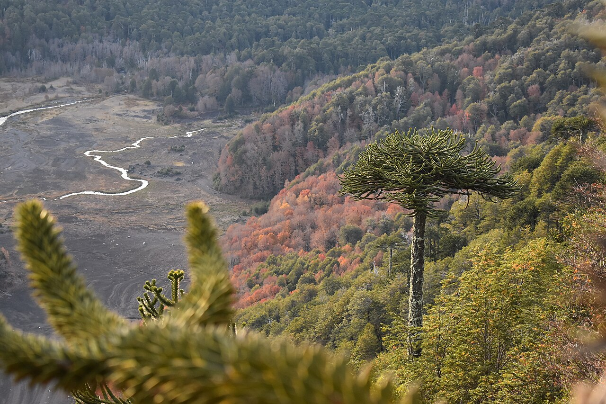

*The automn is one of the attractive season to watch Araucaria trees surrounded by colorful forests in Conguillío National Park of Chile*  
Delahimalaya-alosandes · [CC BY-SA 4.0](https://creativecommons.org/licenses/by-sa/4.0) · [ficha en Commons](https://commons.wikimedia.org/wiki/File:Araucaria_araucana,_Conguill%C3%ADo_National_Park,_Chile.jpg)

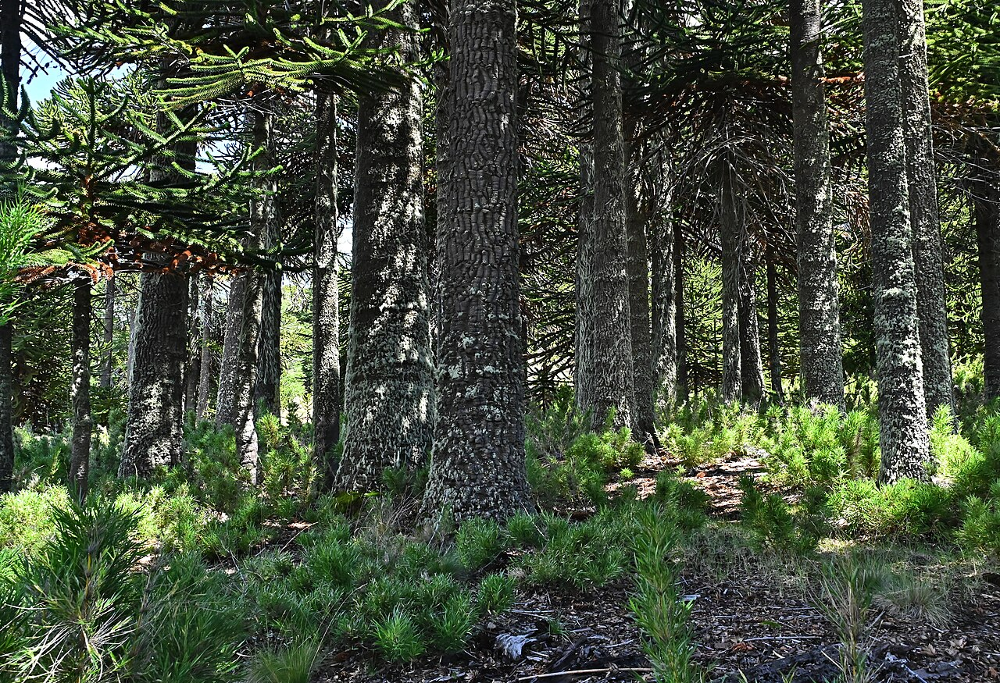

*Araucaria araucana forest NE from Laguna Puesto Care, Araukania, Chile*  
Krzysztof Ziarnek, Kenraiz · [CC BY 4.0](https://creativecommons.org/licenses/by/4.0) · [ficha en Commons](https://commons.wikimedia.org/wiki/File:Araucaria_araucana_kz22.jpg)

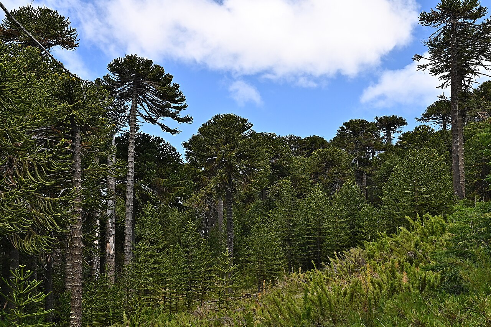

*Araucaria araucana forest NE from Laguna Puesto Care, Araukania, Chile*  
Krzysztof Ziarnek, Kenraiz · [CC BY 4.0](https://creativecommons.org/licenses/by/4.0) · [ficha en Commons](https://commons.wikimedia.org/wiki/File:Araucaria_araucana_kz34.jpg)

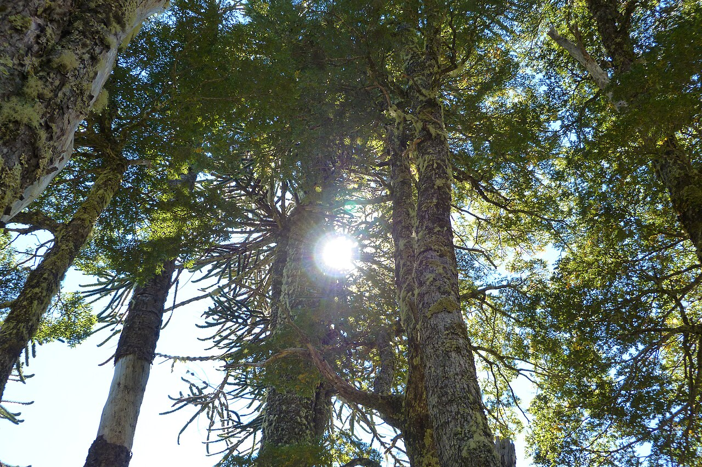

*Foto de araucarias donde aparece el sol entre ellas y realza su color verde.*  
Andrei Pojomovsky · [CC BY-SA 3.0](https://creativecommons.org/licenses/by-sa/3.0) · [ficha en Commons](https://commons.wikimedia.org/wiki/File:Araucarias.JPG)

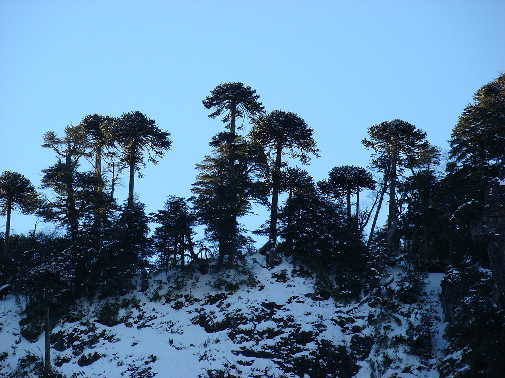

*Araucaria forest (Araucaria araucana) in the "Sierra Nevada Mountain", near Lonquimay, Chile.*  
Jardouin · [CC BY-SA 4.0](https://creativecommons.org/licenses/by-sa/4.0) · [ficha en Commons](https://commons.wikimedia.org/wiki/File:Araucarias_en_Sierra_Nevada.jpg)

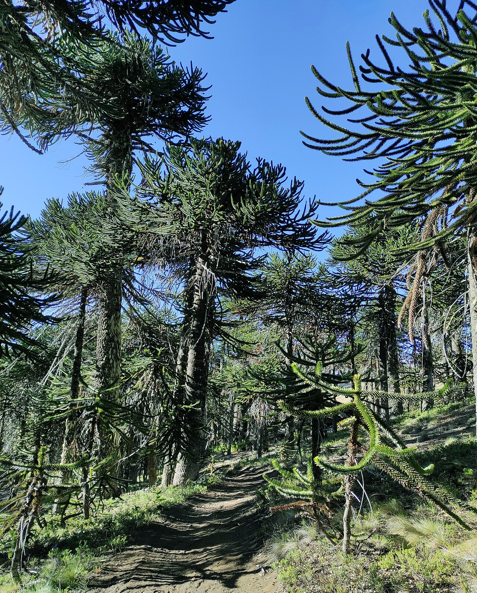

📍 *Bosque de pehuén (Araucaria arauca) en la ladera sur del volcán Batea Mahuida, al norte de Villa Pehuenia, Neuquen, Argentina.*  
Kelbraer · [CC BY-SA 4.0](https://creativecommons.org/licenses/by-sa/4.0) · [ficha en Commons](https://commons.wikimedia.org/wiki/File:Atravesando_un_bosque_de_pehu%C3%A9n_(Araucaria_arauca).jpg)

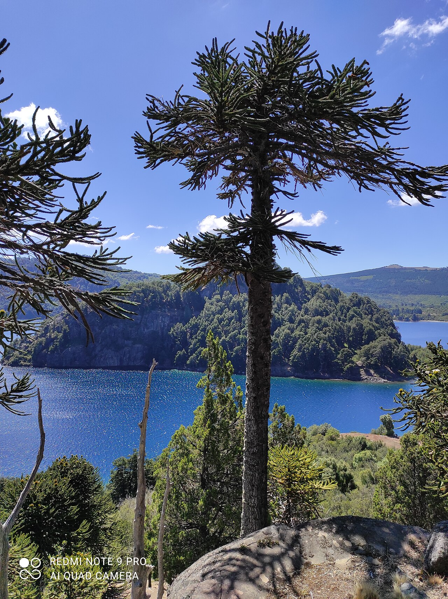

📍 *Vista al lago Moquehue*  
Kelbraer · [CC BY-SA 4.0](https://creativecommons.org/licenses/by-sa/4.0) · [ficha en Commons](https://commons.wikimedia.org/wiki/File:Villa_Pehuenia,_Vista_al_lago_Moquehue.jpg)

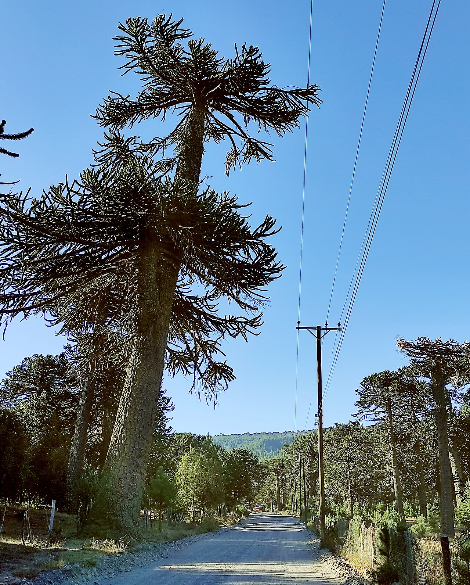

📍 *Ubicación: En la carretera de acceso a La Angostura, la franja terrestre que separa las lagunas Aluminé y Moquehue*  
Kelbraer · [CC BY-SA 4.0](https://creativecommons.org/licenses/by-sa/4.0) · [ficha en Commons](https://commons.wikimedia.org/wiki/File:Villa_Pehuenia-_Un_milenario_%C3%A1rbol_de_pehu%C3%A9n_(Araucaria_arauca).jpg)

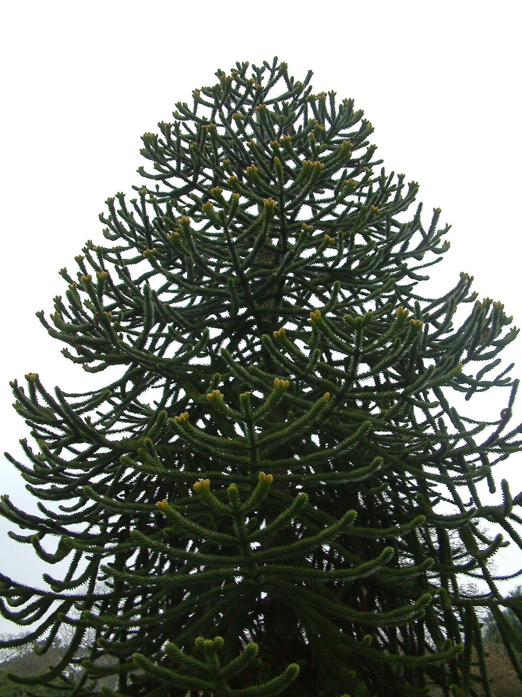

*(cones)*  
Alex Lomas · [CC BY 2.0](https://creativecommons.org/licenses/by/2.0) · [ficha en Commons](https://commons.wikimedia.org/wiki/File:Araucaria_araucana_(2944470892).jpg)

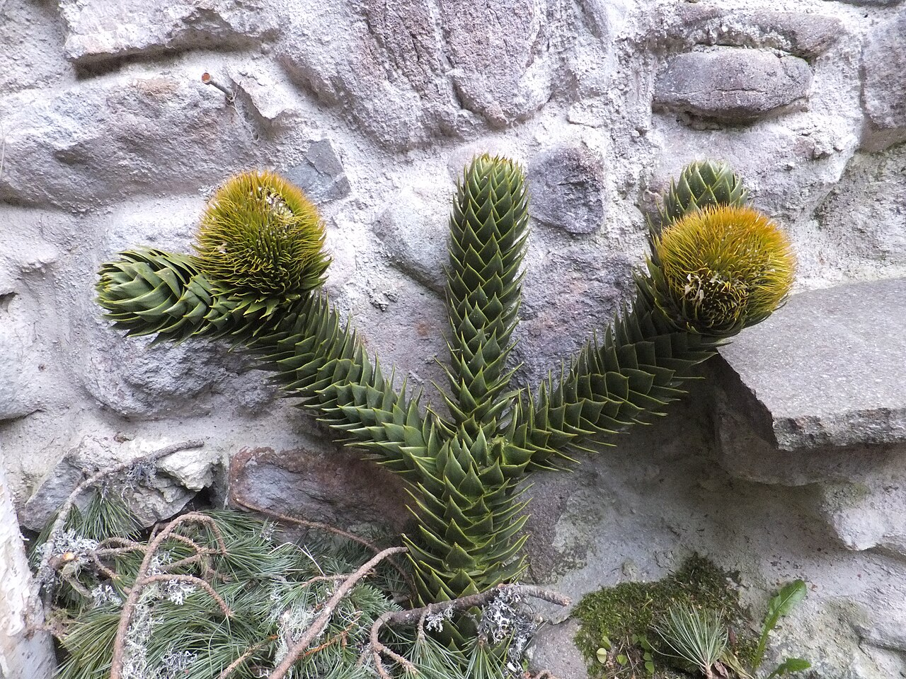

*Branch with cones of an Araucaria araucana*  
Syrio · [CC BY-SA 4.0](https://creativecommons.org/licenses/by-sa/4.0) · [ficha en Commons](https://commons.wikimedia.org/wiki/File:Araucaria_araucana_cone,_cultivated,_Italy.jpg)

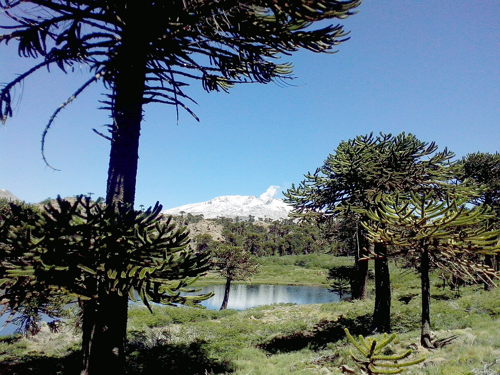

📍 *Caviahue, Neuquén. En el frente se puede observar las Araucarias. Un género de coníferas de la familia Araucariaceae. Hay 19 especies en el género, con una distribución repartida e*  
rdjulieta · [CC BY-SA 4.0](https://creativecommons.org/licenses/by-sa/4.0) · [ficha en Commons](https://commons.wikimedia.org/wiki/File:Caviahue,_Neuqu%C3%A9n.jpg)

<!-- /GALERIA -->
## Fuentes

- [MMA Chile, ficha de clasificación de *Araucaria araucana*](https://clasificacionespecies.mma.gob.cl/wp-content/uploads/2019/10/Araucaria_araucana_14RCE_FINAL.pdf)
- [Meteored, el ciclo del piñón](https://www.meteored.cl/noticias/plantas/el-largo-viaje-del-pinon-por-que-el-fruto-de-la-araucaria-tarda-anos-en-completar-su-ciclo.html)
- [CONICET, crecimiento según sexo](https://ri.conicet.gov.ar/handle/11336/171342)
- [Frontiers 2025, fuego en bosques de araucaria](https://www.frontiersin.org/journals/forests-and-global-change/articles/10.3389/ffgc.2025.1631614/full) · [Gayana Botánica](https://gayanabotanica.cl/index.php/gb/article/download/113/27/1482)
- [Río Negro, restauración en Ñorquinco](https://www.rionegro.com.ar/sociedad/en-norquinco-ayudan-a-la-naturaleza-a-recuperar-un-bosque-2331182/?amp=1) · [La Nación, 3000 araucarias plantadas](https://www.lanacion.com.ar/sociedad/plantaron-3000-araucarias-para-recuperar-un-bosque-incendiado-en-neuquen-nid30092021/)
- [Cultura de Montaña, travesías del norte del Lanín](https://revistadigital.culturademontania.org.ar/articulo/638419f541678f4c748953d8)
- [Mongabay, el árbol sagrado](https://es.mongabay.com/2024/05/araucaria-arbol-sagrado-memoria-viva-resiste-a-desaparecer/)

- [Currículum Nacional Chile, araucaria](https://www.curriculumnacional.cl/estudiante/621/articles-254609_recurso_pdf.pdf)
- [SAG Chile, araucaria](https://sag.cl/sites/default/files/ARAUCARIA.pdf)
- [UNCuyo, *Araucaria araucana* (PDF)](https://bdigital.uncu.edu.ar/objetos_digitales/20034/12-araucaria-araucana-corregido.pdf)
- [Trees and Shrubs Online, *Araucaria araucana*](https://www.treesandshrubsonline.org/articles/araucaria/araucaria-araucana/)
- [RBGE, Threatened Conifers: *Araucaria araucana*](https://threatenedconifers.rbge.org.uk/conifers/araucaria-araucana)
- [FAO, recursos genéticos de *Araucaria araucana*](https://www.fao.org/4/k1203e/K1203E02.htm)
- [Wikipedia, *Araucaria araucana*](https://en.wikipedia.org/wiki/Araucaria_araucana)
- [EcuRed, pehuén](https://www.ecured.cu/Pehu%C3%A9n)
- [UNNE, Araucariaceae (mezcla datos con *A. angustifolia*)](https://exa.unne.edu.ar/biologia/diversidadv/documentos/GIMNOSPERMAS%20PDF/Descripci%F3n%20de%20los%20grupos/Conipherophyta/2-Coniferales/1-Araucariaceae/Araucariaceae.pdf)
- [iNaturalist, Araucaria araucana](https://www.inaturalist.org/taxa/Araucaria-araucana) · [Wikimedia Commons](https://commons.wikimedia.org/wiki/Category:Araucaria_araucana)
