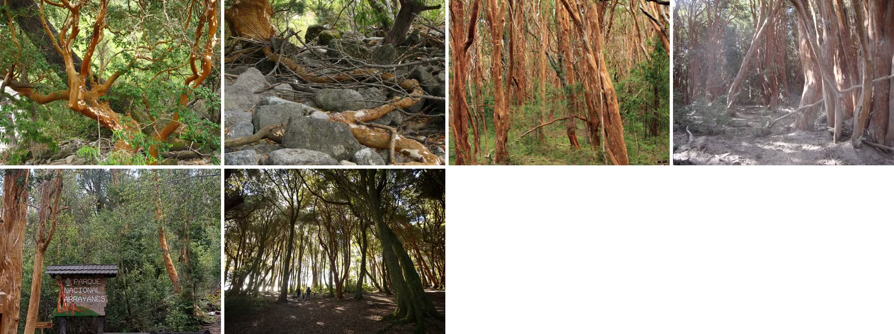
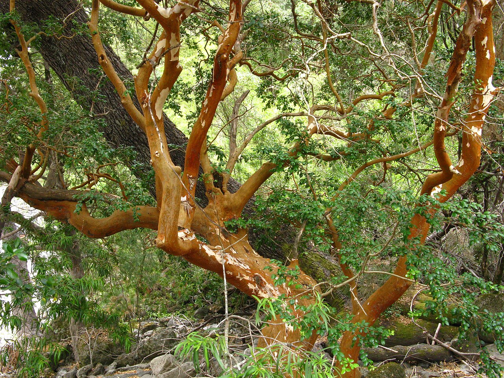
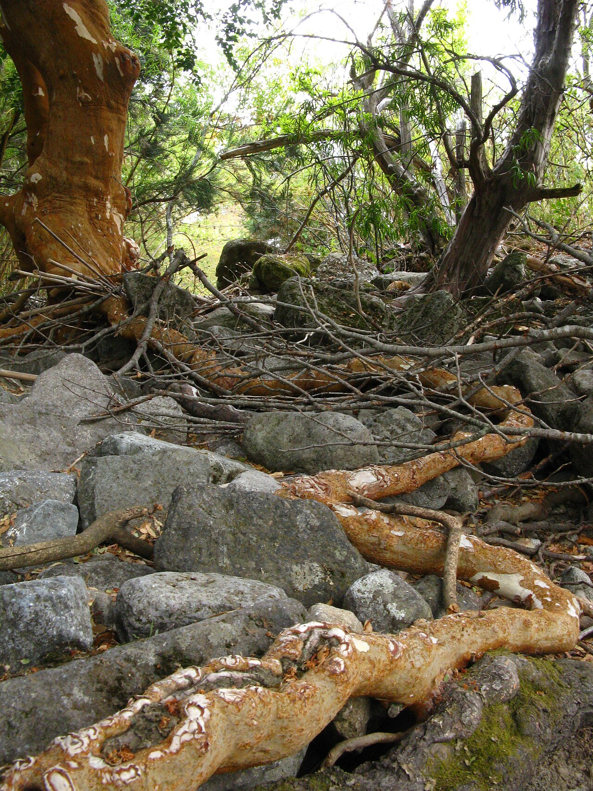
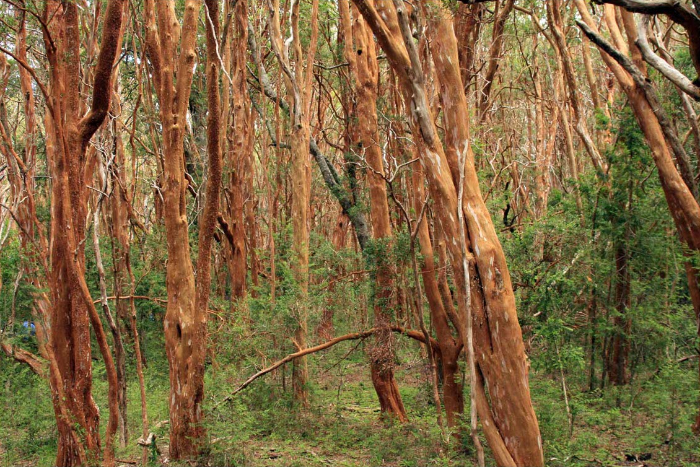
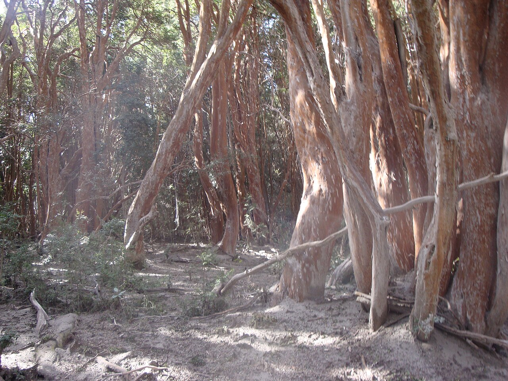
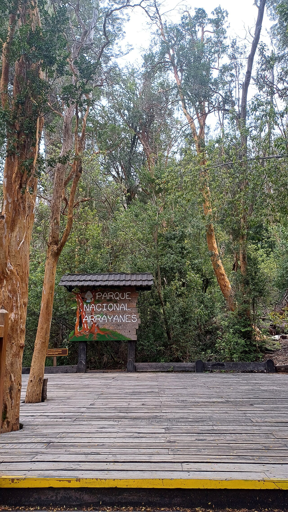
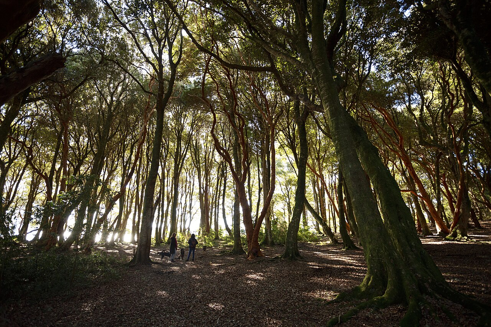

# Arrayán (*Luma apiculata*)

Familia Myrtaceae. También arrayán rojo, temu, palo colorado o *quetri* en mapudungun. **Perenne.** Árbol de orilla de lago y arroyo, con troncos retorcidos de color **canela anaranjado**. El Bosque de Arrayanes de la península de Quetrihué (Villa La Angostura, en el Nahuel Huapi) es su lugar más famoso. La península toma su nombre de él.

[Índice](../README.md) · [Contexto regional](../00-contexto-sma-bariloche.md) · [Generación de assets](../generacion-de-assets.md)

## Ficha rápida

| Rasgo | Valor |
| --- | --- |
| Altura | 10–15 m en su área nativa; hasta 25 m y 650 años en Quetrihué |
| Tronco | Retorcido y contorsionado, a menudo varios troncos |
| Corteza | Lisa, **canela a naranja**, se desprende y deja manchas blanco-crema; fría al tacto |
| Hojas | Pequeñas, perennes, aromáticas, coriáceas, verde oscuro brillante, con punta aguda |
| Flores | Blancas, solitarias, 4 pétalos y muchos estambres; de mediados del verano al otoño |
| Fruto | Baya comestible de ≈ 1 cm, negro-violácea |
| Hábitat | Orillas de lagos y ríos, suelos húmedos |

## Dónde verlo

- **Bariloche y Nahuel Huapi**: Bosque de Arrayanes en Quetrihué. El Parque Nacional Los Arrayanes ocupa toda la península (1753 ha), pero el bosque que le da nombre cubre solo unas 20 ha. ([Lacgeo](https://mail.lacgeo.com/node/93)) También en costas del Nahuel Huapi, Llao Llao y Puerto Blest, cerca de ríos y lagos. ([Parques Nacionales](https://www.argentina.gob.ar/node/138538))
- **San Martín de los Andes**: costas del Lácar y arroyos. El Circuito Arrayán (22 km) recorre la zona con vistas del lago. ([Welcome Argentina](https://www.welcomeargentina.com/sanmartindelosandes/parque-nacional-lanin.html)) Hay fotos de Neuquén en la galería.

## Rasgos visuales

**Corteza.** Es lo que hay que transmitir. Lisa, de color rojizo a naranja, que se desprende periódicamente y deja zonas blanquecinas. ([Desde la Patagonia](https://revele.uncoma.edu.ar/index.php/desdelapatagonia/article/download/2354/pdf/60034), [Wikipedia](https://en.wikipedia.org/wiki/Luma_apiculata)) El nombre mapuche *quetri* alude justamente al árbol de corteza rojiza. ([Desde la Patagonia 27](https://desdelapatagonia.uncoma.edu.ar/wp-content/uploads/2019/06/Revista-27_COMPLETA.pdf))

**Tronco.** Retorcido, contorsionado, a veces con varios fustes. ([Oregon State](https://landscapeplants.oregonstate.edu/node/571)) En el bosque de Quetrihué, la copa queda alta y deja ver un "salón" de troncos naranjas entre los que pasa la pasarela de madera.

**Hojas y flores.** Hojas diminutas, verde oscuro brillante y con punta aguda. Flores blancas de 4 pétalos con un pompón de estambres de anteras rosadas. ([Australian National Arboretum](https://www.nationalarboretum.act.gov.au/living-collections/forests-and-trees/forest-45), [Landcare Research NZ](https://keys.landcareresearch.co.nz/nzmyrtaceae/key/nzmyrtaceae/Media/Html/entities/Luma_apiculata.pdf))

**Luz.** En el bosque de arrayanes, la luz filtrada se vuelve anaranjada por el reflejo de los troncos. Es un ambiente de penumbra cálida muy distinto del resto del bosque.

## Para el asset

- **Silueta**: 3–6 troncos que salen juntos, con torsión (tubos de 5–6 segmentos rotados), copa baja y densa de lóbulos pequeños. En la variante "bosque", la copa empieza alta para mostrar los troncos.
- **Corteza**: base `#C9743A`, manchas `#E8D9BC` por vértice con ruido. Generar una textura propia en `make_textures.py`, porque no hay CC0 equivalente.
- **Follaje**: `#2F4A26`. Variante de verano con puntos blancos de flor (`#F2EEE4`).
- **Distribución**: solo en la franja de costa (distancia al agua muy baja) y en grupos apretados.
- **Iluminación**: si hay un tile especial "Bosque de Arrayanes", tintar la luz ambiente hacia naranja.

## Imágenes

<!-- GALERIA:arrayan -->

Imágenes de Wikimedia Commons con licencia libre, guardadas en [`imagenes/arrayan/`](../imagenes/arrayan/). Las marcadas con 📍 fueron tomadas en Argentina o en la Patagonia según su descripción.

📍 *Luma apiculata (Arrayán rojo), especie endémica de Chile y Argentina. Reserva de Ñuble, Región del Biobío, Chile. Fecha: febrero-marzo 2009.*  
Farisori · [CC BY-SA 3.0](https://creativecommons.org/licenses/by-sa/3.0) · [ficha en Commons](https://commons.wikimedia.org/wiki/File:Luma_apiculata_-_arrayan_rojo.jpg)

📍 *Raíces de un Luma apiculata (Arrayán rojo), especie endémica de Chile y Argentina. Reserva de Ñuble, Región del Biobío, Chile. Fecha: febrero-marzo 2009.*  
Farisori · [CC BY-SA 3.0](https://creativecommons.org/licenses/by-sa/3.0) · [ficha en Commons](https://commons.wikimedia.org/wiki/File:Luma_apiculata_-_arrayan_rojo_(raiz).jpg)

📍 *Luma apiculata, Neuquen, Argentina*  
Nestor Galina · [CC BY 2.0](https://creativecommons.org/licenses/by/2.0) · [ficha en Commons](https://commons.wikimedia.org/wiki/File:Luma_apiculata_Arrayanes_by_Nestor_Galina.jpg)

📍 *San Carlos de Bariloche y alrededores en setiembre de 2011*  
Fadesga · [CC BY-SA 3.0](https://creativecommons.org/licenses/by-sa/3.0) · [ficha en Commons](https://commons.wikimedia.org/wiki/File:Bosque_Arrayanes_setiembre_2011_03.JPG)

📍 *Ingreso al Bosque de Arrayanes desde el lago Nahuel Huapi - Parque Nacional Los Arrayanes - Villa La Angostura - Argentina*  
Viole9977 · [CC BY-SA 4.0](https://creativecommons.org/licenses/by-sa/4.0) · [ficha en Commons](https://commons.wikimedia.org/wiki/File:Bosque_de_Arrayanes_-_Angostura.jpg)

📍 *arrayanes y olivillos. isla chaullín (helvecia), calbuco*  
Nicolás from seno de reloncaví, Chile · [CC BY-SA 2.0](https://creativecommons.org/licenses/by-sa/2.0) · [ficha en Commons](https://commons.wikimedia.org/wiki/File:Bosque_de_arrayanes_(29463403005).jpg)

<!-- /GALERIA -->
## Fuentes

- [Desde la Patagonia, arrayán (UNCo)](https://revele.uncoma.edu.ar/index.php/desdelapatagonia/article/download/2354/pdf/60034)
- [Desde la Patagonia 16(27), número completo](https://desdelapatagonia.uncoma.edu.ar/wp-content/uploads/2019/06/Revista-27_COMPLETA.pdf)
- [Lacgeo, Parque Nacional Los Arrayanes](https://mail.lacgeo.com/node/93)
- [Reforestemos, arrayán](https://www.reforestemos.org/content/uploads/arrayan-35.pdf) · [landing](https://www.reforestemos.org/landings/arrayan-2/)
- [Currículum Nacional Chile, arrayán](https://www.curriculumnacional.cl/estudiante/621/articles-254418_recurso_pdf.pdf)
- [Wikipedia, *Luma apiculata*](https://en.wikipedia.org/wiki/Luma_apiculata)
- [Oregon State, *Luma apiculata*](https://landscapeplants.oregonstate.edu/node/571)
- [Australian National Arboretum, Forest 45](https://www.nationalarboretum.act.gov.au/living-collections/forests-and-trees/forest-45)
- [iNaturalist, post sobre *Luma apiculata*](https://www.inaturalist.org/posts/73322-luma-apiculata-arrayan) · [Wikimedia Commons](https://commons.wikimedia.org/wiki/Category:Luma_apiculata)
