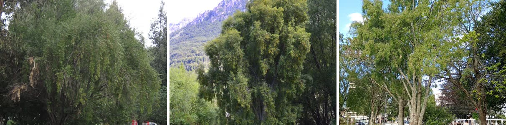
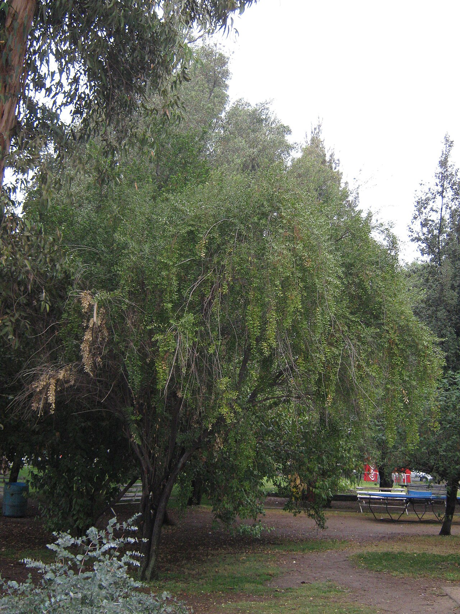
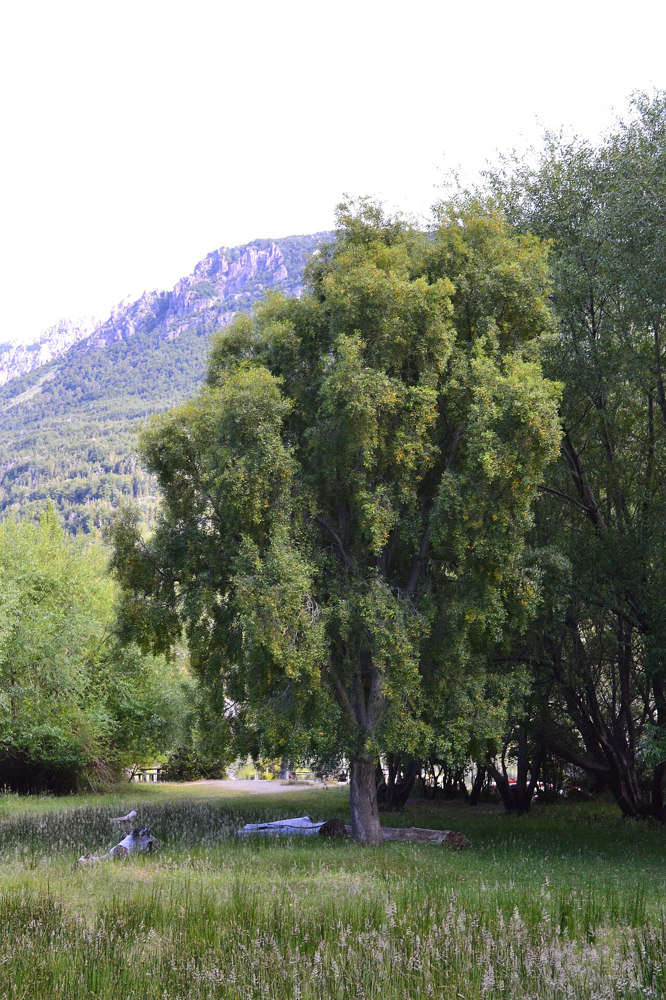
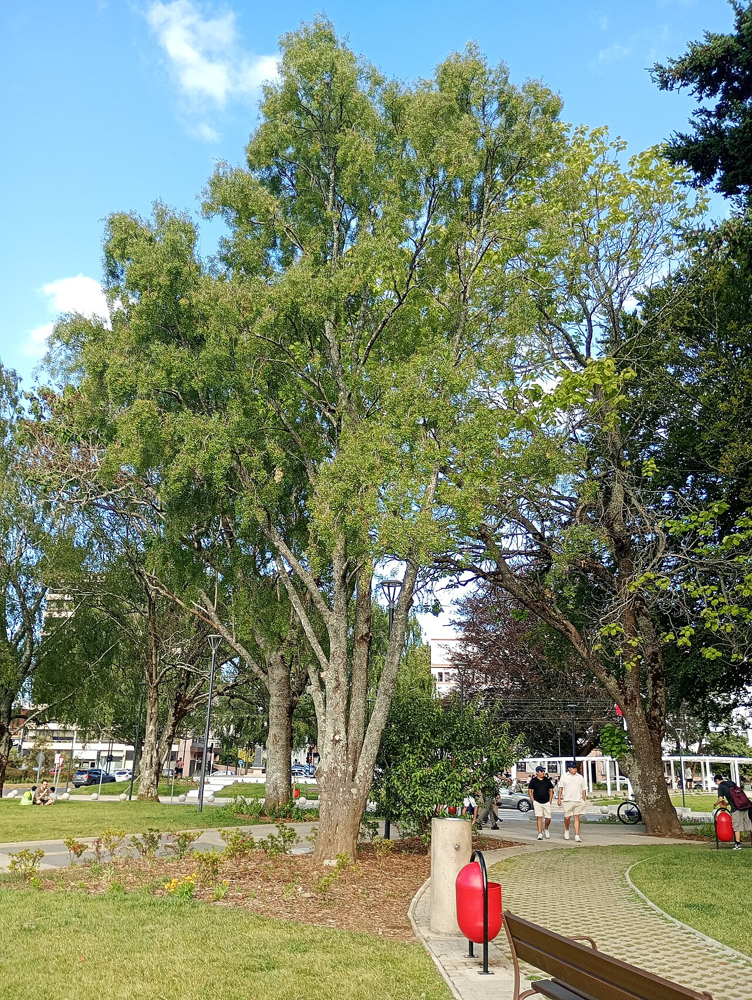

# Maitén (*Maytenus boaria*)

Familia Celastraceae. **Perenne.** Árbol de copa redonda con ramillas colgantes, como un sauce llorón pequeño y siempreverde. Aparece en el ecotono, en praderas y bordes de chacra, y es forraje apreciado por el ganado.

[Índice](../README.md) · [Contexto regional](../00-contexto-sma-bariloche.md) · [Generación de assets](../generacion-de-assets.md)

## Ficha rápida

| Rasgo | Valor |
| --- | --- |
| Altura | 10–20 m en estado silvestre (hasta 24 m citado); tronco de hasta 80 cm |
| Copa | Globosa, densa, redondeada, con **ramas delgadas y colgantes** |
| Hojas | Perennes, simples, alternas, ovado-lanceoladas, 3–9 cm, verde claro, borde aserrado |
| Flores | Pequeñas y poco vistosas |
| Fruto | Cápsula pequeña (4–5 mm) con semilla de arilo rojo o rojo anaranjado |
| Distribución | De Córdoba a Tierra del Fuego, con mayor desarrollo en la Patagonia |
| Hábitat | Bosques xerófilos del borde oriental de la cordillera; ecotono |

## Dónde verlo

- **Bariloche**: ecotono entre el ciprés y la lenga o el coihue, donde aparece con el maqui. ([Revista ADBiA](https://revistas.unc.edu.ar/index.php/revistaadbia/article/download/40363/40610/150911)) Bordes de la estepa, chacras y orillas de arroyo al este.
- **San Martín de los Andes**: valles del este, Meliquina, bordes de pradera. Una nota local lo describe como especie nativa que acompaña los paisajes cordilleranos. ([Noticias NQN](https://www.noticiasnqn.com.ar/noticias/2026/08/19/348706-el-maiten-una-especie-nativa-que-acompana-los-paisajes-cordilleranos))
- Roig lo ubica entre los bosques xerófilos del borde oriental. ([González Loyarte, UNCuyo](https://bdigital.uncu.edu.ar/objetos_digitales/3874/gonzalez-loyarte.pdf))

## Rasgos visuales

**Copa.** Globosa y densa, de hasta 20 m. ([Noticias NQN](https://www.noticiasnqn.com.ar/noticias/2026/08/19/348706-el-maiten-una-especie-nativa-que-acompana-los-paisajes-cordilleranos)) Redondeada y frondosa, con ramas colgantes. ([Currículum Nacional Chile](https://www.curriculumnacional.cl/estudiante/621/articles-254396_recurso_pdf.pdf)) Largas ramillas cuelgan de las ramas y recuerdan a un sauce llorón. ([Cal Poly SelecTree](https://selectree.calpoly.edu/tree-detail/925), [Hillier](https://trees.hillier.co.uk/trees/maytenus-boaria/))

**Hojas.** Angostas, de verde claro a medio, con borde aserrado. Siempreverdes. ([Reforestemos](https://www.reforestemos.org/content/uploads/maiten-13.pdf))

**Fruto.** Pequeño detalle rojo: el arilo de la semilla es rojo o anaranjado. ([NZ Flora](https://nzflora.info/factsheet/Taxon/Maytenus-boaria.html)) A la escala del juego no se ve; puede omitirse.

**Lectura a distancia.** Una cúpula verde claro, suave, aislada en la pradera o en el borde de un camino, que contrasta con el cono oscuro del ciprés.

## Para el asset

- **Silueta**: cúpula redonda de 2–3 lóbulos y un "flequillo" de tiras verticales colgando del borde (planos o tubos finos).
- **Color**: `#8DA457` con sombra `#5F7A3A`, tronco corto gris `#6A665E`.
- **Viento**: el que más se mueve después de la caña colihue. Las tiras colgantes deben tener peso de viento alto.
- **Distribución**: aislado o en pares en praderas del ecotono, bordes de chacra y arroyos del este.

## Imágenes

<!-- GALERIA:maiten -->

Imágenes de Wikimedia Commons con licencia libre, guardadas en [`imagenes/maiten/`](../imagenes/maiten/). Las marcadas con 📍 fueron tomadas en Argentina o en la Patagonia según su descripción.

*Maytenus boaria ex hortus Campus sn. Joaquín P. U. Católica de Chile, Santiago*  
Penarc · [CC BY-SA 3.0](https://creativecommons.org/licenses/by-sa/3.0) · [ficha en Commons](https://commons.wikimedia.org/wiki/File:Maytenus_penarc_001.JPG)

*Maitén tree*  
watsilchum · [CC BY-SA 3.0](https://creativecommons.org/licenses/by-sa/3.0) · [ficha en Commons](https://commons.wikimedia.org/wiki/File:Mait%C3%A9n_tree_-_panoramio.jpg)

*Árbol maduro de la especie Maytenus boaria (Maitén) en Plaza Chile.*  
Pdassori · [CC BY-SA 4.0](https://creativecommons.org/licenses/by-sa/4.0) · [ficha en Commons](https://commons.wikimedia.org/wiki/File:MaytenusBoaria_PlzChileValdivia.jpg)

<!-- /GALERIA -->
## Fuentes

- [Reforestemos, maitén](https://www.reforestemos.org/content/uploads/maiten-13.pdf) · [landing](https://reforestemos.org/landings/maiten)
- [Currículum Nacional Chile, maitén](https://www.curriculumnacional.cl/estudiante/621/articles-254396_recurso_pdf.pdf)
- [Noticias NQN, el maitén en los paisajes cordilleranos](https://www.noticiasnqn.com.ar/noticias/2026/08/19/348706-el-maiten-una-especie-nativa-que-acompana-los-paisajes-cordilleranos)
- [González Loyarte, bosques de maitén en Mendoza (UNCuyo)](https://bdigital.uncu.edu.ar/objetos_digitales/3874/gonzalez-loyarte.pdf)
- [Wikipedia, *Maytenus boaria*](https://en.wikipedia.org/wiki/Maytenus_boaria)
- [Kew POWO, *Maytenus boaria*](https://powo.science.kew.org/taxon/urn:lsid:ipni.org:names:161827-1/general-information)
- [Cal Poly SelecTree, mayten](https://selectree.calpoly.edu/tree-detail/925) · [Hillier](https://trees.hillier.co.uk/trees/maytenus-boaria/)
- [NZ Flora, *Maytenus boaria*](https://nzflora.info/factsheet/Taxon/Maytenus-boaria.html)
- [iNaturalist, Maytenus boaria](https://www.inaturalist.org/taxa/Maytenus-boaria) · [Wikimedia Commons](https://commons.wikimedia.org/wiki/Category:Maytenus_boaria)
