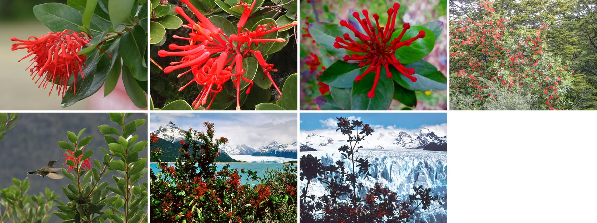
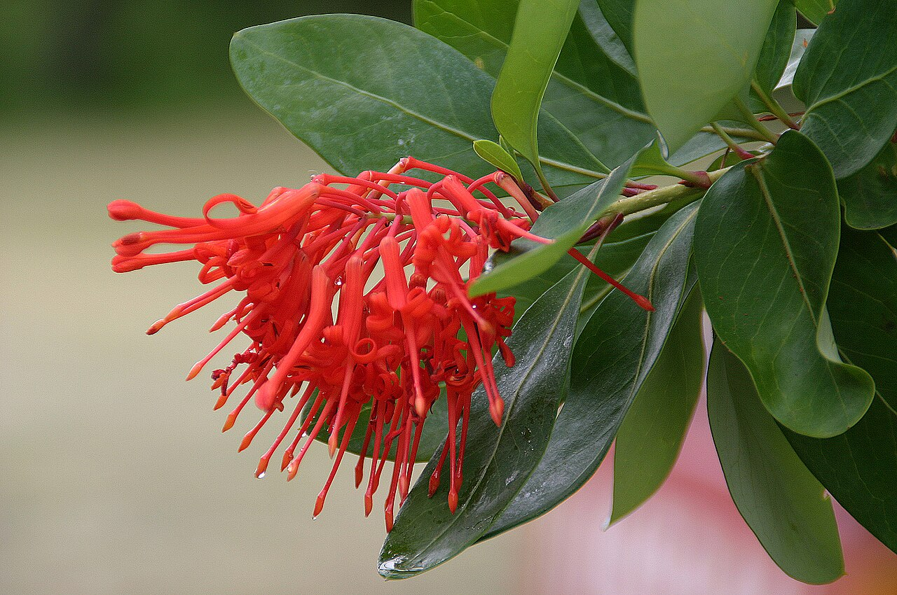
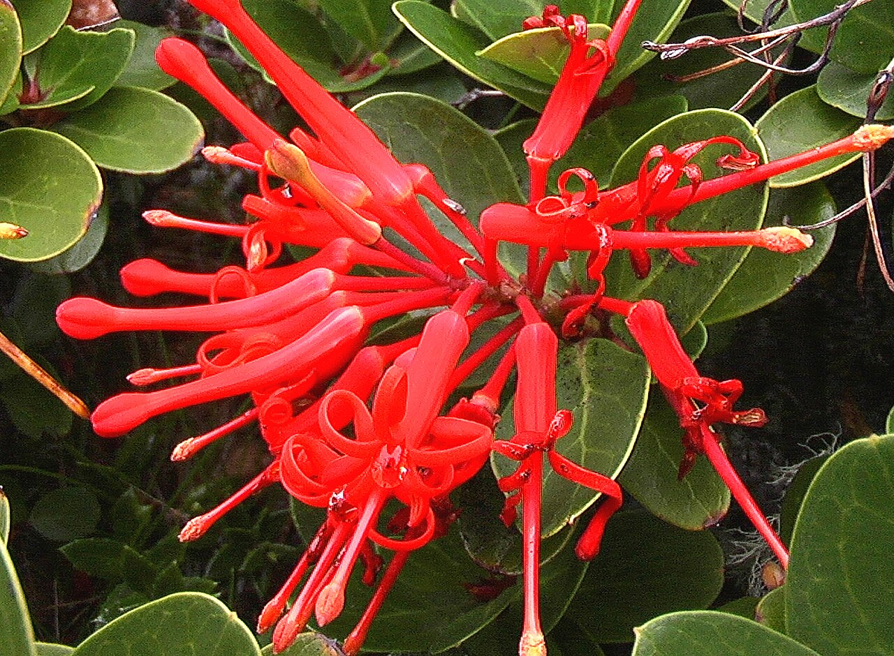
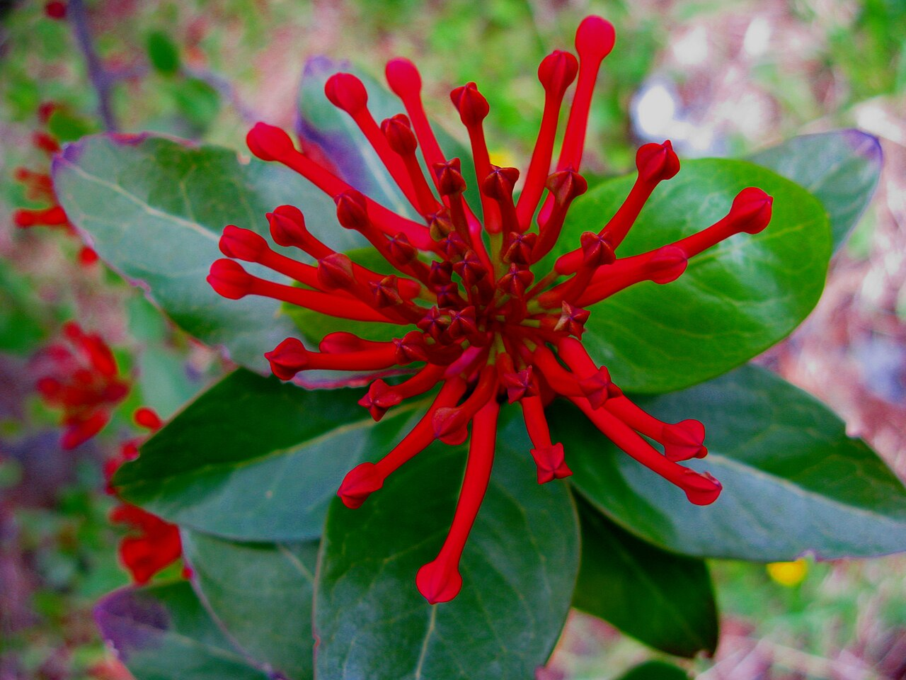
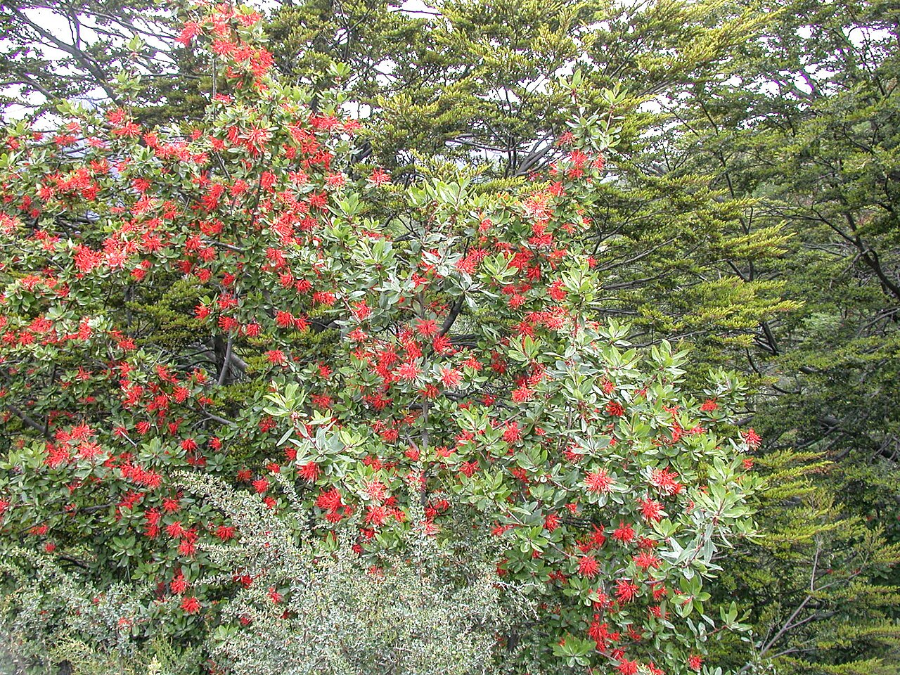
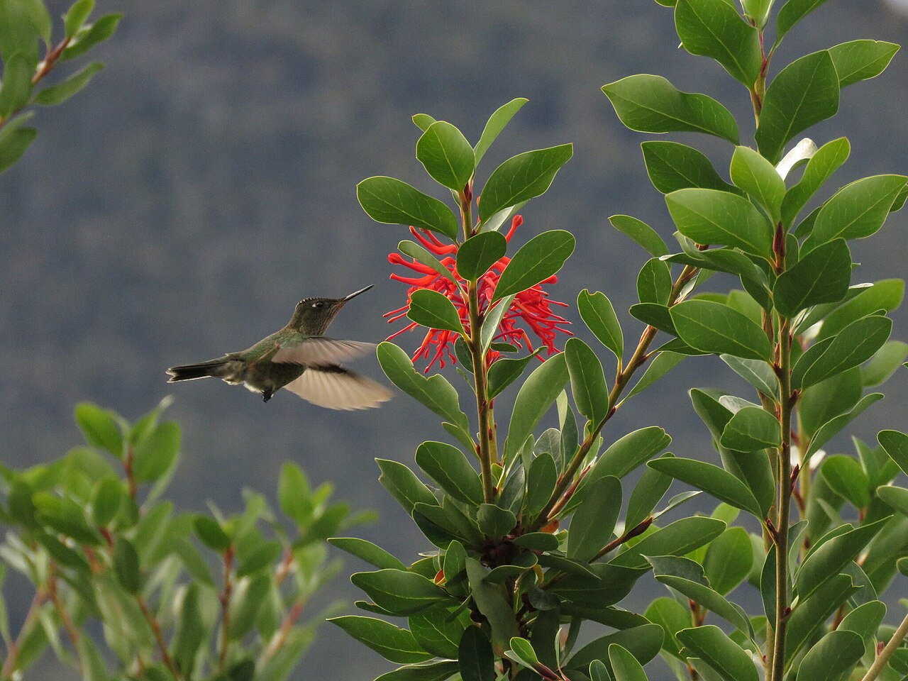
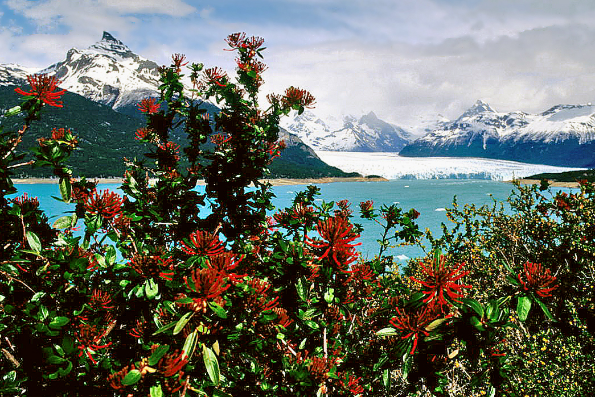

# Notro o ciruelillo (*Embothrium coccineum*)

Familia Proteaceae. También notro, ciruelillo o *Chilean firebush*. **Perenne** en la zona (pierde hojas con heladas fuertes, por debajo de −7 °C). Arbolito de flores **rojo bermellón** que marca la primavera en los bordes del bosque. Es pionero después de incendios y derrumbes.

[Índice](../README.md) · [Contexto regional](../00-contexto-sma-bariloche.md) · [Generación de assets](../generacion-de-assets.md)

## Ficha rápida

| Rasgo | Valor |
| --- | --- |
| Altura | 4–8 m frecuente; formas de 8–15 m; registros de hasta 20 m |
| Porte | Arbusto erguido o arbolito, a menudo multitronco y con rebrotes |
| Hojas | Coriáceas, lanceoladas a oblongas, hasta ≈ 10 cm, verde oscuro, muy variables |
| Flores | Tubulares, rojo anaranjado brillante, 4 lóbulos recurvados, en racimos en las axilas, sobre todo arriba |
| Floración | Septiembre a enero según altitud; pico en noviembre y diciembre |
| Polinizadores | Picaflor rubí, moscas de probóscide larga y abejas |
| Hábitat | Claros, bordes de bosque y de camino; áreas incendiadas o derrumbadas |

## Dónde verlo

- **Bariloche**: bordes de ruta (Circuito Chico, camino a Llao Llao y a Catedral), claros, laderas en regeneración. Un estudio de Bariloche lo ubica en áreas abiertas y bordes de bosque y caminos. ([Devoto y Medan 2006](https://www.agro.uba.ar/users/mdevoto/Devoto&Medan2006b.pdf))
- **San Martín de los Andes**: bordes de bosque del Lácar, caminos hacia Chapelco y Hua Hum.
- Está entre las flores que más visita el picaflor rubí en el Nahuel Huapi. ([El Hornero](https://elhornero.avesargentinas.org.ar/index.php/home/article/download/967/942))

## Rasgos visuales

**Flor.** Lo que hay que mostrar. Racimos de flores tubulares rojo anaranjado brillante, con 4 lóbulos que se enrollan hacia atrás, en las axilas de las hojas y concentrados en la parte alta de la copa. ([World Plants](https://www.worldplants.ca/display.php?id=3431)) Durante noviembre y diciembre, el notro "tiñe de rojo fuego" los bordes del bosque. ([Meteored](https://www.meteored.cl/noticias/plantas/cada-noviembre-un-arbol-tine-de-rojo-fuego-la-patagonia-por-una-sorprendente-razon.html))

**Porte.** Arbusto erguido o arbolito de hojas coriáceas lanceoladas, a menudo con varios troncos por rebrote. ([RHS](https://www.rhs.org.uk/plants/6346/wd/details)) Copa rala, angosta y algo irregular. Corteza lisa, descrita como rojiza en una fuente argentina. ([Patagonia-ar](https://patagonia-ar.com/pages/notro))

**Fenología por altura.** Florece de septiembre a enero; cuanto más alto, más tarde. ([Patagonia-ar](https://patagonia-ar.com/pages/notro)) En un mapa con relieve, el rojo puede "subir" por la ladera a lo largo de la estación.

**Ecología.** Es pionero en la regeneración natural de áreas devastadas por incendios, derrumbes y otras alteraciones. ([Reforestemos](https://www.reforestemos.org/content/uploads/notro-47.pdf)) En Chile se propone como planta nodriza para regenerar lenga en bosques quemados. ([Revistas Chilenas](https://revistaschilenas.uchile.cl/handle/2250/195095))

## Para el asset

- **Silueta**: tronco delgado (o 2–3 troncos) y copa rala, angosta, de 3–4 lóbulos.
- **Variante** `notro_flor`: 30–50 % de los vértices de los lóbulos superiores en rojo `#D2321E` con algo de `#E8552A`. Fuera de la floración, follaje `#2F4526`.
- **Distribución**: borde entre bosque y claro, costados de camino, tiles "quemados" en regeneración (junto a troncos secos grises).
- **Animación**: posible picaflor como partícula en primer plano.

## Imágenes

<!-- GALERIA:notro -->

Imágenes de Wikimedia Commons con licencia libre, guardadas en [`imagenes/notro/`](../imagenes/notro/). Las marcadas con 📍 fueron tomadas en Argentina o en la Patagonia según su descripción.

📍 *The Chilean fire tree (Embothrium coccineum) is 4 to 15 m high and can reach a diameter of 60 cm. It grows in Chile and Argentina.*  
W. Bulach · [CC BY-SA 4.0](https://creativecommons.org/licenses/by-sa/4.0) · [ficha en Commons](https://commons.wikimedia.org/wiki/File:00_2621_Chilenische_Feuerbaum_(Embothrium_coccineum).jpg)

📍 *Chilean Firetree (Embothrium coccineum) Tierra del Fuego, near Ushuaia, Argentina. Photographed on 5 January 2004*  
Arthur Chapman · [CC BY 2.0](https://creativecommons.org/licenses/by/2.0) · [ficha en Commons](https://commons.wikimedia.org/wiki/File:Embothrium_coccineum_(1).jpg)

📍 *Close-up on a flower of Embothrium coccineum, J. R. Forst. & G.Forst. 1775. The picture was taken in Tierra del Fuego National Park, Tierra del Fuego, Argentina.*  
Butterfly austral · [CC BY-SA 3.0](https://creativecommons.org/licenses/by-sa/3.0) · [ficha en Commons](https://commons.wikimedia.org/wiki/File:Parcnatioanaldelaterredefeunotro.jpg)

📍 *Embothrium coccineum, Los Glaciares National Park, Argentina*  
Ron Knight from Seaford, East Sussex, United Kingdom · [CC BY 2.0](https://creativecommons.org/licenses/by/2.0) · [ficha en Commons](https://commons.wikimedia.org/wiki/File:Embothrium_coccineum,_Los_Glaciares_National_Park_1.jpg)

📍 *Photo of Green-backed Firecrown (undefined) uploaded from iNaturalist.*  
no rights reserved · [CC0](http://creativecommons.org/publicdomain/zero/1.0/deed.en) · [ficha en Commons](https://commons.wikimedia.org/wiki/File:Green-backed_Firecrown,_Ushuaia,_Tierra_del_Fuego,_Argentina_imported_from_iNaturalist_photo_362459841.jpg)

📍 *Flowering notro or ciruelillo (Embothrium coccineum) in front of Perito Moreno Glacier, Lago Argentino Department, Santa Cruz, Argentina*  
LBM1948 · [CC BY-SA 4.0](https://creativecommons.org/licenses/by-sa/4.0) · [ficha en Commons](https://commons.wikimedia.org/wiki/File:Perito_Moreno_1994_01.jpg)

📍 *Flowering notro or ciruelillo (Embothrium coccineum) in front of Perito Moreno Glacier, Lago Argentino Department, Santa Cruz, Argentina*  
LBM1948 · [CC BY-SA 4.0](https://creativecommons.org/licenses/by-sa/4.0) · [ficha en Commons](https://commons.wikimedia.org/wiki/File:Perito_Moreno_1994_07.jpg)

<!-- /GALERIA -->
## Fuentes

- [Patagonia-ar, notro (con acuarela)](https://patagonia-ar.com/pages/notro)
- [Meteored, cada noviembre un árbol tiñe de rojo la Patagonia](https://www.meteored.cl/noticias/plantas/cada-noviembre-un-arbol-tine-de-rojo-fuego-la-patagonia-por-una-sorprendente-razon.html)
- [Reforestemos, notro](https://www.reforestemos.org/content/uploads/notro-47.pdf)
- [Desde la Patagonia nº 2 (UNCo)](https://desdelapatagonia.uncoma.edu.ar/wp-content/uploads/2019/11/Revista-N2-Completa.pdf)
- [Devoto y Medan 2006, polinización en Bariloche](https://www.agro.uba.ar/users/mdevoto/Devoto&Medan2006b.pdf)
- [El Hornero, picaflor rubí en el Nahuel Huapi](https://elhornero.avesargentinas.org.ar/index.php/home/article/download/967/942)
- [Notro como nodriza de lenga en bosques quemados](https://revistaschilenas.uchile.cl/handle/2250/195095)
- [Redalyc, polinización de *Embothrium*](https://www.redalyc.org/pdf/3699/369944278008.pdf)
- [RHS, *Embothrium coccineum*](https://www.rhs.org.uk/plants/6346/wd/details) · [World Plants](https://www.worldplants.ca/display.php?id=3431)
- [Wikipedia, *Embothrium coccineum*](https://en.wikipedia.org/wiki/Embothrium_coccineum)
- [iNaturalist, Embothrium coccineum](https://www.inaturalist.org/taxa/Embothrium-coccineum) · [Wikimedia Commons](https://commons.wikimedia.org/wiki/Category:Embothrium_coccineum)
