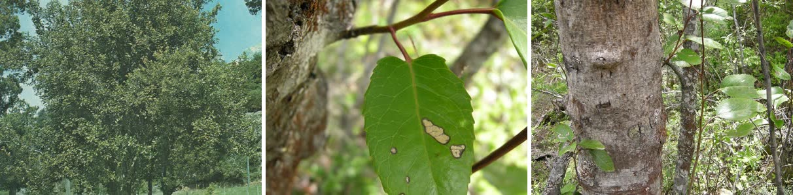
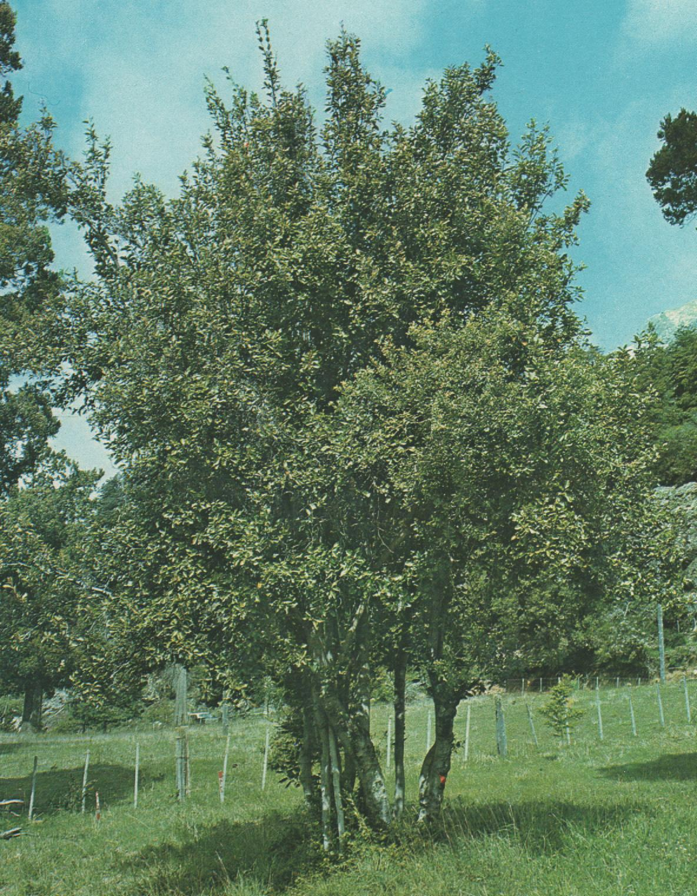
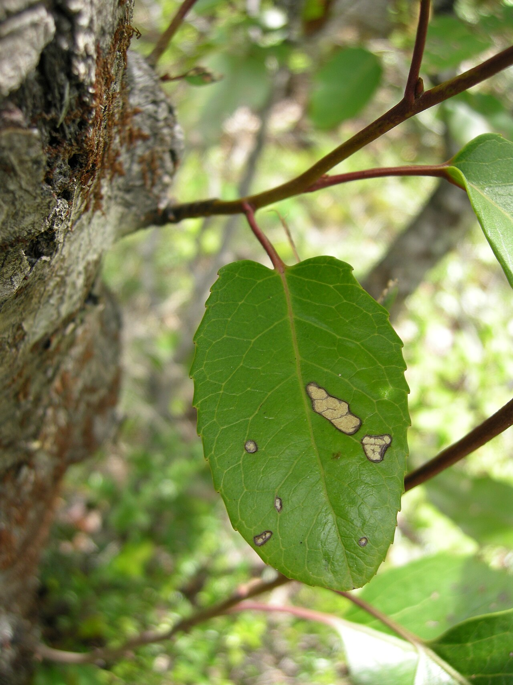
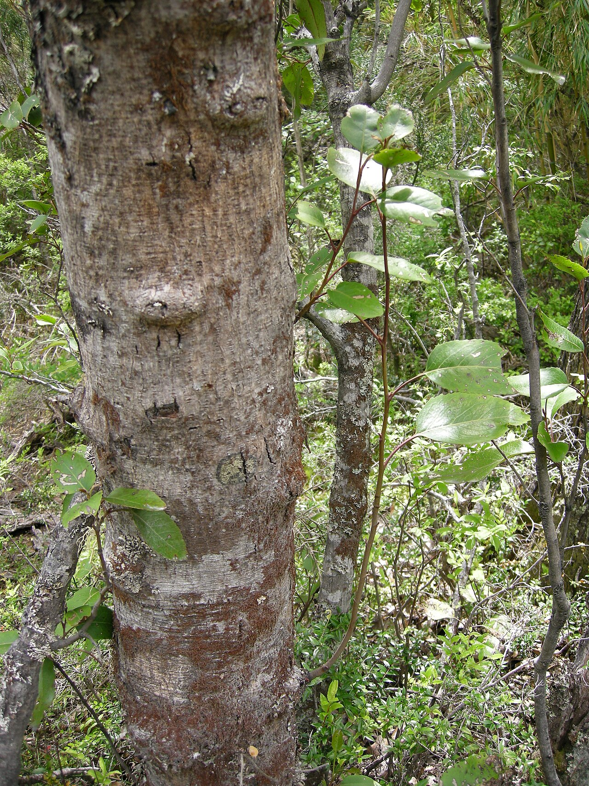

# Radal (*Lomatia hirsuta*)

Familia Proteaceae, como el notro. **Perenne.** Arbolito de hojas grandes y duras, típico de los matorrales del ecotono junto al ñire. Su flor crema da una miel apreciada en el sur de Neuquén.

[Índice](../README.md) · [Contexto regional](../00-contexto-sma-bariloche.md) · [Generación de assets](../generacion-de-assets.md)

## Ficha rápida

| Rasgo | Valor |
| --- | --- |
| Altura | Hasta 15 m; tronco de hasta 0,9 m (en el ecotono, mucho más bajo) |
| Corteza | Delgada, gris a pardo oscura, algo rugosa, con fisuras longitudinales |
| Hojas | Duras, entre las más grandes de los árboles de la región (hasta 15 cm o más); ovadas, base cordada, borde aserrado, verde oscuro brillante arriba y mate abajo |
| Flores | Pequeñas, crema o blanco verdoso, en racimos laxos; cubiertas de un vello rojizo |
| Floración | Octubre y noviembre en el sur de Neuquén |
| Fruto | Folículo gris negruzco casi leñoso, 2–4 cm, de dos valvas |
| Hábitat | Matorrales del ecotono, laderas secas, bordes de bosque |

## Dónde verlo

- **Bariloche**: borde oriental del bosque, en el mosaico de ciprés, matorral de ñire y radal, y estepa. ([Fuentes, aacademica](https://www.aacademica.org/ricardo.daniel.fuentes/6.pdf)) Matorrales mixtos con ñire, laura y retamo. ([INTA](https://repositorio.inta.gob.ar/handle/20.500.12123/14974?show=full))
- **San Martín de los Andes**: hay registros fotográficos en la ciudad y en el Jardín Botánico Lácar. ([EcoRegistros](https://ecoregistros.org/site_en/imagen.php?id=450015), [iNaturalist](https://www.inaturalist.org/identifications/mmore))

## Rasgos visuales

**Hojas.** Grandes, duras y brillantes, de borde aserrado. ([Currículum Nacional Chile](https://curriculumnacional.cl/estudiante/621/articles-254331_recurso_pdf.pdf), [Reforestemos](https://www.reforestemos.org/content/uploads/radal.pdf)) Las hojas juveniles pueden ser mucho más grandes que las adultas. ([NYBG](https://sweetgum.nybg.org/science/vh/monographs-details/?irn=19562)) A distancia, una copa verde oscuro brillante y de textura gruesa, distinta de la hoja diminuta del ñire que suele tener al lado.

**Flores.** Racimos laxos de blanco verdoso que atraen muchos insectos. ([RBGE Stories](https://stories.rbge.org.uk/?p=24769)) Flores verde amarillentas cubiertas de un vello rojizo. ([Earth.com](https://earth.com/plant-encyclopedia/Angiosperms/Proteaceae/lomatia-hirsuta/en/)) Florece en octubre y noviembre en el sur de Neuquén. ([MAGyP, miel de radal](https://www.magyp.gob.ar/apicultura/_pdf/Miel%20de%20Radal%20-%20Patagonia.pdf))

**Fruto.** Folículos gris negruzcos, casi leñosos, que quedan en el árbol. ([Wikipedia](https://en.wikipedia.org/wiki/Lomatia_hirsuta))

**Corteza.** Delgada, gris a parda oscura, algo rugosa y con fisuras longitudinales. ([Reforestemos](https://www.reforestemos.org/content/uploads/radal.pdf))

## Para el asset

- **Silueta**: arbolito bajo con copa irregular y abierta de 3–5 lóbulos, con un hueco central. A veces multitronco.
- **Color**: `#33502A` con brillo `#55703C`. Variante de primavera con puntos crema `#E6DDB8`.
- **Distribución**: matorral del ecotono junto al ñire, laderas secas, bordes de camino. En grupos mixtos de 3–6 plantas.

## Imágenes

<!-- GALERIA:radal -->

Imágenes de Wikimedia Commons con licencia libre, guardadas en [`imagenes/radal/`](../imagenes/radal/). Las marcadas con 📍 fueron tomadas en Argentina o en la Patagonia según su descripción.

📍 *Ejemplar de Lomatia hirsuta, en Argentina.*  
Jorge Vallmitjana · Public domain · [ficha en Commons](https://commons.wikimedia.org/wiki/File:Lomatia_hirsuta.jpg)

📍 *Leave of Lomatia hirsuta. Picture taken in Los Alerces National Park (Chubut province, Argentina).*  
Gagea · [CC BY-SA 3.0](https://creativecommons.org/licenses/by-sa/3.0) · [ficha en Commons](https://commons.wikimedia.org/wiki/File:Lomatia_hirsuta_-_leave_-_01.JPG)

📍 *Trunk and branch of Lomatia hirsuta. Picture taken in Los Alerces National Park (Chubut province, Argentina).*  
Gagea · [CC BY-SA 3.0](https://creativecommons.org/licenses/by-sa/3.0) · [ficha en Commons](https://commons.wikimedia.org/wiki/File:Lomatia_hirsuta_-_trunk_and_branch_-_01.JPG)

<!-- /GALERIA -->
## Fuentes

- [Reforestemos, radal](https://www.reforestemos.org/content/uploads/radal.pdf)
- [Currículum Nacional Chile, radal](https://curriculumnacional.cl/estudiante/621/articles-254331_recurso_pdf.pdf)
- [MAGyP, miel de radal en la Patagonia](https://www.magyp.gob.ar/apicultura/_pdf/Miel%20de%20Radal%20-%20Patagonia.pdf)
- [NYBG, monografía de *Lomatia hirsuta*](https://sweetgum.nybg.org/science/vh/monographs-details/?irn=19562)
- [RBGE Stories, *Lomatia hirsuta*](https://stories.rbge.org.uk/?p=24769)
- [Wikipedia, *Lomatia hirsuta*](https://en.wikipedia.org/wiki/Lomatia_hirsuta)
- [Earth.com, *Lomatia hirsuta*](https://earth.com/plant-encyclopedia/Angiosperms/Proteaceae/lomatia-hirsuta/en/)
- [EcoRegistros, radal en San Martín de los Andes](https://ecoregistros.org/site_en/imagen.php?id=450015)
- [Etnofarmacología del radal (PMC)](https://www.ncbi.nlm.nih.gov/pmc/articles/PMC1564040/)
- [iNaturalist, Lomatia hirsuta](https://www.inaturalist.org/taxa/Lomatia-hirsuta) · [Wikimedia Commons](https://commons.wikimedia.org/wiki/Category:Lomatia_hirsuta)
