# Galería de paisajes y acompañantes

Fotos reales de San Martín de los Andes, Bariloche y alrededores, y de las especies acompañantes. Todas son de Wikimedia Commons con licencia libre.

[Volver al índice](README.md)

## Paisajes de referencia

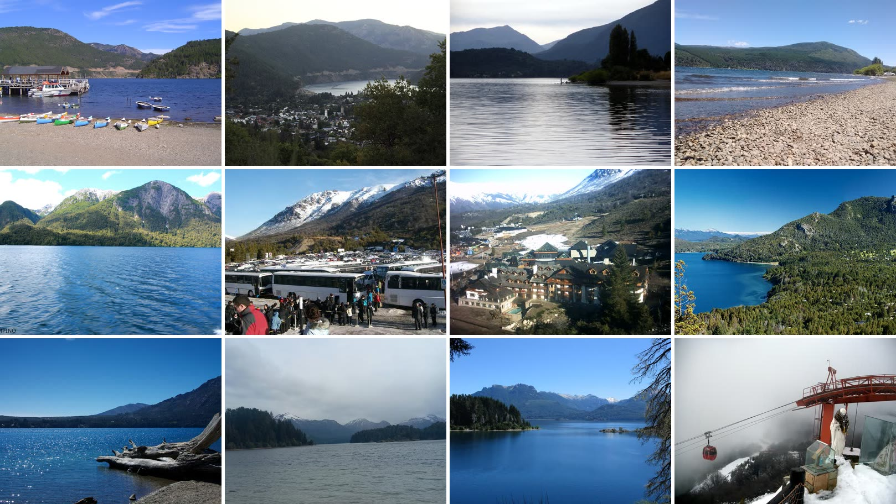

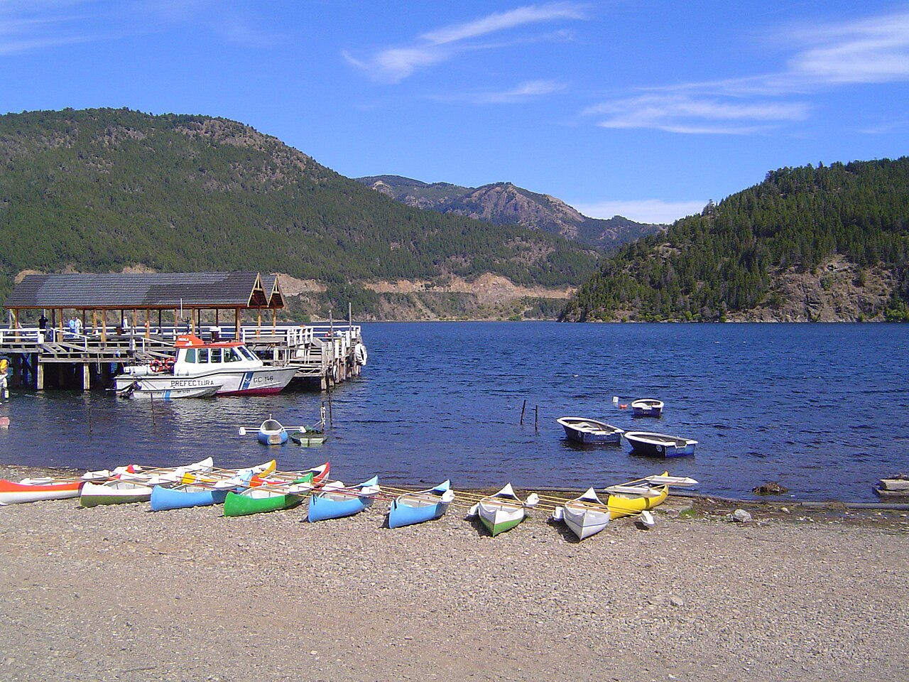

*Costa del Lago Lacar, San Martín de los Andes*  
Albasmalko · [CC BY-SA 3.0](http://creativecommons.org/licenses/by-sa/3.0/) · [ficha en Commons](https://commons.wikimedia.org/wiki/File:Costa_del_Lago_Lacar.JPG)

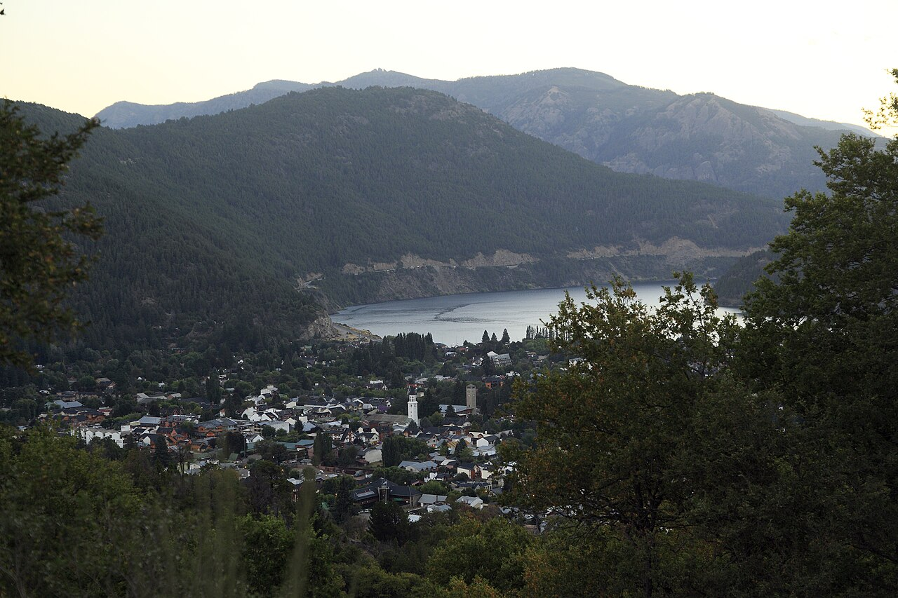

*Vom Aussichtspunkt an der Ruta provincial 48 von Pirihueico, im Hintergrund liegt das Ostende des Lago Lácar mit der Ruta nacionál 40 am Ufer.*  
Falk2 · [CC BY-SA 4.0](https://creativecommons.org/licenses/by-sa/4.0) · [ficha en Commons](https://commons.wikimedia.org/wiki/File:J28_076_San_Mart%C3%ADn_de_los_Andes.jpg)

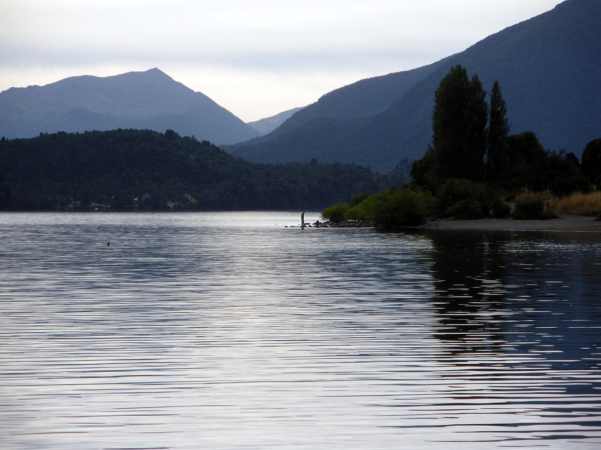

*Vista del Lago Lolog, nei pressi della localitá Lolog, distretto di Junín de Los Andes, provincia di Neuquen, Argentina.*  
Supersuperluis · [CC BY-SA 4.0](https://creativecommons.org/licenses/by-sa/4.0) · [ficha en Commons](https://commons.wikimedia.org/wiki/File:LagoLolog.jpg)

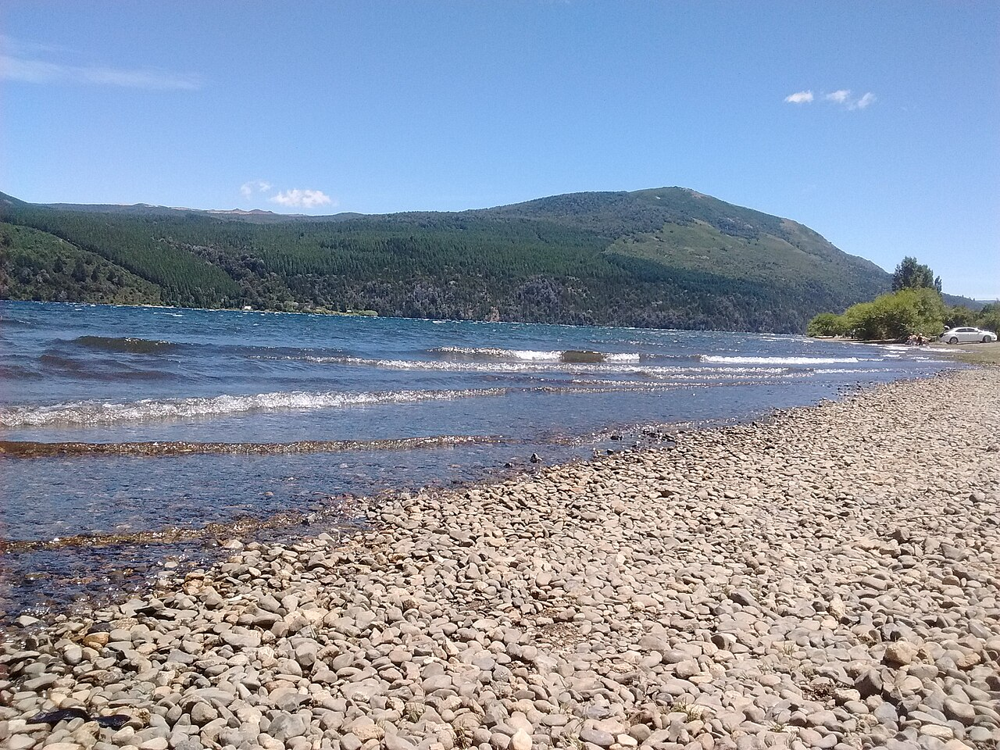

*Vista del lago Lolog desde la costa.*  
Inaragon · [CC BY-SA 3.0](https://creativecommons.org/licenses/by-sa/3.0) · [ficha en Commons](https://commons.wikimedia.org/wiki/File:Lago_Lolog.jpg)

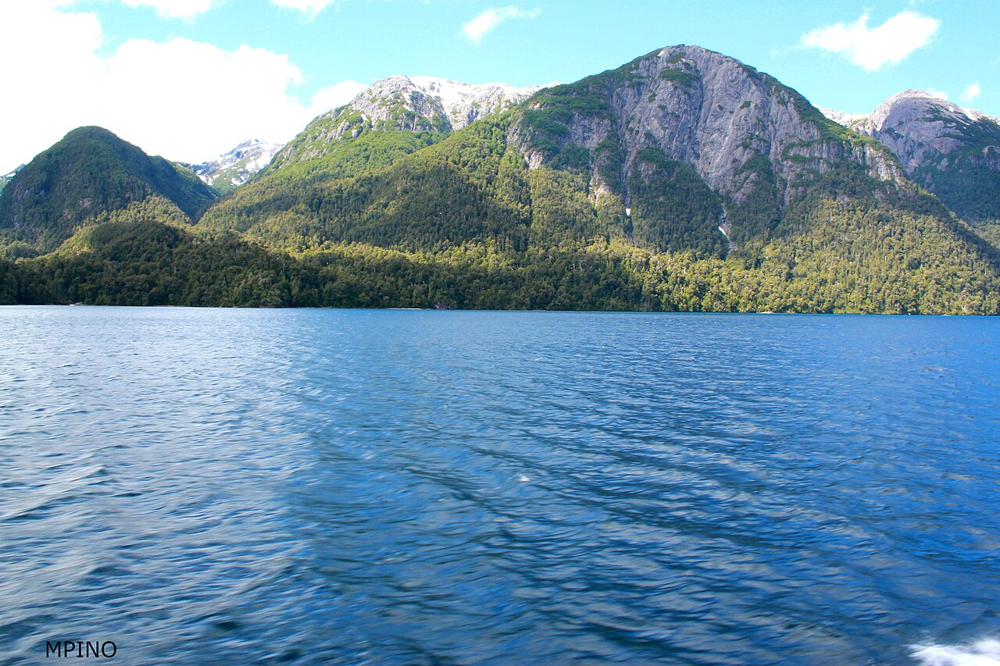

*><((((º>PUERTO BLEST<º))))><*  
Manuel pino · [CC BY-SA 3.0](https://creativecommons.org/licenses/by-sa/3.0) · [ficha en Commons](https://commons.wikimedia.org/wiki/File:)(((((%C2%BA)PUERTO_BLEST(%C2%BA)))))(_-_panoramio.jpg)

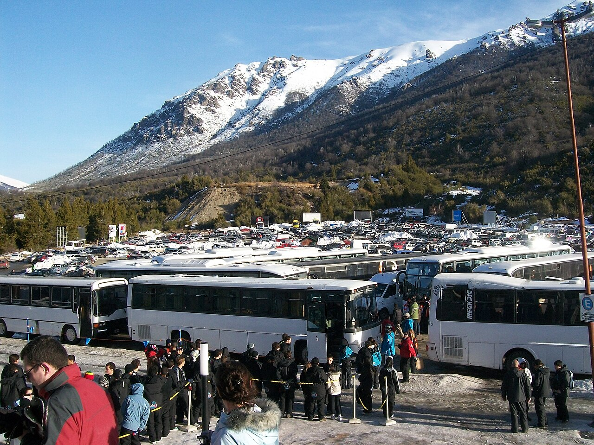

*Base del Cerro Catedral en Bariloche. (Patagonia Argentina)*  
Diego Gabriel · [CC BY-SA 3.0](https://creativecommons.org/licenses/by-sa/3.0) · [ficha en Commons](https://commons.wikimedia.org/wiki/File:100_Base_del_Cerro_Catedral_en_Bariloche._(Patagonia_Argentina)_03.JPG)

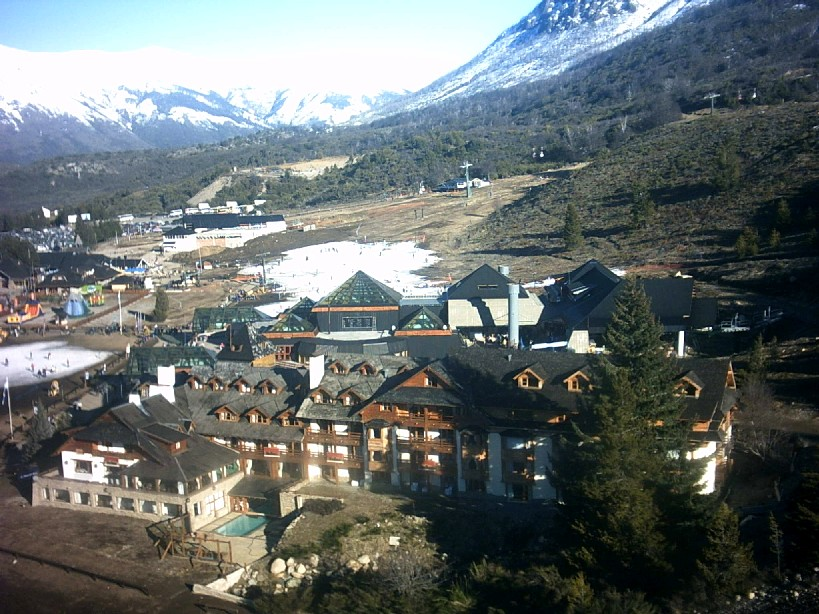

*Bariloche (Argentina). Base del Cerro Catedral*  
Pepe Robles · Public domain · [ficha en Commons](https://commons.wikimedia.org/wiki/File:Bariloche._Base_del_Cerro_Catedral.JPG)

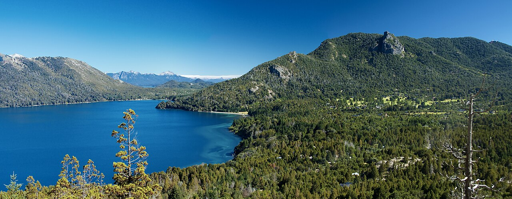

*Argentina - Bariloche 063 - Panorama overlooking Lago Gutiérrez*  
McKay Savage from London, UK · [CC BY 2.0](https://creativecommons.org/licenses/by/2.0) · [ficha en Commons](https://commons.wikimedia.org/wiki/File:Argentina_-_Bariloche_063_-_Panorama_overlooking_Lago_Guti%C3%A9rrez_(6961987935).jpg)

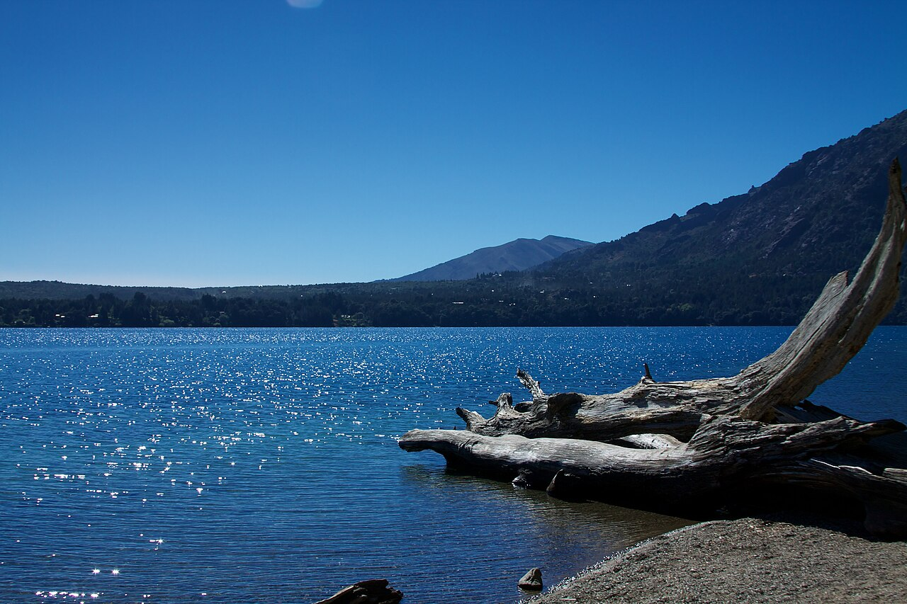

*Before heading up to Frey, we stopped at the lakeside of gorgeous Lago Gutiérrez.*  
McKay Savage from London, UK · [CC BY 2.0](https://creativecommons.org/licenses/by/2.0) · [ficha en Commons](https://commons.wikimedia.org/wiki/File:Argentina_-_Bariloche_068_-_Lago_Guti%C3%A9rrez_(6961991109).jpg)

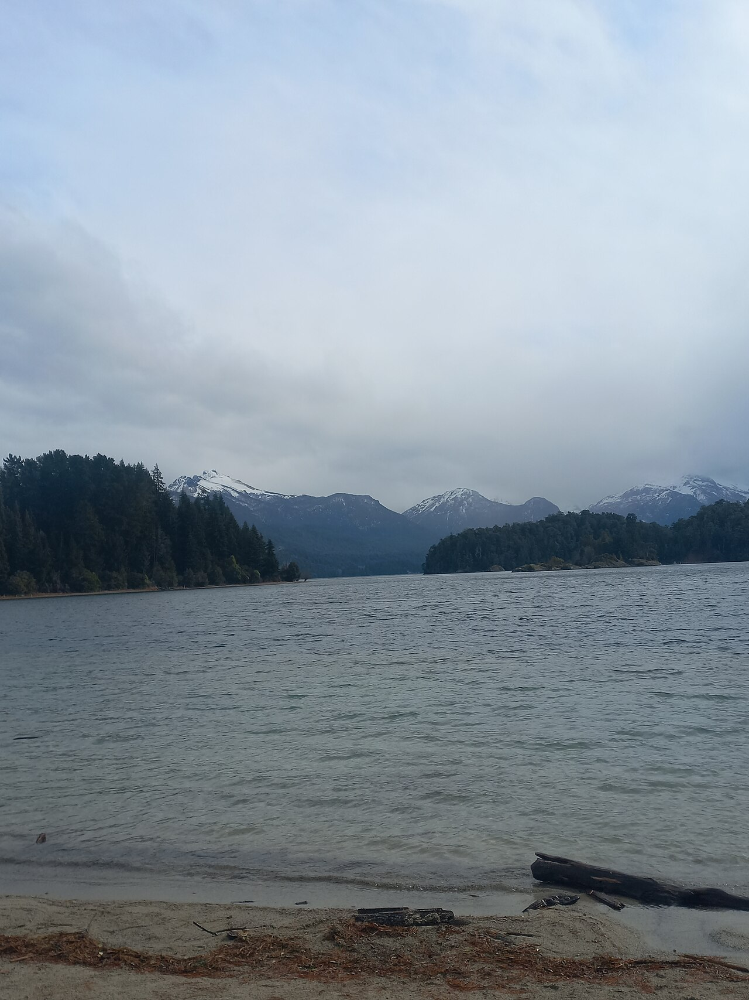

*Foto del Lago Nahuel Huapi tomada desde la costa de Isla Victoria*  
CaroDiStefano · [CC0](http://creativecommons.org/publicdomain/zero/1.0/deed.en) · [ficha en Commons](https://commons.wikimedia.org/wiki/File:Isla_Victoria_Julio_2025.jpg)

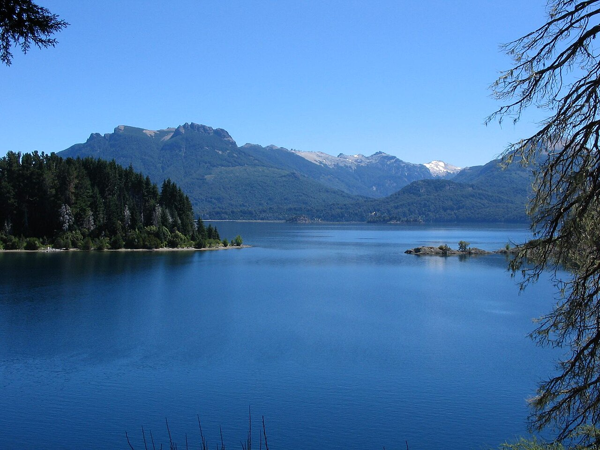

*Lake Nahuel Huapi (Argentina).*  
ramonbaile · [CC BY-SA 2.0](https://creativecommons.org/licenses/by-sa/2.0) · [ficha en Commons](https://commons.wikimedia.org/wiki/File:Isla_Victoria_Lago_Nahuel_Huapi_(2408).jpg)

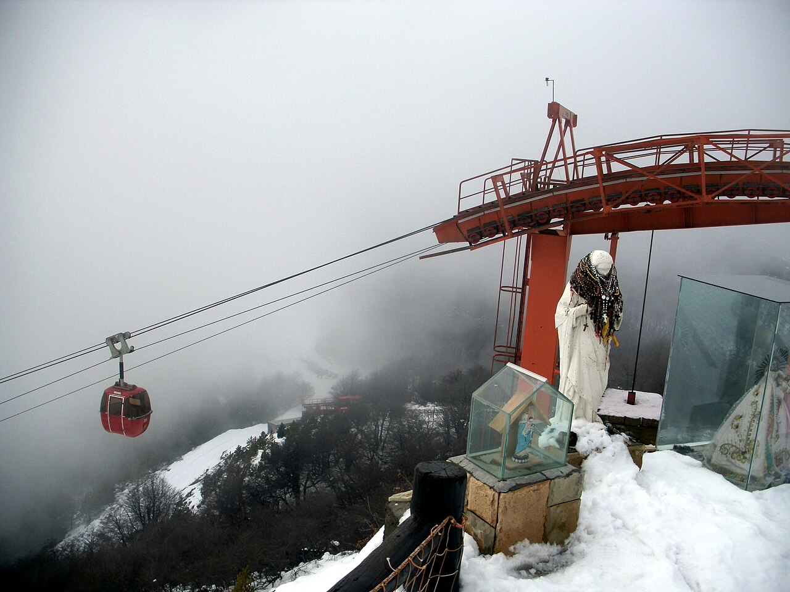

*Sistema de telecabinas que lleva hasta la cima del cerro.*  
Gonce · [CC BY-SA 4.0](https://creativecommons.org/licenses/by-sa/4.0) · [ficha en Commons](https://commons.wikimedia.org/wiki/File:Ascencion_otto.jpg)

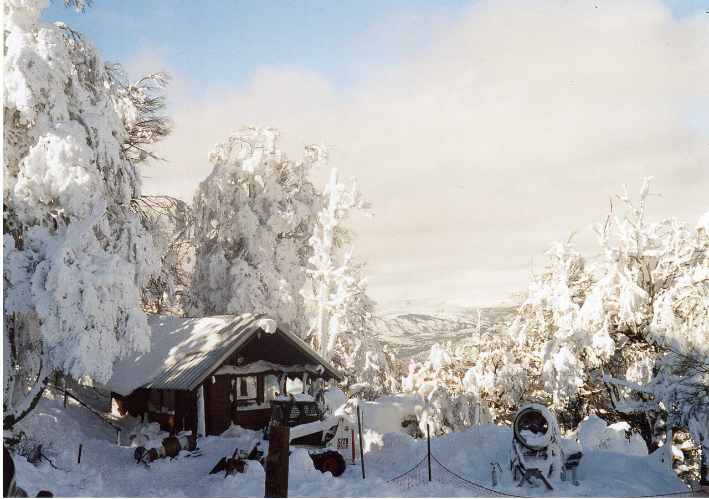

*Cabaña cubierta de nieve en el Cerro Otto, Bariloche, Patagonia Argentina.*  
Mel 23 · [CC BY-SA 3.0](https://creativecommons.org/licenses/by-sa/3.0) · [ficha en Commons](https://commons.wikimedia.org/wiki/File:Caba%C3%B1a_en_Cerro_Otto.jpg)

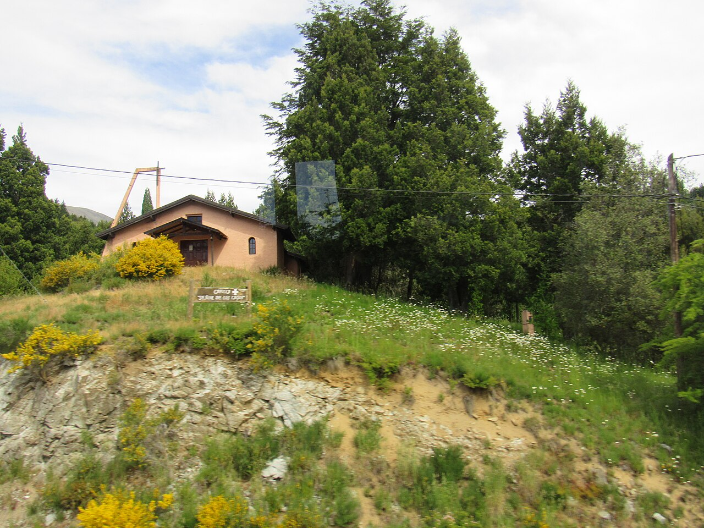

*Capilla Señor de los Lagos de Villa Mascardi a la vera de la ruta 40*  
Jmmuguerza · [CC BY-SA 4.0](https://creativecommons.org/licenses/by-sa/4.0) · [ficha en Commons](https://commons.wikimedia.org/wiki/File:Capilla_Villa_Mascardi.jpg)

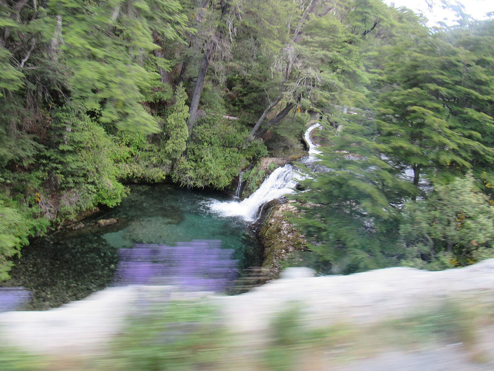

*Cascada Arroyo Guillelmo, que une el Lago Guillelmo con el Lago Mascardi, a la vera de la ruta 40*  
Jmmuguerza · [CC BY-SA 4.0](https://creativecommons.org/licenses/by-sa/4.0) · [ficha en Commons](https://commons.wikimedia.org/wiki/File:Cascada_Arroyo_Guillelmo.jpg)

## Especies acompañantes

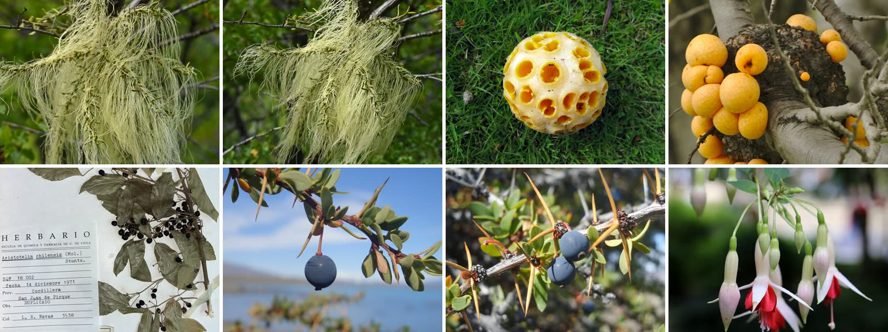

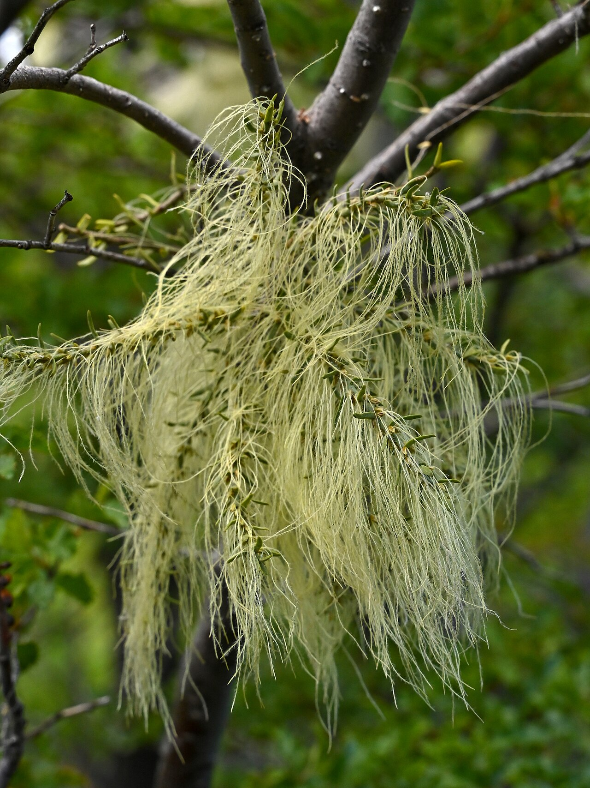

*Misodendrum linearifolium NE from Laguna Puesto Care, Araukania, Chile*  
Krzysztof Ziarnek, Kenraiz · [CC BY 4.0](https://creativecommons.org/licenses/by/4.0) · [ficha en Commons](https://commons.wikimedia.org/wiki/File:Misodendrum_linearifolium_kz01.jpg)

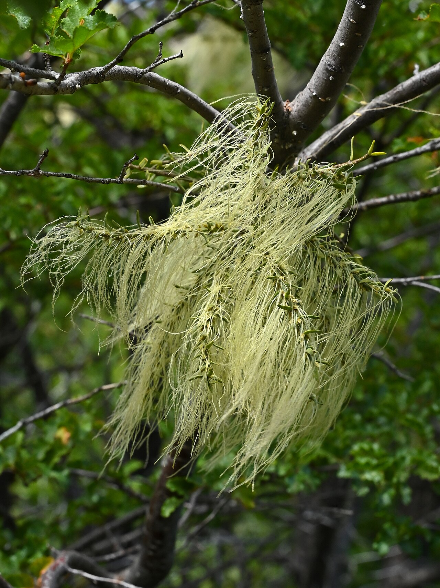

*Misodendrum linearifolium NE from Laguna Puesto Care, Araukania, Chile*  
Krzysztof Ziarnek, Kenraiz · [CC BY 4.0](https://creativecommons.org/licenses/by/4.0) · [ficha en Commons](https://commons.wikimedia.org/wiki/File:Misodendrum_linearifolium_kz02.jpg)

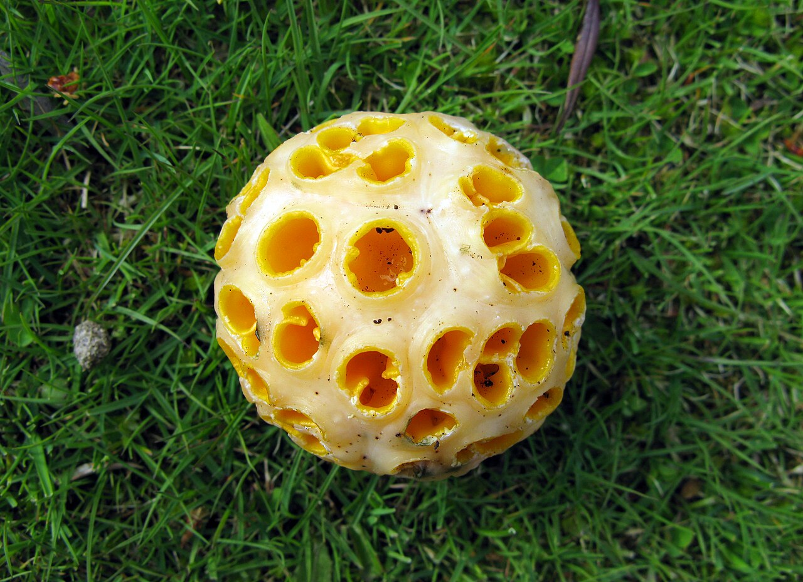

*A Cyttaria hariotii fruiting body.*  
Butterfly austral · [CC BY-SA 3.0](https://creativecommons.org/licenses/by-sa/3.0) · [ficha en Commons](https://commons.wikimedia.org/wiki/File:Cyttaria.fruit.jpg)

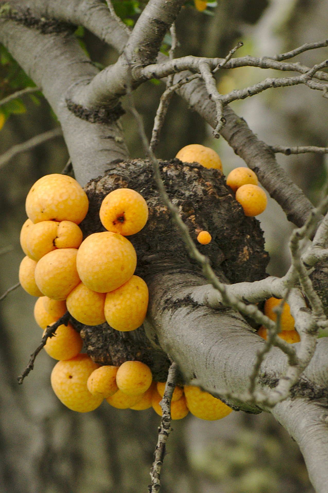

*Cyttaria Darwinii in a tree in Tierra del Fuego*  
Alexander Klink · [CC BY 3.0](https://creativecommons.org/licenses/by/3.0) · [ficha en Commons](https://commons.wikimedia.org/wiki/File:Cyttaria_Darwinii_Tierra_del_Fuego.jpg)

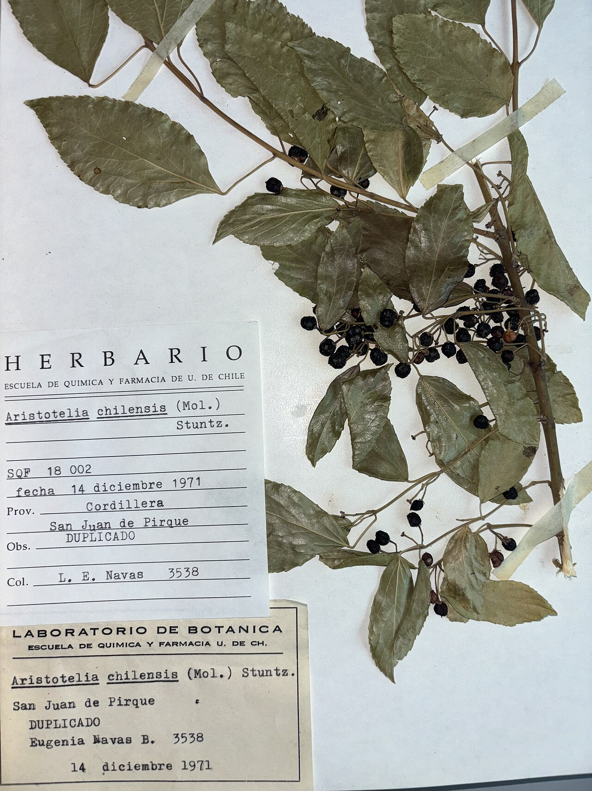

*Muestra de Aristotelia chilensis (Mol.) Stuntz*  
Alejandranantequera · [CC BY 4.0](https://creativecommons.org/licenses/by/4.0) · [ficha en Commons](https://commons.wikimedia.org/wiki/File:Aristotelia_Chilensis.jpg)

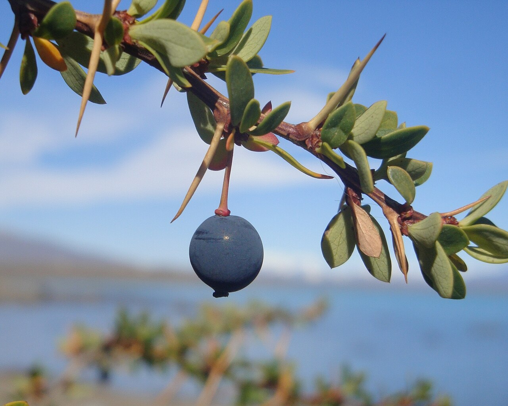

*Fruto de Berberis buxifolia (=Berberis microphylla), conocido como Calafate.*  
Banfield · [CC BY-SA 3.0](https://creativecommons.org/licenses/by-sa/3.0) · [ficha en Commons](https://commons.wikimedia.org/wiki/File:Berberis_buxifolia_-_Calafate_(2).jpg)

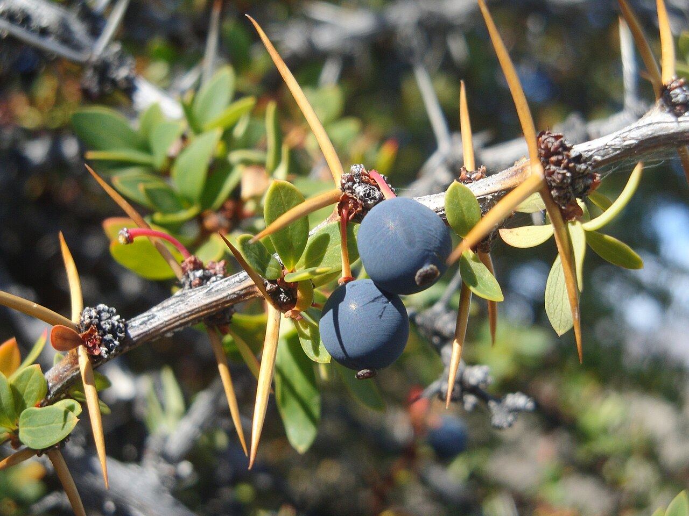

*Fruto de Berberis microphylla, conocido como Calafate.*  
Banfield · [CC BY-SA 3.0](https://creativecommons.org/licenses/by-sa/3.0) · [ficha en Commons](https://commons.wikimedia.org/wiki/File:Berberis_microphylla_-_Calafate_(1).jpg)

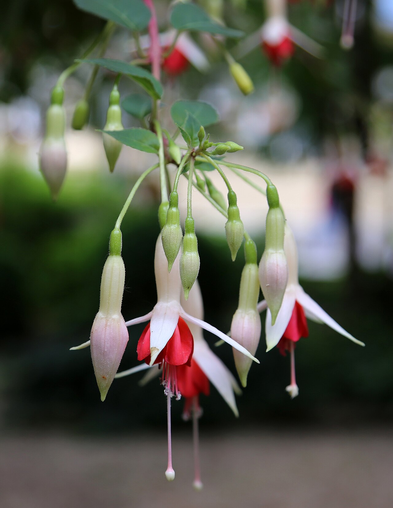

*Hardy fuchsia (Fuchsia magellanica) of the genus Fuchsia. The cultivated plant reaches a height of up to 1.5 meters as a shrub. The original plant is native to the Andes.*  
W. Bulach · [CC BY-SA 4.0](https://creativecommons.org/licenses/by-sa/4.0) · [ficha en Commons](https://commons.wikimedia.org/wiki/File:00_8211_Scharlach-Fuchsie.jpg)
