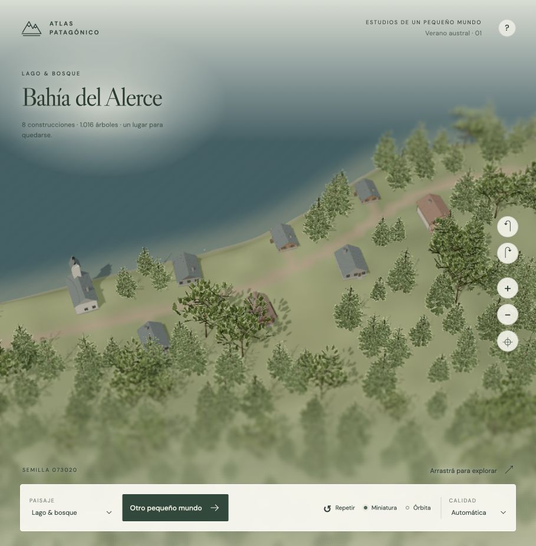
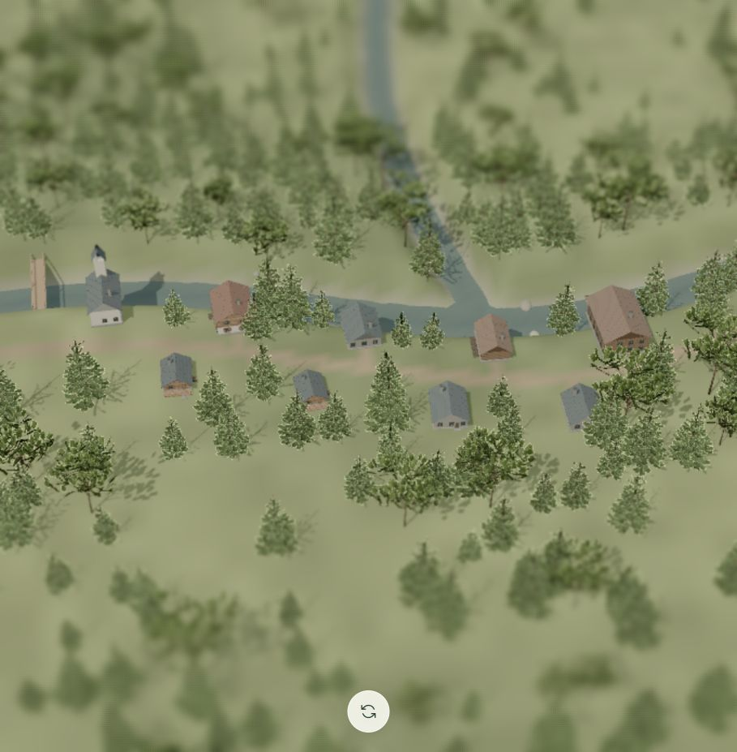
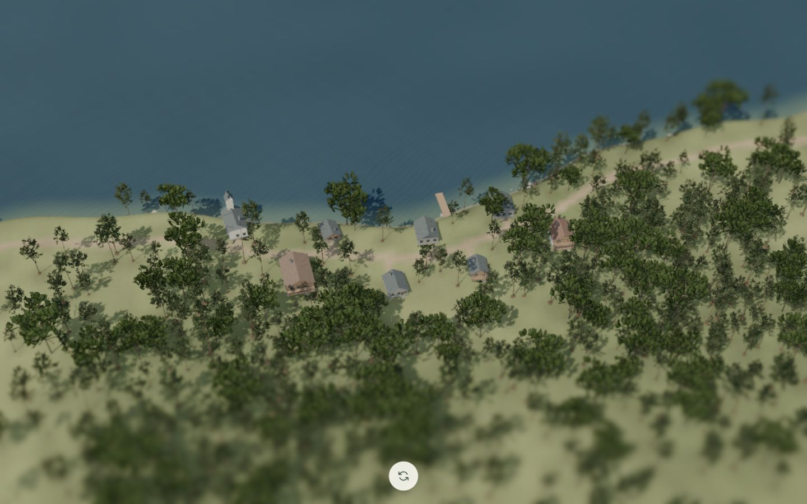
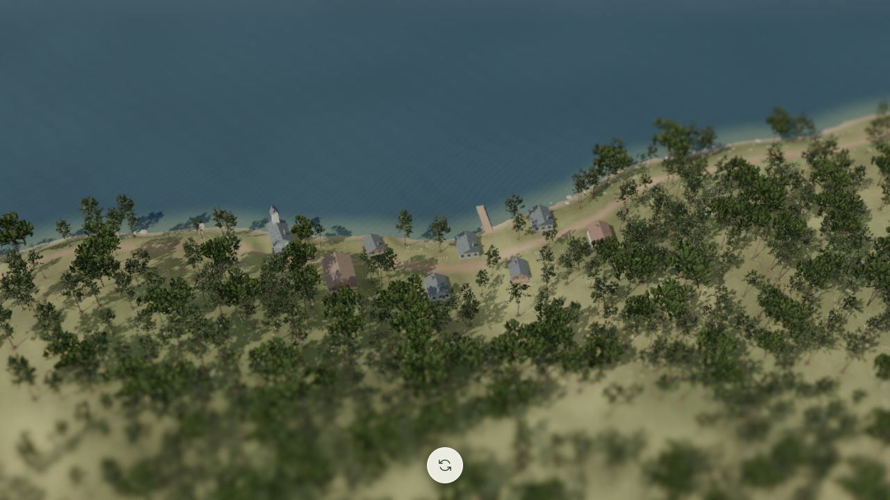

# Verificación · Atlas patagónico

Fecha: 3 de noviembre de 2026. Entorno local: macOS, Apple M2 Pro, 16 GB, Node 22.23.1, pnpm 10.27.0, Blender 5.2.0 LTS. Navegador integrado de Codex; estas observaciones no sustituyen pruebas en dispositivos físicos de gama baja.

## Comprobaciones de la versión inicial

| Comprobación | Resultado |
| --- | --- |
| `pnpm test:atlas` | 3 pruebas aprobadas: determinismo, distribución de 60 combinaciones de familia/semilla y terreno completo válido. |
| `pnpm build` | TypeScript y compilación Vite aprobados, incluyendo las tres demos. |
| GLB de producción | 434.068 bytes, Meshopt y WebP. Carga correcta en el navegador. |
| Recursos externos | Fuentes y modelos locales. El build conserva rutas relativas para la biblioteca y las fuentes. |
| Cambio de mapa | Semilla, título, conteos y URL se actualizan; nueva aparición animada. |
| Cambio de familia | Probados lago, río, bosque, península y confluencia en navegador; las seis familias pasan los tests de distribución. |
| Cámara | Botones de giro, zoom y reset; arrastre real verificado también en producción. |
| Controles de presentación | Repetir, Miniatura y Órbita responden y muestran su estado. |
| Calidad y ayuda | Cambio Automática/Ahorro; apertura de ayuda y cierre con Escape. |
| Móvil | Vista 390 × 844: barra en dos filas, paisaje visible y controles accesibles. Sin prueba de pellizco en hardware táctil. |
| Producción | Probada con `pnpm preview` y la semilla 73020/bahía: modelos, texturas, fuentes y worker cargan. Consola sin errores ni advertencias. |

Durante las pruebas se corrigieron coníferas que perdían follaje a distancia, sombras con una constante obsoleta, siluetas repetidas por el desenfoque, casas demasiado próximas al río y un puente que podía acercarse a un edificio grande.

## Observaciones de rendimiento

Muestras de desarrollo tomadas con el efecto Miniatura activo. Son lecturas puntuales del contador de cuadros durante ventanas de 2,5 segundos, no percentiles ni garantías de FPS. La generación incluye, cuando corresponde, la transición de 240 ms entre mapas; no incluye toda la animación posterior.

| Escenario / semilla | Árboles | Cuadros/s observados | Escala de render | Draw calls | Generación |
| --- | ---: | ---: | ---: | ---: | ---: |
| Bahía / 2672166387, escritorio | 1.145 | 53 | 0,85 | 65 | 452 ms |
| Península / 2672166387, 390 × 844 | 711 | 116 | 1,0 | 48 | 128 ms |
| Bosque / 3568672863, escritorio, Ahorro | 1.929 | 45 | 1,0 | 120 | 323 ms |
| Confluencia / 3568672863, escritorio, Ahorro | 1.724 | 42 | 1,0 | 132 | 360 ms |

Los conteos de texturas permanecieron en 9 durante estos cambios de mapa. Las geometrías variaron aproximadamente entre 100 y 204 según los sectores, edificios y puentes presentes. Se verificó la liberación explícita de recursos en el código; no se realizó un perfil prolongado del heap ni una medición de memoria GPU en bytes.

En desarrollo, el atributo `data-performance` del canvas publica una muestra cada 2,5 segundos. También se puede consultar `window.__atlas.snapshot()` desde las herramientas del navegador. El atributo de diagnóstico no se incluye en producción y no envía datos fuera del equipo.

## Evidencia

Vista de la compilación de producción después de girar la cámara:

La adaptación web utiliza materiales y óptica simplificados. Los renders aprobados de Cycles siguen siendo la referencia para evaluar una futura mejora de acabado.

## Revisión: un solo botón

La interfaz actual elimina textos visibles, paneles y selectores. TypeScript y Vite compilan correctamente. La revisión en producción confirma un único botón, generación de una nueva semilla, conservación del giro por arrastre y ausencia de errores de consola. El estado de carga se indica en el icono; los mensajes accesibles permanecen ocultos visualmente. Las tablas anteriores documentan la versión inicial.

## Revisión visual: vegetación, costa y materiales

Se reemplazaron las coníferas procedurales por dos variantes optimizadas de la biblioteca usada en Blender. La exportación ahora conserva sus UV y corrige la interpretación del color de la textura combinada de hojas. Se incorporaron mapas escaneados de suelo, sombras de contacto, cielo para reflejos, agua con variación irregular, una bahía más curva, penínsulas redondeadas, rocas costeras y un muelle. El bosque tiene mayor densidad; el caserío sigue siendo pequeño y la interfaz conserva un solo botón.

- `pnpm test:atlas`: **4 pruebas aprobadas**, incluyendo la regresión de UV en el GLB, 60 combinaciones de familia/semilla y el terreno completo.
- `pnpm build`: TypeScript y Vite aprobados para las tres demos.
- Biblioteca final: **682.724 bytes**, con coníferas de 5.435 y 5.523 triángulos. Texturas WebP y geometría Meshopt en un solo GLB.
- Revisión visual de bahía `73020` y de la península original `36644541/sorpresa`.
- Producción a 1.440 × 900: carga, un único botón, giro por arrastre y generación de otro mapa comprobados en navegador. El botón generó la ladera `2398570049/sorpresa`; consola sin errores ni advertencias.

Muestras puntuales de desarrollo a 909 × 927 CSS px, después de la aparición, con tilt-shift activo. No son un benchmark sostenido ni garantizan ese rendimiento en otros equipos:

| Escenario / semilla | Árboles | Cuadros/s observados | Escala de render | Draw calls | Triángulos renderizados | Generación |
| --- | ---: | ---: | ---: | ---: | ---: | ---: |
| Bahía / 73020 | 1.375 | 119 | 1,25 | 76 | 3.540.902 | 136 ms |
| Península / 36644541 | 955 | 120 | 1,25 | 60 | 2.119.360 | 246 ms |

Ambas muestras registraron 12 texturas. La mejora de silueta aumenta el costo de geometría respecto de la versión inicial; se mantienen las instancias, el descarte por sectores y la resolución adaptativa. Falta medir rendimiento sostenido en móviles físicos.

## Revisión: fundido óptico y terreno con relieve

Se eliminó el escalado de aparición de árboles, edificios y rocas. Todos se crean a tamaño completo. La entrada usa un fundido de 0,85 s y la regeneración uno de 1,35 s con desenfoque breve y curva quíntica. Una captura GPU conserva el paisaje saliente; solo se renderiza el nuevo mundo. El ángulo y la distancia de cámara se conservan. La preferencia de movimiento reducido omite el fundido.

El terreno combina lomas, pliegues pequeños, orillas graduales y terrazas horizontales bajo las construcciones. Cuatro materiales escaneados mezclan pasto, hojarasca, ripio y arena con sus normales. Se añadieron pequeñas matas de pasto por instancias, sin transparencias ni movimiento. El atlas pesa **1.069.836 bytes**; todas las texturas son locales.

- **5 pruebas aprobadas**: UV de al menos ocho piezas texturizadas, determinismo, 60 combinaciones de familia/semilla, buffers y máscaras válidos, relieve sin invadir el agua y bases horizontales bajo casas.
- TypeScript y Vite compilan las tres demos.
- Producción revisada con río `73021/rio`; giro y botón de regeneración hasta ladera `2159107307/sorpresa`. Se inspeccionaron fotogramas intermedios y finales del fundido: sin crecimiento individual, sin cuadro de suelo vacío y sin salto de ángulo al cambiar de mapa.
- Zoom y arrastre revisados. Un solo botón; consola sin errores ni advertencias durante la carga y la regeneración.
- Encuadre a 390 × 844 revisado en el navegador: canvas completo y botón accesible; se restauró el tamaño de escritorio al terminar.
- Las mediciones de las revisiones anteriores son históricas. Esta pasada no incluye un benchmark sostenido en móviles físicos ni una comparación de percentiles de tiempo por cuadro.

